```{=html}
<div class="home-hero">
  <div class="hero-map" aria-hidden="true">
    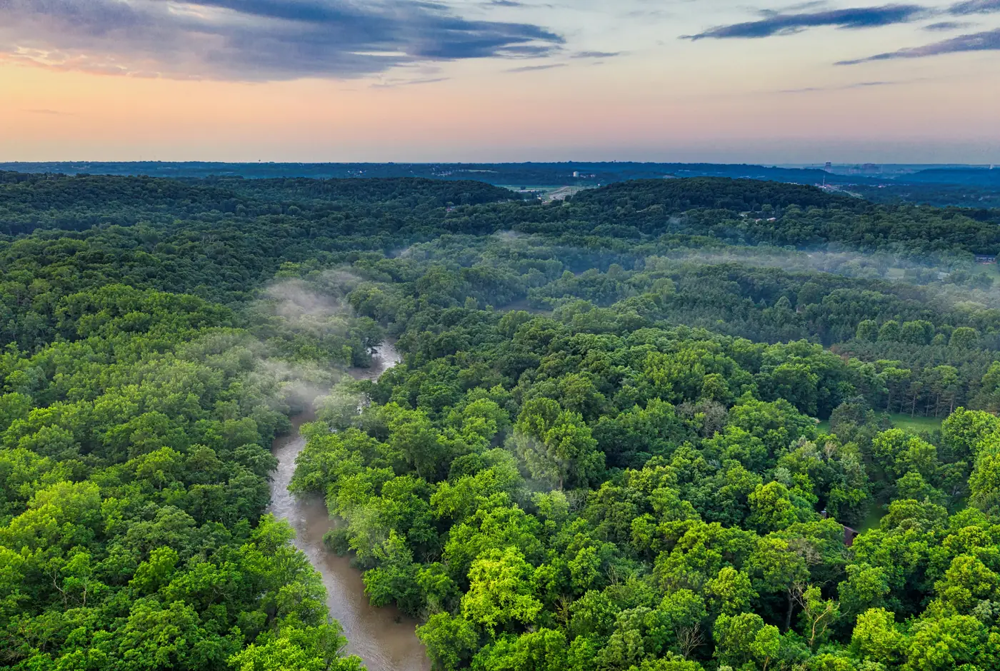
    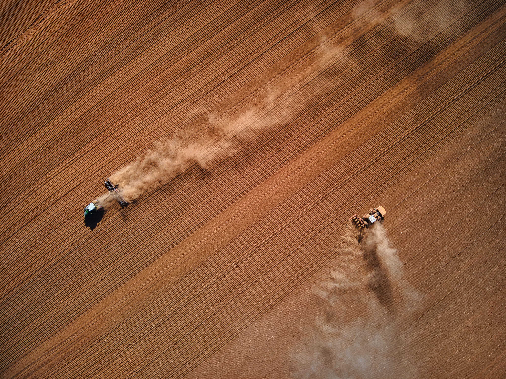
    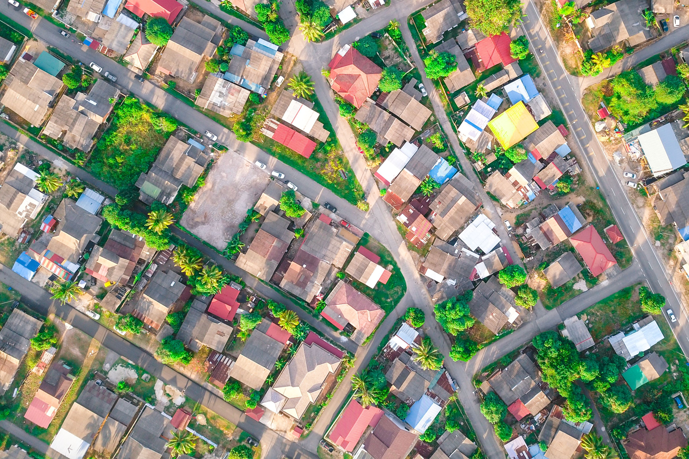
    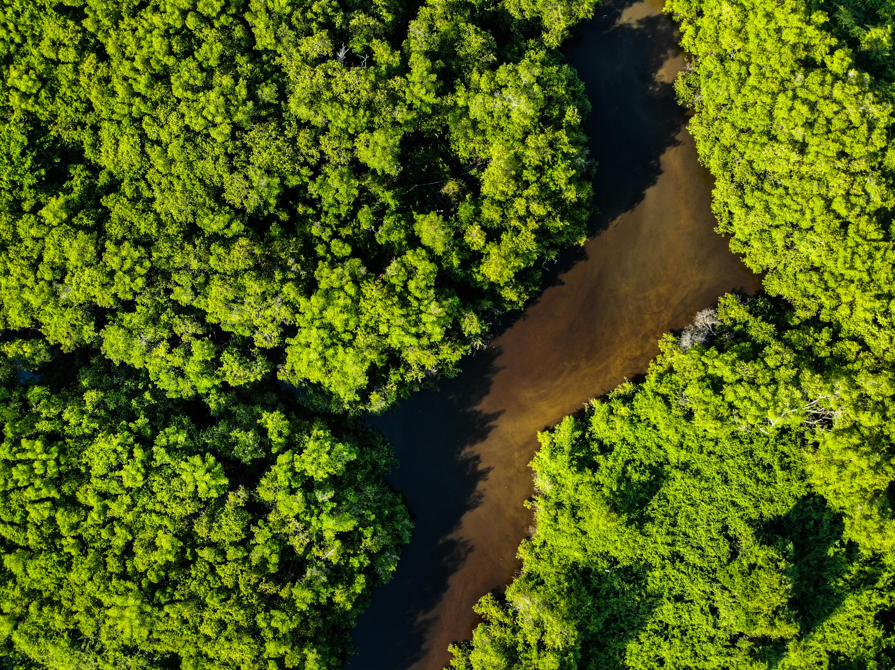
    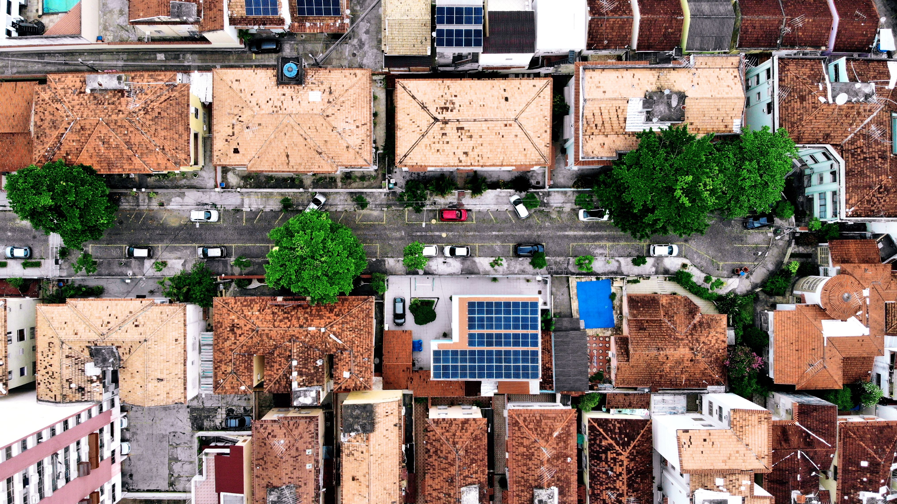
    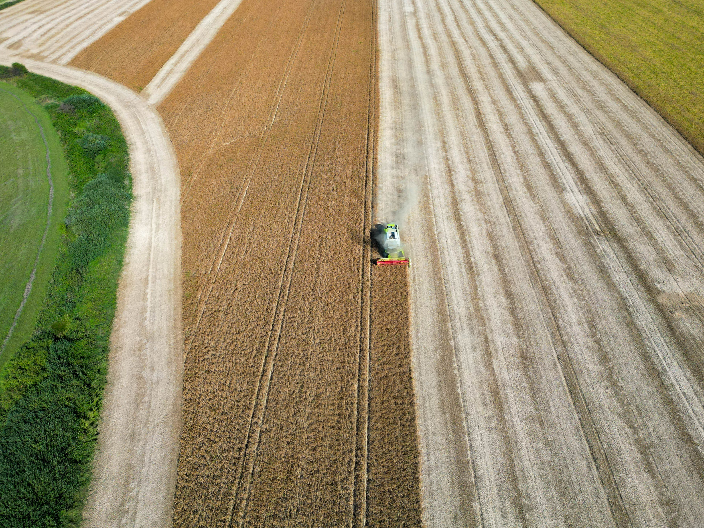
    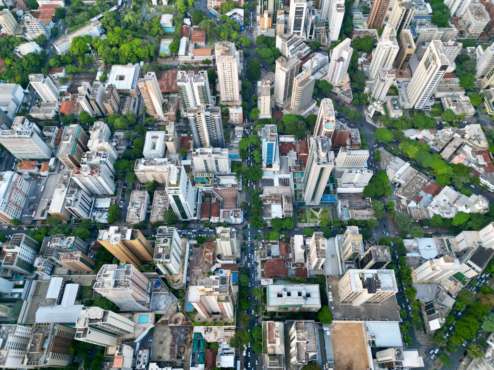
  </div>
  <div class="hero-lockup">
    
    <span class="hero-name">GAIA Lab</span>
  </div>
  <p class="hero-tagline">
    Artificial intelligence and Earth observation to understand the dynamics
    of complex socio-environmental systems.
  </p>
  <div class="hero-action-group">
    <a class="hero-cta" href="#home-pesquisa">Learn more</a>
    <a class="hero-scroll" href="#home-pesquisa" aria-label="Scroll to research areas">
      <svg viewBox="0 0 24 24" fill="none" stroke="currentColor" stroke-width="2.5" stroke-linecap="round">
        <path d="m5 9 7 7 7-7"/>
      </svg>
    </a>
  </div>
</div>

<div class="home-body">
  <section id="home-pesquisa" class="home-section reveal">
    <h2 class="section-title">Research</h2>
    <p class="section-lead">
      The lab's research moves on two fronts that feed each other: applications to
      socio-environmental challenges and the development of the techniques that make
      them possible.
    </p>

    <div class="track-head reveal">
      <div>
        <h3 class="track-title">Application to socio-environmental challenges</h3>
      </div>
    </div>
    <p class="track-text">
      We combine massive satellite streams and deep learning to tackle critical
      ecological and production bottlenecks across four priority axes. From agricultural
      plot scale to urban dynamics, we turn complex satellite pixels into actionable
      territorial insights.
    </p>
    <div class="home-areas">
      <a class="area-card reveal" href="research/#agriculture">
        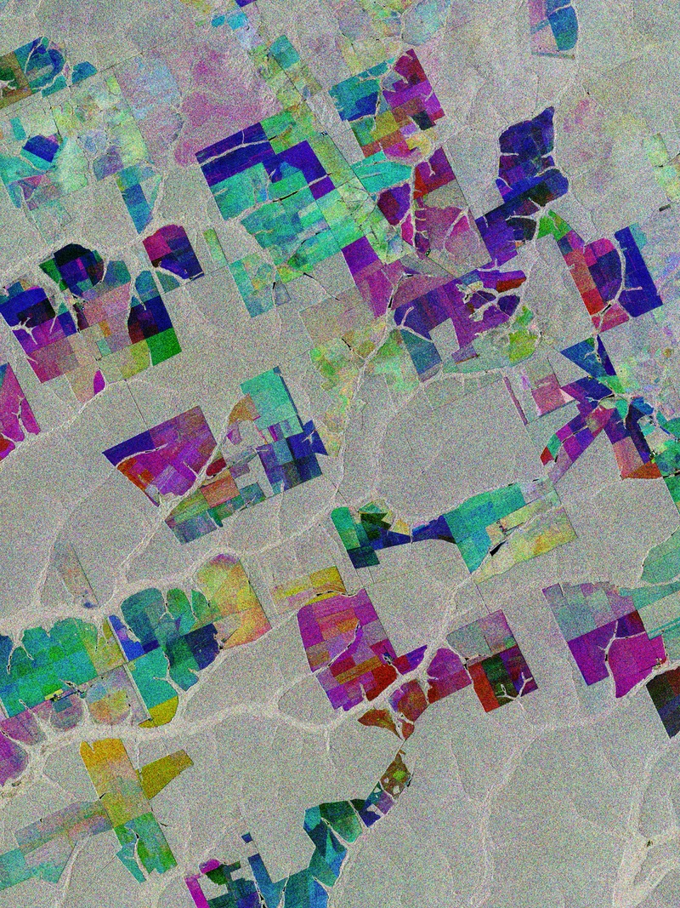
        <div class="area-card-top">
          <span class="card-arrow" aria-hidden="true">
            <svg viewBox="0 0 24 24" fill="none" stroke="currentColor" stroke-width="2.2" stroke-linecap="round" stroke-linejoin="round">
              <path d="M5 12h14M12 5l7 7-7 7"/>
            </svg>
          </span>
        </div>
        <div class="area-card-overlay">
          <div class="area-title">Agriculture</div>
          <div class="area-text">Crop classification and vegetation index series at plot scale.</div>
          <div class="area-kpi">359,600 plots<span>across 5 states, from 2020 to 2025</span></div>
        </div>
      </a>
      <a class="area-card reveal" href="research/#forests">
        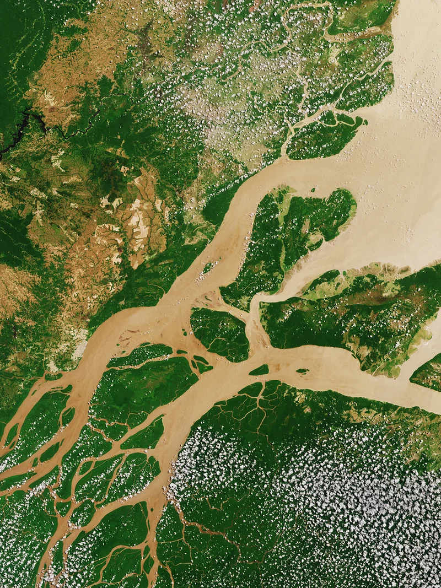
        <div class="area-card-top">
          <span class="card-arrow" aria-hidden="true">
            <svg viewBox="0 0 24 24" fill="none" stroke="currentColor" stroke-width="2.2" stroke-linecap="round" stroke-linejoin="round">
              <path d="M5 12h14M12 5l7 7-7 7"/>
            </svg>
          </span>
        </div>
        <div class="area-card-overlay">
          <div class="area-title">Forests</div>
          <div class="area-text">Satellite forest segmentation, validated against official INPE data.</div>
          <div class="area-kpi">0.85 IoU<span>across 26 quarters, from 2020 to 2026</span></div>
        </div>
      </a>
      <a class="area-card reveal" href="research/#climate">
        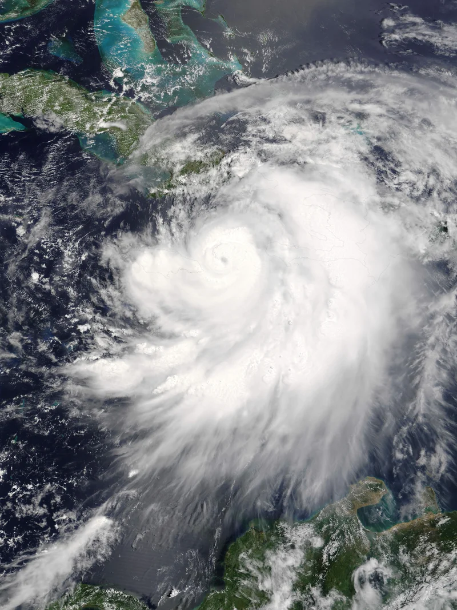
        <div class="area-card-top">
          <span class="card-arrow" aria-hidden="true">
            <svg viewBox="0 0 24 24" fill="none" stroke="currentColor" stroke-width="2.2" stroke-linecap="round" stroke-linejoin="round">
              <path d="M5 12h14M12 5l7 7-7 7"/>
            </svg>
          </span>
        </div>
        <div class="area-card-overlay">
          <div class="area-title">Climate</div>
          <div class="area-text">Climate trends and agricultural risk in 15-year windows.</div>
          <div class="area-kpi">+1.1 °C peak<span>Nova Mutum, MT, 2011 to 2025</span></div>
        </div>
      </a>
      <a class="area-card reveal" href="research/#cities">
        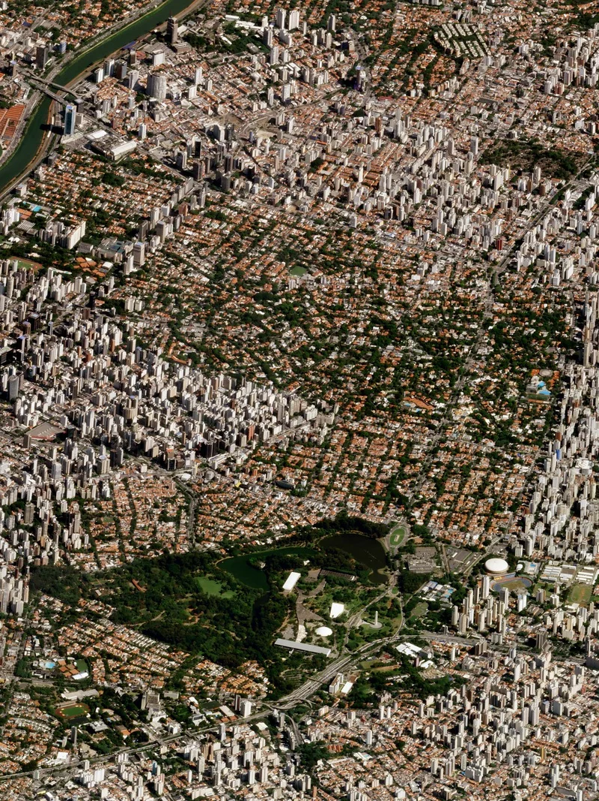
        <div class="area-card-top">
          <span class="card-arrow" aria-hidden="true">
            <svg viewBox="0 0 24 24" fill="none" stroke="currentColor" stroke-width="2.2" stroke-linecap="round" stroke-linejoin="round">
              <path d="M5 12h14M12 5l7 7-7 7"/>
            </svg>
          </span>
        </div>
        <div class="area-card-overlay">
          <div class="area-title">Cities</div>
          <div class="area-text">Characterization of urban settlements and socioeconomic analysis.</div>
          <div class="area-kpi">Urban sensing<span>Mapping and vulnerability</span></div>
        </div>
      </a>
    </div>

    <div class="track-head reveal">
      <div>
        <h3 class="track-title">Methodological advances</h3>
      </div>
    </div>
    <p class="track-text">
      The research lines develop techniques that belong to no single problem: what
      is learned mapping forests carries over to crops, cities or any other territory.
      Each line advances as research in its own right, with deliverables of its own:
      a thesis, a paper, code or a model.
    </p>
    <a class="area-card area-card-wide reveal" href="research/#lines">
      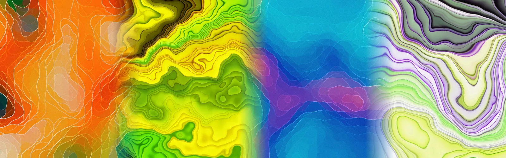
      <div class="area-card-top">
        <span class="card-arrow" aria-hidden="true">
          <svg viewBox="0 0 24 24" fill="none" stroke="currentColor" stroke-width="2.2" stroke-linecap="round" stroke-linejoin="round">
              <path d="M5 12h14M12 5l7 7-7 7"/>
            </svg>
        </span>
      </div>
      <div class="area-card-overlay">
        <div class="area-card-wide-head">
          <div class="area-title">Research lines</div>
          <div class="area-text">Eight lines in three layers, from building blocks to coupled systems.</div>
        </div>
        <ul class="method-lines">
          <li>Climate modeling</li>
          <li>Coupled systems</li>
          <li>Domain adaptation</li>
          <li>Learning with limited labels</li>
          <li>Networks of geolocated specialists</li>
          <li>Open-set and OOD</li>
          <li>Textual data modeling</li>
          <li>Uncertainty modeling</li>
        </ul>
      </div>
    </a>
  </section>

  <section class="home-section jogral-section reveal">
    <div class="jogral-grid">
      <div class="jogral-text">
        <h2 class="section-title">How we work</h2>
        <p class="section-lead">
          Every piece of research follows the same path, from question to result, whether applied or
          methodological.
        </p>
        <p>
          To learn where this way of working comes from, what supports it and who takes part in it,
          get to know the lab.
        </p>
      </div>

      <div class="jogral-visual">
        <div class="jogral-cards">
          <a class="jogral-card jogral-card-link reveal" href="about/">
            <div class="jogral-card-figure jogral-wordmark" aria-hidden="true">
              <span>GAIA</span>
              <span>Lab</span>
            </div>
            <div class="jogral-card-body">
              <h3>About the lab</h3>
            </div>
            <div class="jogral-card-arrow" aria-hidden="true">
              <svg viewBox="0 0 24 24" fill="none" stroke="currentColor" stroke-width="2.2" stroke-linecap="round" stroke-linejoin="round">
                <path d="M5 12h14M12 5l7 7-7 7"/>
              </svg>
            </div>
          </a>
        </div>
      </div>
    </div>

    <ol class="process-steps reveal">
      <li class="process-step">
        <span class="process-num" aria-hidden="true">01</span>
        <span class="process-name">Question</span>
        <p class="process-desc">The problem comes from a partner, from a gap in the literature or from a discussion within the group.</p>
      </li>
      <li class="process-step">
        <span class="process-num" aria-hidden="true">02</span>
        <span class="process-name">Data</span>
        <p class="process-desc">Optical and radar imagery, climate series and documents are organised into datasets spanning years and whole territories.</p>
      </li>
      <li class="process-step">
        <span class="process-num" aria-hidden="true">03</span>
        <span class="process-name">Method</span>
        <p class="process-desc">New or adapted models are trained and checked against public references and the state of the art before any result counts.</p>
      </li>
      <li class="process-step">
        <span class="process-num" aria-hidden="true">04</span>
        <span class="process-name">Delivery</span>
        <p class="process-desc">The result becomes a map, dashboard or report for the partner, or an open paper and code when the advance is methodological.</p>
      </li>
    </ol>
  </section>

  <section class="home-section jogral-section reveal">
    <div class="jogral-grid reverse">
      <div class="jogral-visual">
        <div class="jogral-cards">
          <a class="jogral-card jogral-card-link reveal" href="publications/#papers">
            <div class="jogral-card-figure">
              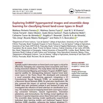
            </div>
            <div class="jogral-card-body">
              <h3>Journal and conference papers</h3>
            </div>
            <div class="jogral-card-arrow" aria-hidden="true">
              <svg viewBox="0 0 24 24" fill="none" stroke="currentColor" stroke-width="2.2" stroke-linecap="round" stroke-linejoin="round">
                <path d="M5 12h14M12 5l7 7-7 7"/>
              </svg>
            </div>
          </a>
          <a class="jogral-card jogral-card-link reveal" href="publications/#theses">
            <div class="jogral-card-figure">
              
            </div>
            <div class="jogral-card-body">
              <h3>Theses, dissertations and capstones</h3>
            </div>
            <div class="jogral-card-arrow" aria-hidden="true">
              <svg viewBox="0 0 24 24" fill="none" stroke="currentColor" stroke-width="2.2" stroke-linecap="round" stroke-linejoin="round">
                <path d="M5 12h14M12 5l7 7-7 7"/>
              </svg>
            </div>
          </a>
          <a class="jogral-card jogral-card-link reveal" href="publications/#news">
            <div class="jogral-card-figure">
              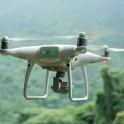
            </div>
            <div class="jogral-card-body">
              <h3>News and press</h3>
            </div>
            <div class="jogral-card-arrow" aria-hidden="true">
              <svg viewBox="0 0 24 24" fill="none" stroke="currentColor" stroke-width="2.2" stroke-linecap="round" stroke-linejoin="round">
                <path d="M5 12h14M12 5l7 7-7 7"/>
              </svg>
            </div>
          </a>
        </div>
      </div>

      <div class="jogral-text">
        <h2 class="section-title">Scientific output and outreach</h2>
        <p class="section-lead">
          Scientific contributions are submitted to international journals and conferences in
          artificial intelligence, computer vision and remote sensing.
        </p>
        <p>
          Research by undergraduate and graduate students results in theses, dissertations
          and capstone projects, with methodological advances and applications to real
          socio-environmental problems. The resulting methods and data reach the public
          through dashboards, articles and press coverage.
        </p>
      </div>
    </div>
  </section>

  <section class="home-section jogral-section reveal">
    <div class="jogral-grid">
      <div class="jogral-text">
        <h2 class="section-title">A multidisciplinary group</h2>
        <p class="section-lead">
          GAIA Lab brings together researchers from computer science, applied mathematics,
          data science, engineering and economics.
        </p>
        <p>
          Faculty, postdocs, PhD and master's students and undergraduates work side by side,
          and the exchange between fields happens day to day and in the group's meetings.
        </p>
      </div>

      <div class="jogral-visual">
        <div class="jogral-cards">
          <a class="jogral-card jogral-card-link reveal" href="people/#professor">
            <div class="avatar-stack" aria-hidden="true">
```

::: {#home-docentes}
:::

```{=html}
            </div>
            <div class="jogral-card-body">
              <h3>Faculty and postdocs</h3>
            </div>
            <div class="jogral-card-arrow" aria-hidden="true">
              <svg viewBox="0 0 24 24" fill="none" stroke="currentColor" stroke-width="2.2" stroke-linecap="round" stroke-linejoin="round">
                <path d="M5 12h14M12 5l7 7-7 7"/>
              </svg>
            </div>
          </a>
          <a class="jogral-card jogral-card-link reveal" href="people/#phd">
            <div class="avatar-stack" aria-hidden="true">
```

::: {#home-pos}
:::

```{=html}
            </div>
            <div class="jogral-card-body">
              <h3>PhD and master's students</h3>
            </div>
            <div class="jogral-card-arrow" aria-hidden="true">
              <svg viewBox="0 0 24 24" fill="none" stroke="currentColor" stroke-width="2.2" stroke-linecap="round" stroke-linejoin="round">
                <path d="M5 12h14M12 5l7 7-7 7"/>
              </svg>
            </div>
          </a>
          <a class="jogral-card jogral-card-link reveal" href="people/#undergrad">
            <div class="avatar-stack" aria-hidden="true">
```

::: {#home-graduacao}
:::

```{=html}
            </div>
            <div class="jogral-card-body">
              <h3>Undergraduates</h3>
            </div>
            <div class="jogral-card-arrow" aria-hidden="true">
              <svg viewBox="0 0 24 24" fill="none" stroke="currentColor" stroke-width="2.2" stroke-linecap="round" stroke-linejoin="round">
                <path d="M5 12h14M12 5l7 7-7 7"/>
              </svg>
            </div>
          </a>
          <a class="jogral-card jogral-card-link reveal" href="people/#colaborador">
            <div class="avatar-stack" aria-hidden="true">
```

::: {#home-rede}
:::

```{=html}
            </div>
            <div class="jogral-card-body">
              <h3>Collaborators and alumni</h3>
            </div>
            <div class="jogral-card-arrow" aria-hidden="true">
              <svg viewBox="0 0 24 24" fill="none" stroke="currentColor" stroke-width="2.2" stroke-linecap="round" stroke-linejoin="round">
                <path d="M5 12h14M12 5l7 7-7 7"/>
              </svg>
            </div>
          </a>
        </div>
      </div>
    </div>
  </section>
</div>
```
