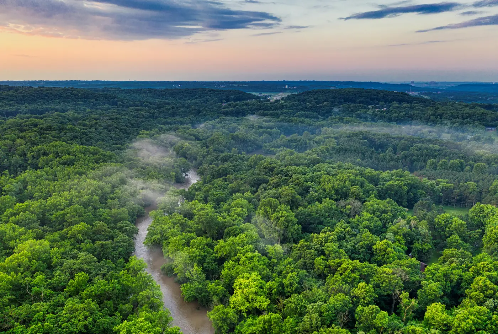
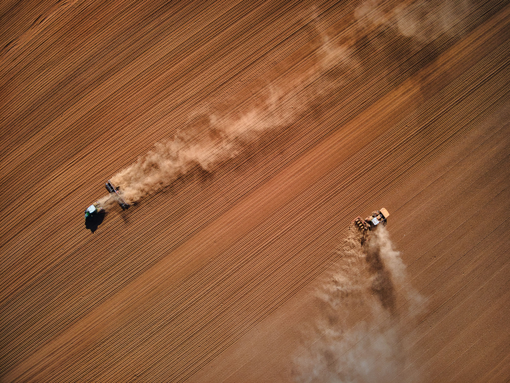
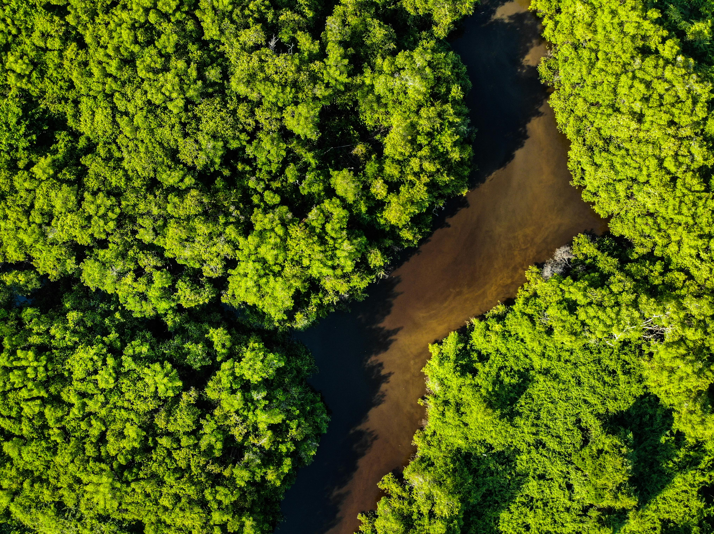
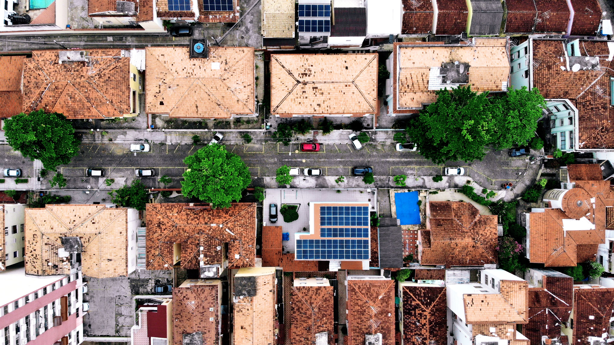
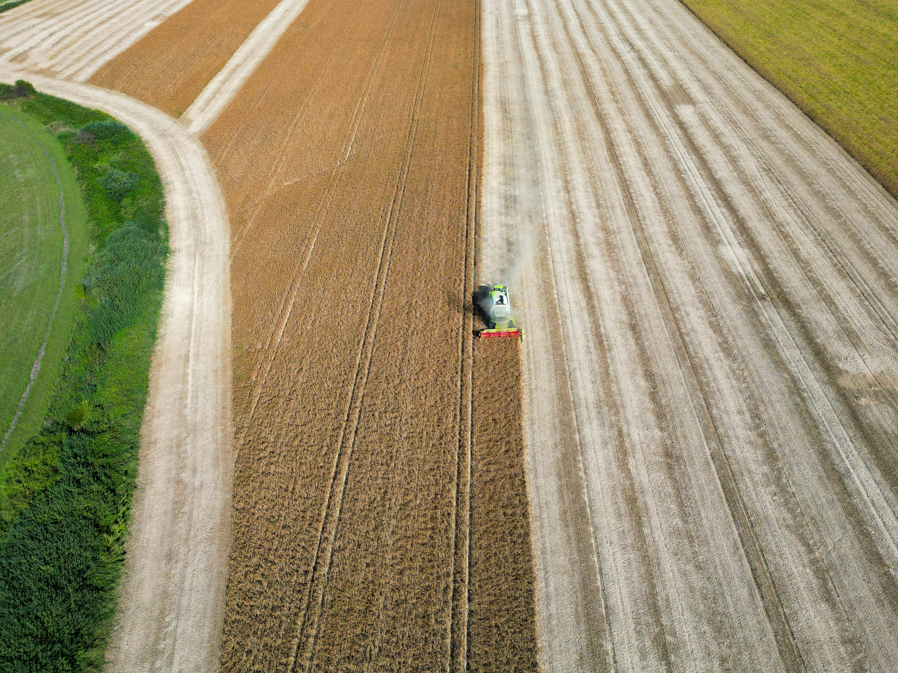
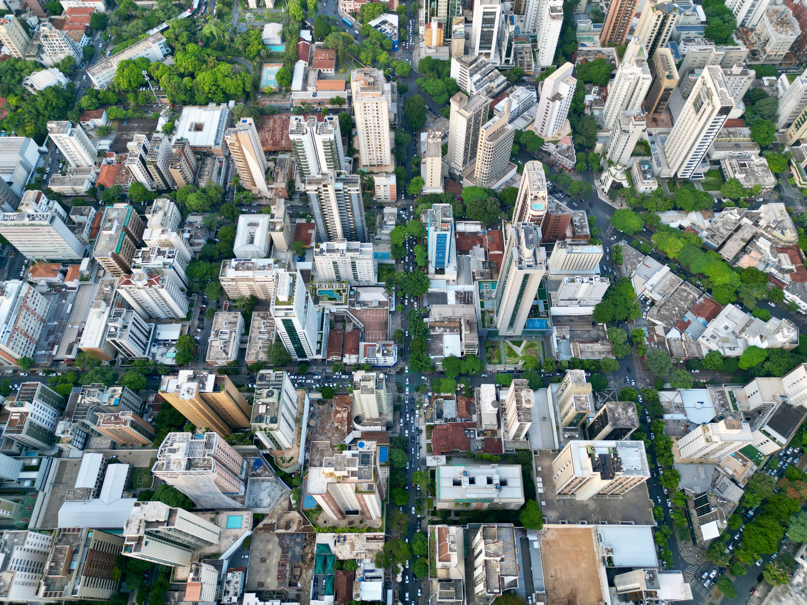
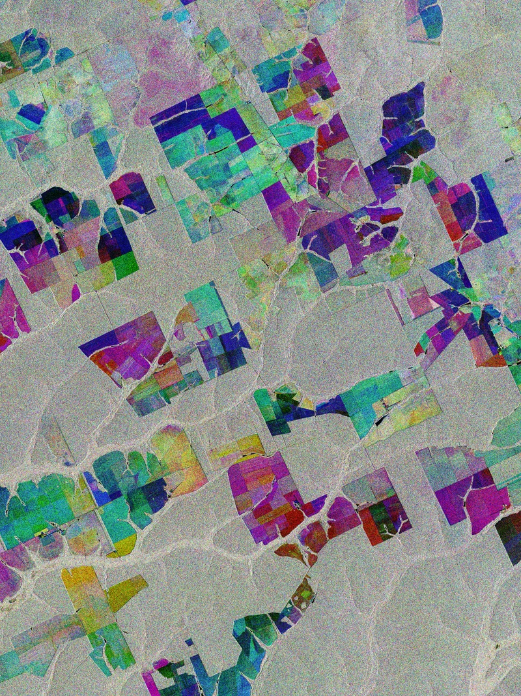
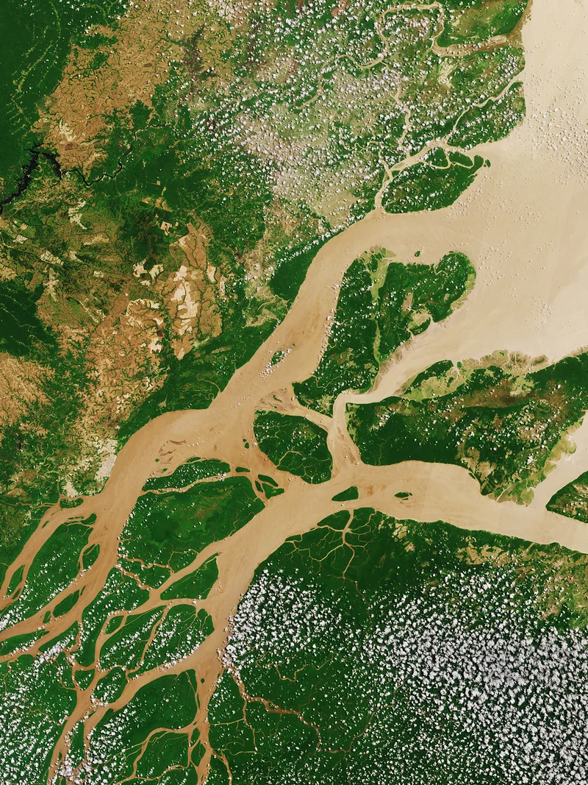
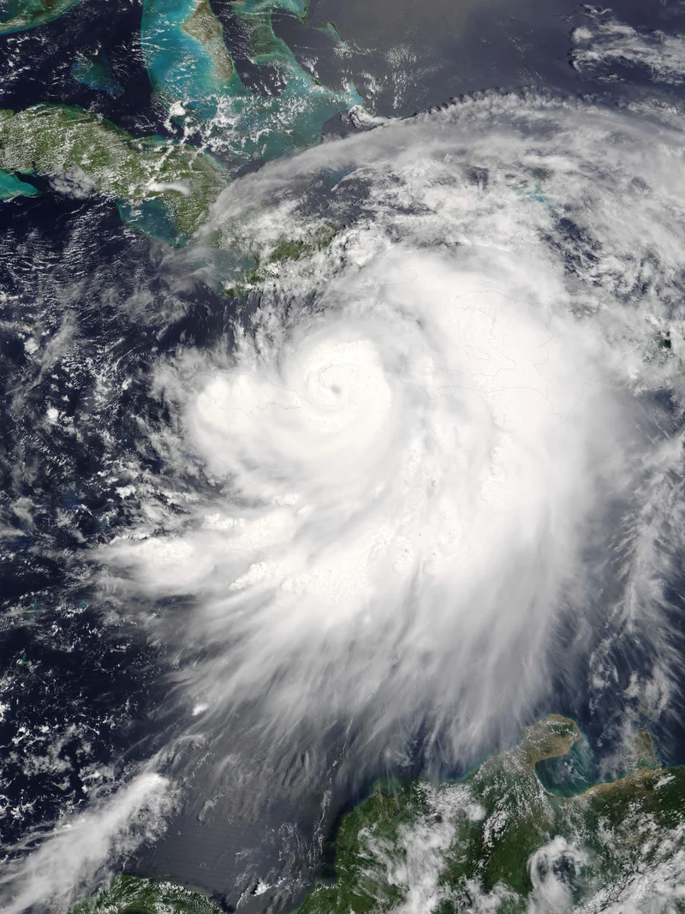
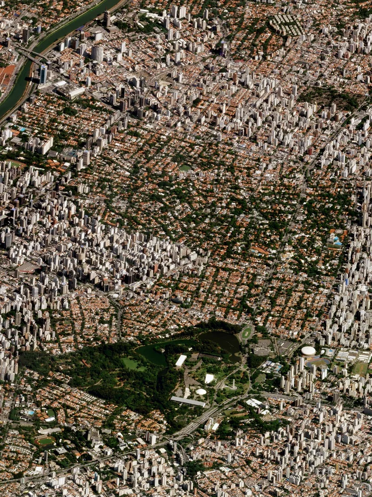

```{=html}
<div class="home-hero">
  <div class="hero-map" aria-hidden="true">
    
    
    
    
    
    
    
  </div>
  <div class="hero-lockup">
    
    <span class="hero-name">GAIA Lab</span>
  </div>
  <p class="hero-tagline">
    Artificial intelligence and Earth observation to understand the dynamics
    of complex socio-environmental systems.
  </p>
  <div class="hero-action-group">
    <a class="hero-cta" href="#home-pesquisa">Learn more</a>
    <a class="hero-scroll" href="#home-pesquisa" aria-label="Scroll to research areas">
      <svg viewBox="0 0 24 24" fill="none" stroke="currentColor" stroke-width="2.5" stroke-linecap="round">
        <path d="m5 9 7 7 7-7"/>
      </svg>
    </a>
  </div>
</div>

<div class="home-body">
  <section id="home-pesquisa" class="home-section reveal">
    <h2 class="section-title">Research applied to socio-environmental challenges</h2>
    <p class="section-lead">
      We combine massive satellite streams and deep learning to tackle critical
      ecological and production bottlenecks across four priority axes. From agricultural
      plot scale to urban dynamics, we turn complex satellite pixels into actionable
      territorial insights.
    </p>
    <div class="home-areas">
      <a class="area-card reveal" href="research/#agriculture">
        
        <div class="area-card-top">
          <span class="card-arrow" aria-hidden="true">
            <svg viewBox="0 0 24 24" fill="none" stroke="currentColor" stroke-width="2.2" stroke-linecap="round" stroke-linejoin="round">
              <path d="M5 12h14M12 5l7 7-7 7"/>
            </svg>
          </span>
        </div>
        <div class="area-card-overlay">
          <div class="area-title">Agriculture</div>
          <div class="area-text">Crop classification and vegetation index series at plot scale.</div>
          <div class="area-kpi">359,600 plots<span>across 5 states, from 2020 to 2025</span></div>
        </div>
      </a>
      <a class="area-card reveal" href="research/#forests">
        
        <div class="area-card-top">
          <span class="card-arrow" aria-hidden="true">
            <svg viewBox="0 0 24 24" fill="none" stroke="currentColor" stroke-width="2.2" stroke-linecap="round" stroke-linejoin="round">
              <path d="M5 12h14M12 5l7 7-7 7"/>
            </svg>
          </span>
        </div>
        <div class="area-card-overlay">
          <div class="area-title">Forests</div>
          <div class="area-text">Satellite forest segmentation, validated against official INPE data.</div>
          <div class="area-kpi">0.85 IoU<span>across 26 quarters, from 2020 to 2026</span></div>
        </div>
      </a>
      <a class="area-card reveal" href="research/#climate">
        
        <div class="area-card-top">
          <span class="card-arrow" aria-hidden="true">
            <svg viewBox="0 0 24 24" fill="none" stroke="currentColor" stroke-width="2.2" stroke-linecap="round" stroke-linejoin="round">
              <path d="M5 12h14M12 5l7 7-7 7"/>
            </svg>
          </span>
        </div>
        <div class="area-card-overlay">
          <div class="area-title">Climate</div>
          <div class="area-text">Climate trends and agricultural risk in 15-year windows.</div>
          <div class="area-kpi">+1.1 °C peak<span>Nova Mutum, MT, 2011 to 2025</span></div>
        </div>
      </a>
      <a class="area-card reveal" href="research/#cities">
        
        <div class="area-card-top">
          <span class="card-arrow" aria-hidden="true">
            <svg viewBox="0 0 24 24" fill="none" stroke="currentColor" stroke-width="2.2" stroke-linecap="round" stroke-linejoin="round">
              <path d="M5 12h14M12 5l7 7-7 7"/>
            </svg>
          </span>
        </div>
        <div class="area-card-overlay">
          <div class="area-title">Cities</div>
          <div class="area-text">Characterization of urban settlements and socioeconomic analysis.</div>
          <div class="area-kpi">Urban sensing<span>Mapping and vulnerability</span></div>
        </div>
      </a>
    </div>
  </section>

  <section class="home-section reveal">
    <h2 class="section-title">How we work: from orbit to actionable intelligence</h2>
    <p class="section-lead">
      Our methodological pipeline connects multimodal satellite constellations,
      meteorological reanalyses, and deep learning architectures into an end-to-end
      framework, validated against official records and committed to reproducible science.
    </p>

    <div class="stats reveal">
      <div><div class="stat-num" data-count="359596" data-thousands=",">0</div><div class="stat-label">Plots mapped</div></div>
      <div><div class="stat-num" data-count="897">0</div><div class="stat-label">Municipalities</div></div>
      <div><div class="stat-num" data-count="5">0</div><div class="stat-label">States</div></div>
      <div><div class="stat-num">2020 to 2026</div><div class="stat-label">Data period</div></div>
    </div>

    <div class="hscroll-wrap reveal">
      <button class="hscroll-btn prev" aria-label="Previous step"><svg viewBox="0 0 24 24" fill="none" stroke="currentColor" stroke-width="2.5" stroke-linecap="round"><path d="M15 5l-7 7 7 7"/></svg></button>
      <div class="hscroll">
        <article class="hs-card"><div class="hs-step">01</div><div class="hs-kicker">Step</div><div class="hs-title">Multimodal ingestion</div><div class="hs-text">Continuous acquisition of satellite constellations (optical and SAR radar), climate reanalyses, and institutional corpora.</div></article>
        <article class="hs-card"><div class="hs-step">02</div><div class="hs-kicker">Step</div><div class="hs-title">Spatiotemporal harmonisation</div><div class="hs-text">Atmospheric correction, cloud masking, and multi-year time series alignment at territorial scale.</div></article>
        <article class="hs-card"><div class="hs-step">03</div><div class="hs-kicker">Step</div><div class="hs-title">Deep learning and foundation models</div><div class="hs-text">Semantic segmentation, geospatial foundation models, and applied language models for complex representations.</div></article>
        <article class="hs-card"><div class="hs-step">04</div><div class="hs-kicker">Step</div><div class="hs-title">Auditing and official validation</div><div class="hs-text">Systematic benchmarking against INPE field references (DETER and PRODES), ZARC zoning, MapBiomas, and uncertainty metrics.</div></article>
        <article class="hs-card"><div class="hs-step">05</div><div class="hs-kicker">Step</div><div class="hs-title">Actionable intelligence</div><div class="hs-text">Generation of risk indicators, territorial monitoring tools, and open-source code supporting decision-makers.</div></article>
      </div>
      <button class="hscroll-btn next" aria-label="Next step"><svg viewBox="0 0 24 24" fill="none" stroke="currentColor" stroke-width="2.5" stroke-linecap="round"><path d="m9 5 7 7-7 7"/></svg></button>
    </div>
    <div class="section-cta">
      <a class="pub-btn" href="about/">Learn more about our approach</a>
    </div>
  </section>

  <section class="home-section jogral-section reveal">
    <div class="jogral-grid">
      <div class="jogral-text">
        <h2 class="section-title">Scientific production, academic theses and public outreach</h2>
        <p class="section-lead">
          Scientific inquiries led by GAIA Lab generate impact across multiple formats
          and avenues. Our contributions are published in premier international journals
          and presented at major machine learning, computer vision, and Earth observation conferences.
        </p>
        <p>
          In academia, the lab is an active hub of student mentorship, yielding PhD
          dissertations, Master's theses, and undergraduate capstone research centered
          on concrete socio-environmental questions. In the public sphere, our open models
          and data inform journalistic coverage, podcasts, and public reports on environmental
          preservation and green transition.
        </p>
      </div>

      <div class="jogral-visual">
        <div class="jogral-cards">
          <a class="jogral-card jogral-card-link reveal" href="publications/#papers">
            <div class="jogral-card-icon">
              <svg viewBox="0 0 24 24" fill="none" stroke="currentColor" stroke-width="1.8"><path d="M4 19.5v-15A2.5 2.5 0 0 1 6.5 2H20v20H6.5a2.5 2.5 0 0 1-2.5-2.5Z"/><path d="M6 6h10M6 10h10M6 14h6"/></svg>
            </div>
            <div class="jogral-card-body">
              <h3>Journal articles and conferences</h3>
              <p>Peer-reviewed deep learning architectures, computer vision benchmarks, and orbital data fusion.</p>
            </div>
            <div class="jogral-card-arrow" aria-hidden="true">
              <svg viewBox="0 0 24 24" fill="none" stroke="currentColor" stroke-width="2.2" stroke-linecap="round" stroke-linejoin="round">
                <path d="M5 12h14M12 5l7 7-7 7"/>
              </svg>
            </div>
          </a>
          <a class="jogral-card jogral-card-link reveal" href="publications/#papers">
            <div class="jogral-card-icon">
              <svg viewBox="0 0 24 24" fill="none" stroke="currentColor" stroke-width="1.8"><path d="M22 10v6M2 10l10-5 10 5-10 5z"/><path d="M6 12v5c3 3 9 3 12 0v-5"/></svg>
            </div>
            <div class="jogral-card-body">
              <h3>Theses, dissertations and capstones</h3>
              <p>Academic research with rigorous mathematical grounding dedicated to real-world ecological challenges.</p>
            </div>
            <div class="jogral-card-arrow" aria-hidden="true">
              <svg viewBox="0 0 24 24" fill="none" stroke="currentColor" stroke-width="2.2" stroke-linecap="round" stroke-linejoin="round">
                <path d="M5 12h14M12 5l7 7-7 7"/>
              </svg>
            </div>
          </a>
          <a class="jogral-card jogral-card-link reveal" href="publications/#news">
            <div class="jogral-card-icon">
              <svg viewBox="0 0 24 24" fill="none" stroke="currentColor" stroke-width="1.8"><path d="M4 22h16a2 2 0 0 0 2-2V4a2 2 0 0 0-2-2H8a2 2 0 0 0-2 2v16a2 2 0 0 1-2 2Zm0 0a2 2 0 0 1-2-2v-9c0-1.1.9-2 2-2h2"/><path d="M18 14h-8M15 18h-5M10 6h8v4h-8z"/></svg>
            </div>
            <div class="jogral-card-body">
              <h3>News and media presence</h3>
              <p>Science communication, journalistic press coverage, and transparent engagement with society.</p>
            </div>
            <div class="jogral-card-arrow" aria-hidden="true">
              <svg viewBox="0 0 24 24" fill="none" stroke="currentColor" stroke-width="2.2" stroke-linecap="round" stroke-linejoin="round">
                <path d="M5 12h14M12 5l7 7-7 7"/>
              </svg>
            </div>
          </a>
        </div>
      </div>
    </div>
  </section>

  <section class="home-section jogral-section reveal">
    <div class="jogral-grid reverse">
      <div class="jogral-visual">
        <div class="jogral-cards">
          <div class="jogral-card reveal">
            <div class="jogral-card-icon">
              <svg viewBox="0 0 24 24" fill="none" stroke="currentColor" stroke-width="1.8"><path d="M17 21v-2a4 4 0 0 0-4-4H5a4 4 0 0 0-4 4v2"/><circle cx="9" cy="7" r="4"/><path d="M23 21v-2a4 4 0 0 0-3-3.87M16 3.13a4 4 0 0 1 0 7.75"/></svg>
            </div>
            <div class="jogral-card-body">
              <h3>Principal investigators and postdocs</h3>
              <p>Scientific leaders coordinating advanced computational modeling and real-world technology transfer.</p>
            </div>
          </div>
          <div class="jogral-card reveal">
            <div class="jogral-card-icon">
              <svg viewBox="0 0 24 24" fill="none" stroke="currentColor" stroke-width="1.8"><path d="M12 14c4 0 7-3 7-7s-3-7-7-7-7 3-7 7 3 7 7 7Z"/><path d="M8.21 13.89 7 23l5-3 5 3-1.21-9.12"/></svg>
            </div>
            <div class="jogral-card-body">
              <h3>PhD and master's researchers</h3>
              <p>Graduate students pioneering novel algorithms in spatial artificial intelligence and biophysical sensing.</p>
            </div>
          </div>
          <div class="jogral-card reveal">
            <div class="jogral-card-icon">
              <svg viewBox="0 0 24 24" fill="none" stroke="currentColor" stroke-width="1.8"><path d="M2 3h6a4 4 0 0 1 4 4v14a3 3 0 0 0-3-3H2z"/><path d="M22 3h-6a4 4 0 0 0-4 4v14a3 3 0 0 1 3-3h7z"/></svg>
            </div>
            <div class="jogral-card-body">
              <h3>Undergraduate research fellows</h3>
              <p>Early-career talent actively contributing to data engineering, experimentation, and open code.</p>
            </div>
          </div>
          <div class="jogral-card reveal">
            <div class="jogral-card-icon">
              <svg viewBox="0 0 24 24" fill="none" stroke="currentColor" stroke-width="1.8"><circle cx="12" cy="12" r="10"/><path d="M12 2a14.5 14.5 0 0 0 0 20M12 2a14.5 14.5 0 0 1 0 20M2 12h20"/></svg>
            </div>
            <div class="jogral-card-body">
              <h3>National and global network</h3>
              <p>Collaborators from top universities and research centers across Brazil and worldwide.</p>
            </div>
          </div>
        </div>
      </div>

      <div class="jogral-text">
        <h2 class="section-title">A highly skilled, multidisciplinary team</h2>
        <p class="section-lead">
          The fundamental engine of GAIA Lab is the depth and versatility of our team.
          We bring together talent with diverse expertise in computer science, applied
          mathematics, environmental engineering, and economics.
        </p>
        <p>
          Our community unites senior faculty, postdoctoral fellows, doctoral candidates,
          master's students, and undergraduate researchers working side by side.
          This multilevel dynamic fosters active mentorship and international academic
          mobility, turning the lab into an incubator for the next generation of
          scientific leaders in green artificial intelligence.
        </p>
        <div class="jogral-actions">
          <a class="pub-btn" href="people/">Meet our full team</a>
        </div>
      </div>
    </div>
  </section>
</div>
```
