```{=html}
<div class="home-hero">
  <div class="hero-map" aria-hidden="true">
    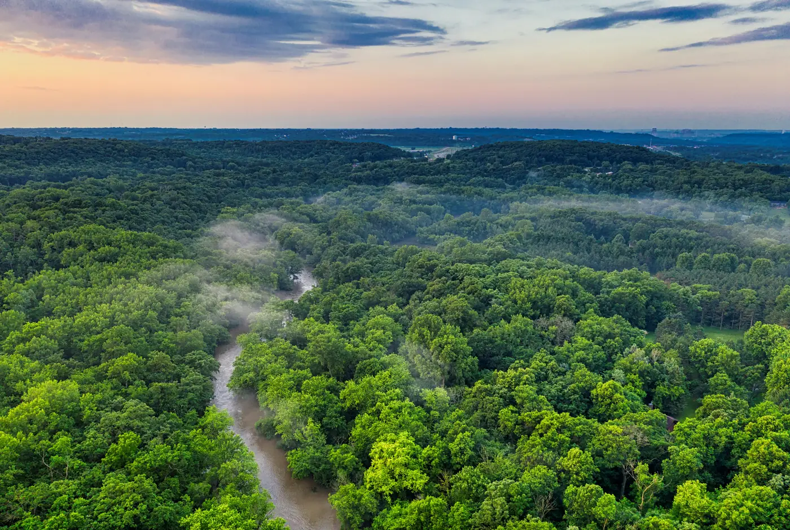
    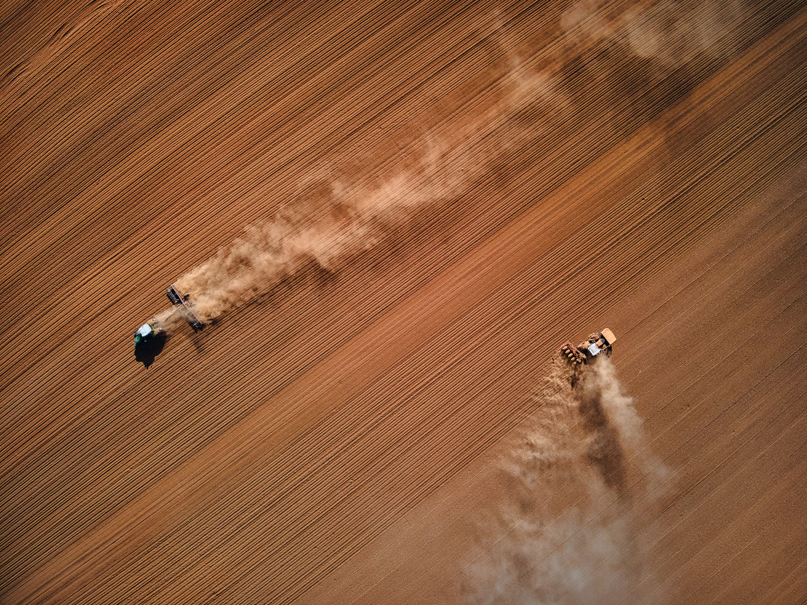
    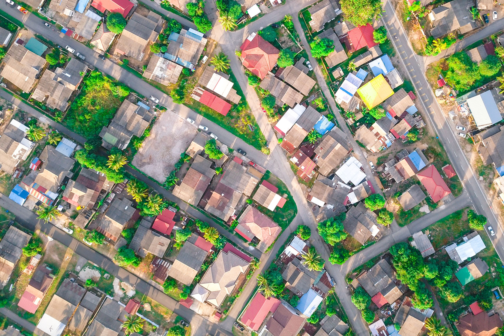
    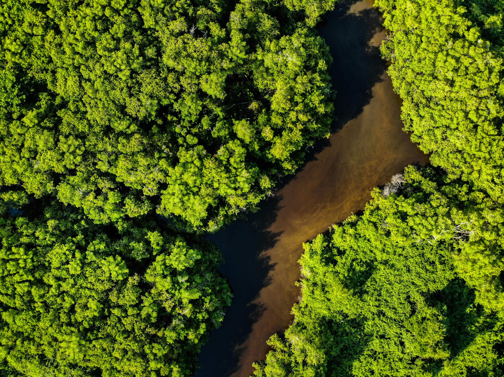
    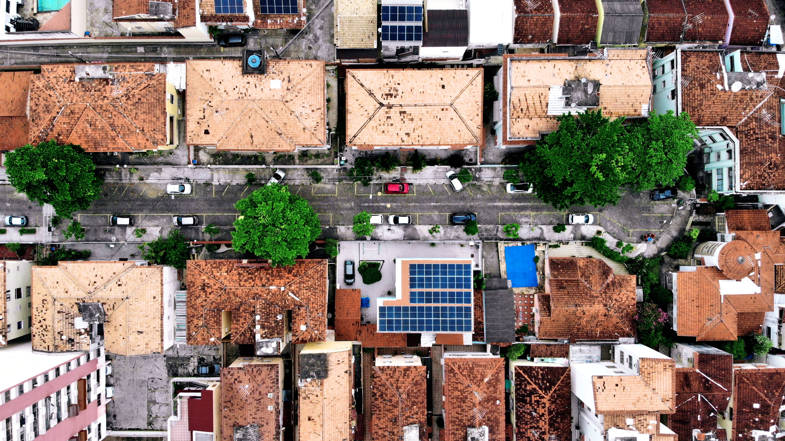
    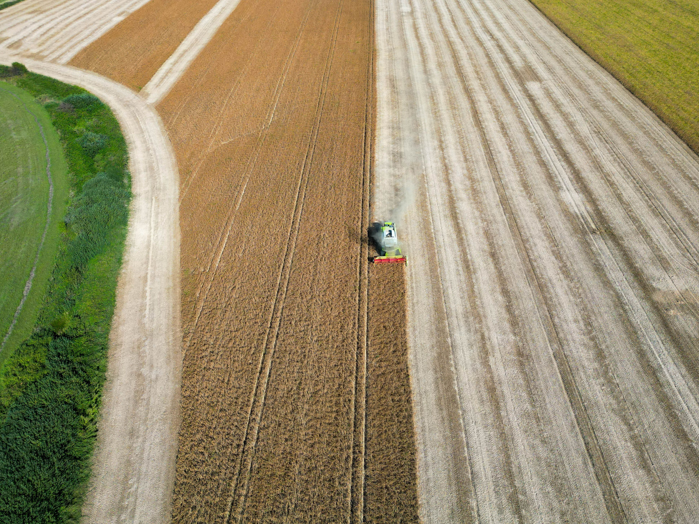
    
  </div>
  <div class="hero-lockup">
    
    <span class="hero-name">GAIA Lab</span>
  </div>
  <p class="hero-tagline">
    Inteligência artificial e observação da Terra para entender a dinâmica de
    sistemas socioambientais complexos.
  </p>
  <div class="hero-action-group">
    <a class="hero-cta" href="#home-pesquisa">Saber mais</a>
    <a class="hero-scroll" href="#home-pesquisa" aria-label="Rolar para as áreas de pesquisa">
      <svg viewBox="0 0 24 24" fill="none" stroke="currentColor" stroke-width="2.5" stroke-linecap="round">
        <path d="m5 9 7 7 7-7"/>
      </svg>
    </a>
  </div>
</div>

<div class="home-body">
  <section id="home-pesquisa" class="home-section reveal">
    <h2 class="section-title">Pesquisa aplicada a desafios socioambientais</h2>
    <p class="section-lead">
      Combinamos dados orbitais e aprendizado profundo para enfrentar gargalos
      ecológicos e produtivos em quatro frentes prioritárias. Da escala do talhão
      agrícola ao tecido urbano, convertemos fluxos complexos de satélite em diagnósticos
      territoriais acionáveis.
    </p>
    <div class="home-areas">
      <a class="area-card reveal" href="research/#agricultura">
        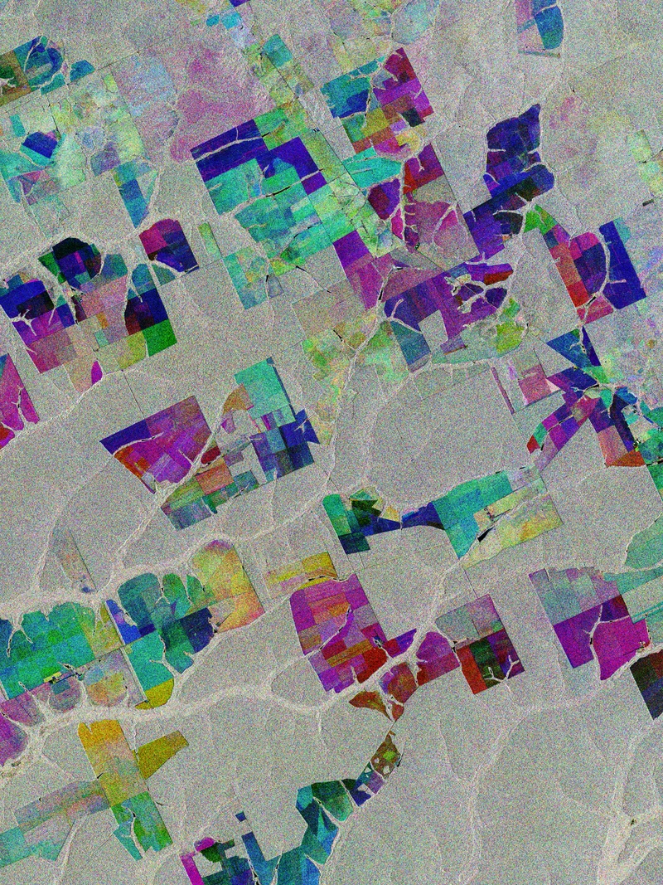
        <div class="area-card-top">
          <span class="card-arrow" aria-hidden="true">
            <svg viewBox="0 0 24 24" fill="none" stroke="currentColor" stroke-width="2.2" stroke-linecap="round" stroke-linejoin="round">
              <path d="M5 12h14M12 5l7 7-7 7"/>
            </svg>
          </span>
        </div>
        <div class="area-card-overlay">
          <div class="area-title">Agricultura</div>
          <div class="area-text">Classificação de culturas e séries de índices de vegetação em escala de talhão.</div>
          <div class="area-kpi">359,6 mil talhões<span>em 5 estados, de 2020 a 2025</span></div>
        </div>
      </a>
      <a class="area-card reveal" href="research/#floresta">
        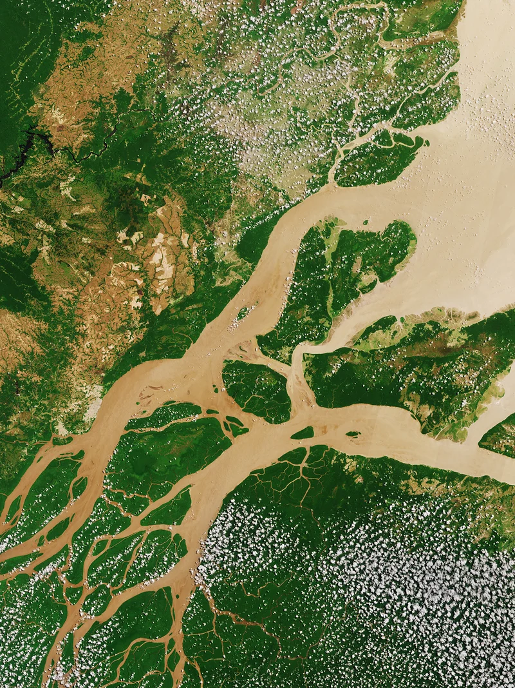
        <div class="area-card-top">
          <span class="card-arrow" aria-hidden="true">
            <svg viewBox="0 0 24 24" fill="none" stroke="currentColor" stroke-width="2.2" stroke-linecap="round" stroke-linejoin="round">
              <path d="M5 12h14M12 5l7 7-7 7"/>
            </svg>
          </span>
        </div>
        <div class="area-card-overlay">
          <div class="area-title">Floresta</div>
          <div class="area-text">Segmentação de floresta por satélite, validada contra dados oficiais do INPE.</div>
          <div class="area-kpi">0,85 de IoU<span>em 26 trimestres, de 2020 a 2026</span></div>
        </div>
      </a>
      <a class="area-card reveal" href="research/#clima">
        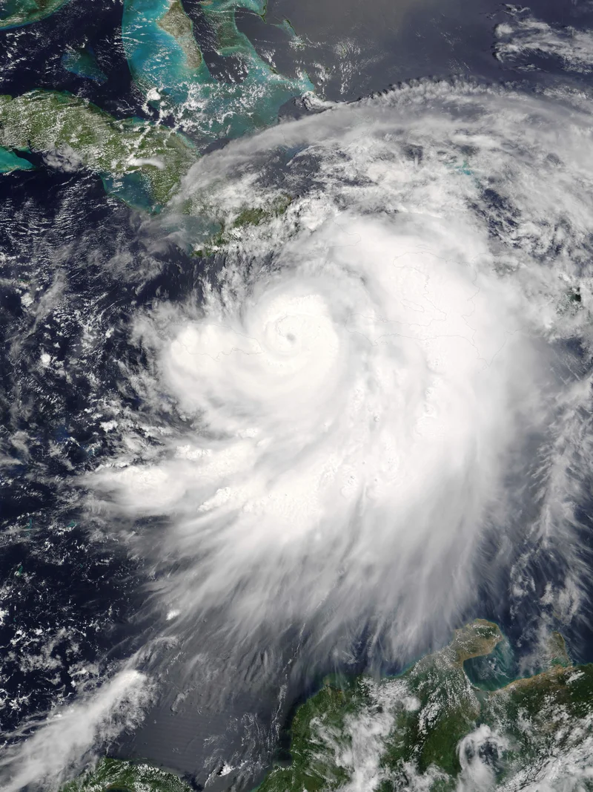
        <div class="area-card-top">
          <span class="card-arrow" aria-hidden="true">
            <svg viewBox="0 0 24 24" fill="none" stroke="currentColor" stroke-width="2.2" stroke-linecap="round" stroke-linejoin="round">
              <path d="M5 12h14M12 5l7 7-7 7"/>
            </svg>
          </span>
        </div>
        <div class="area-card-overlay">
          <div class="area-title">Clima</div>
          <div class="area-text">Tendências climáticas e risco agrícola em janelas de 15 anos.</div>
          <div class="area-kpi">+1,1 °C na máxima<span>Nova Mutum, MT, de 2011 a 2025</span></div>
        </div>
      </a>
      <a class="area-card reveal" href="research/#cidades">
        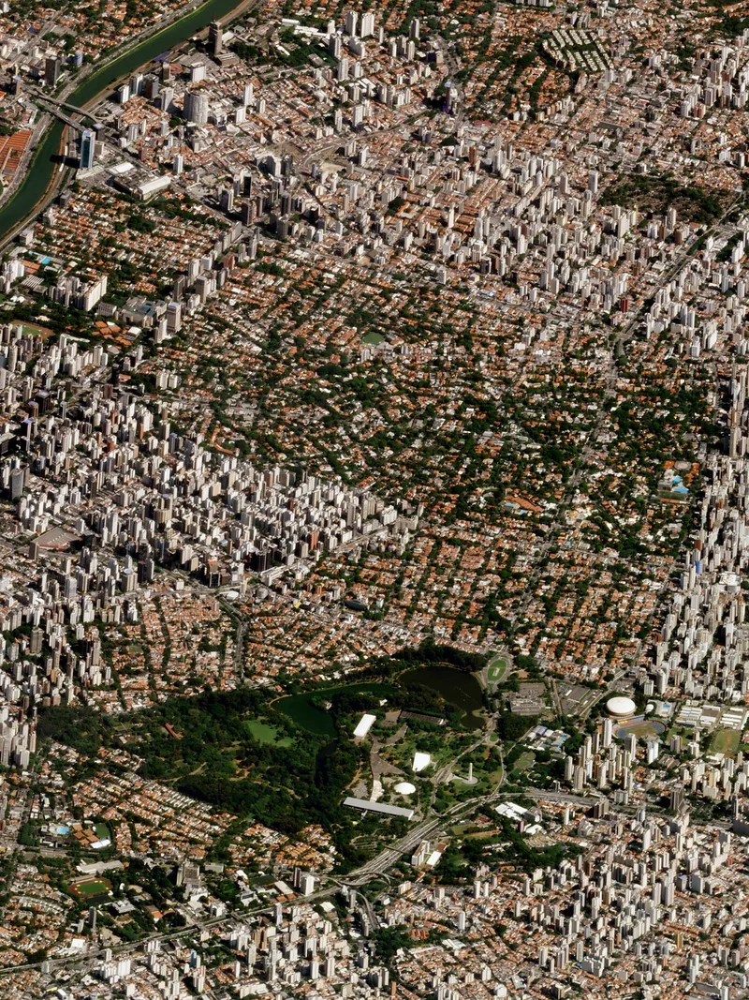
        <div class="area-card-top">
          <span class="card-arrow" aria-hidden="true">
            <svg viewBox="0 0 24 24" fill="none" stroke="currentColor" stroke-width="2.2" stroke-linecap="round" stroke-linejoin="round">
              <path d="M5 12h14M12 5l7 7-7 7"/>
            </svg>
          </span>
        </div>
        <div class="area-card-overlay">
          <div class="area-title">Cidades</div>
          <div class="area-text">Caracterização de assentamentos urbanos e leitura socioeconômica.</div>
          <div class="area-kpi">Sensoriamento urbano<span>Mapeamento e vulnerabilidade</span></div>
        </div>
      </a>
    </div>
  </section>

  <section class="home-section reveal">
    <h2 class="section-title">Como fazemos: da órbita ao conhecimento acionável</h2>
    <p class="section-lead">
      Nossa esteira metodológica conecta múltiplas constelações de satélites, reanálises
      climáticas e modelos de aprendizado profundo de ponta a ponta, com validação sistemática
      e compromisso com código aberto.
    </p>

    <div class="stats reveal">
      <div><div class="stat-num" data-count="359596" data-thousands=".">0</div><div class="stat-label">Talhões mapeados</div></div>
      <div><div class="stat-num" data-count="897">0</div><div class="stat-label">Municípios</div></div>
      <div><div class="stat-num" data-count="5">0</div><div class="stat-label">Estados</div></div>
      <div><div class="stat-num">2020 a 2026</div><div class="stat-label">Período dos dados</div></div>
    </div>

    <div class="hscroll-wrap reveal">
      <button class="hscroll-btn prev" aria-label="Etapa anterior"><svg viewBox="0 0 24 24" fill="none" stroke="currentColor" stroke-width="2.5" stroke-linecap="round"><path d="M15 5l-7 7 7 7"/></svg></button>
      <div class="hscroll">
        <article class="hs-card"><div class="hs-step">01</div><div class="hs-kicker">Etapa</div><div class="hs-title">Ingestão multimodal</div><div class="hs-text">Aquisição contínua de constelações orbitais (óptico e radar SAR), reanálises climáticas e acervos documentais.</div></article>
        <article class="hs-card"><div class="hs-step">02</div><div class="hs-kicker">Etapa</div><div class="hs-title">Harmonização espaço-temporal</div><div class="hs-text">Correção atmosférica, filtragem de nuvens e alinhamento de séries temporais de múltiplos anos em escala territorial.</div></article>
        <article class="hs-card"><div class="hs-step">03</div><div class="hs-kicker">Etapa</div><div class="hs-title">Modelagem e redes profundas</div><div class="hs-text">Segmentação semântica, modelos de fundação geoespacial e modelos de linguagem para representação de fenômenos complexos.</div></article>
        <article class="hs-card"><div class="hs-step">04</div><div class="hs-kicker">Etapa</div><div class="hs-title">Auditoria e validação oficial</div><div class="hs-text">Confrontação sistemática com dados de campo do INPE (DETER e PRODES), zoneamento ZARC, MapBiomas e métricas de incerteza.</div></article>
        <article class="hs-card"><div class="hs-step">05</div><div class="hs-kicker">Etapa</div><div class="hs-title">Diagnósticos acionáveis</div><div class="hs-text">Geração de indicadores de risco, ferramentas de monitoramento e código aberto voltados à tomada de decisão socioambiental.</div></article>
      </div>
      <button class="hscroll-btn next" aria-label="Próxima etapa"><svg viewBox="0 0 24 24" fill="none" stroke="currentColor" stroke-width="2.5" stroke-linecap="round"><path d="m9 5 7 7-7 7"/></svg></button>
    </div>
    <div class="section-cta">
      <a class="pub-btn" href="about/">Saiba mais sobre a nossa abordagem</a>
    </div>
  </section>

  <section class="home-section jogral-section reveal">
    <div class="jogral-grid">
      <div class="jogral-text">
        <h2 class="section-title">Produção científica e difusão</h2>
        <p class="section-lead">
          Nossas contribuições são submetidas a periódicos de referência internacional e
          apresentadas nos principais congressos de inteligência artificial, visão computacional
          e sensoriamento remoto.
        </p>
        <p>
          O laboratório também forma pesquisadores em teses, dissertações e TCCs sobre
          problemas socioambientais concretos. Nossos métodos e dados chegam ao público em
          reportagens, podcasts e matérias de imprensa.
        </p>
      </div>

      <div class="jogral-visual">
        <div class="jogral-cards">
          <a class="jogral-card jogral-card-link reveal" href="publications/#artigos">
            <div class="jogral-card-figure">
              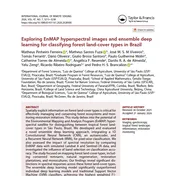
            </div>
            <div class="jogral-card-body">
              <h3>Artigos em periódicos e conferências</h3>
            </div>
            <div class="jogral-card-arrow" aria-hidden="true">
              <svg viewBox="0 0 24 24" fill="none" stroke="currentColor" stroke-width="2.2" stroke-linecap="round" stroke-linejoin="round">
                <path d="M5 12h14M12 5l7 7-7 7"/>
              </svg>
            </div>
          </a>
          <a class="jogral-card jogral-card-link reveal" href="publications/#teses">
            <div class="jogral-card-figure">
              
            </div>
            <div class="jogral-card-body">
              <h3>Teses, dissertações e TCCs</h3>
            </div>
            <div class="jogral-card-arrow" aria-hidden="true">
              <svg viewBox="0 0 24 24" fill="none" stroke="currentColor" stroke-width="2.2" stroke-linecap="round" stroke-linejoin="round">
                <path d="M5 12h14M12 5l7 7-7 7"/>
              </svg>
            </div>
          </a>
          <a class="jogral-card jogral-card-link reveal" href="publications/#noticias">
            <div class="jogral-card-figure">
              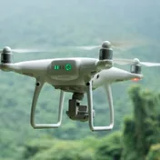
            </div>
            <div class="jogral-card-body">
              <h3>Notícias e imprensa</h3>
            </div>
            <div class="jogral-card-arrow" aria-hidden="true">
              <svg viewBox="0 0 24 24" fill="none" stroke="currentColor" stroke-width="2.2" stroke-linecap="round" stroke-linejoin="round">
                <path d="M5 12h14M12 5l7 7-7 7"/>
              </svg>
            </div>
          </a>
        </div>
      </div>
    </div>
  </section>

  <section class="home-section jogral-section reveal">
    <div class="jogral-grid reverse">
      <div class="jogral-visual">
        <div class="jogral-cards">
          <a class="jogral-card jogral-card-link reveal" href="people/#professor">
            <div class="avatar-stack" aria-hidden="true">
```

::: {#home-docentes}
:::

```{=html}
            </div>
            <div class="jogral-card-body">
              <h3>Professores e pós-doutorandos</h3>
            </div>
            <div class="jogral-card-arrow" aria-hidden="true">
              <svg viewBox="0 0 24 24" fill="none" stroke="currentColor" stroke-width="2.2" stroke-linecap="round" stroke-linejoin="round">
                <path d="M5 12h14M12 5l7 7-7 7"/>
              </svg>
            </div>
          </a>
          <a class="jogral-card jogral-card-link reveal" href="people/#phd">
            <div class="avatar-stack" aria-hidden="true">
```

::: {#home-pos}
:::

```{=html}
            </div>
            <div class="jogral-card-body">
              <h3>Doutorado e mestrado</h3>
            </div>
            <div class="jogral-card-arrow" aria-hidden="true">
              <svg viewBox="0 0 24 24" fill="none" stroke="currentColor" stroke-width="2.2" stroke-linecap="round" stroke-linejoin="round">
                <path d="M5 12h14M12 5l7 7-7 7"/>
              </svg>
            </div>
          </a>
          <a class="jogral-card jogral-card-link reveal" href="people/#undergrad">
            <div class="avatar-stack" aria-hidden="true">
```

::: {#home-graduacao}
:::

```{=html}
            </div>
            <div class="jogral-card-body">
              <h3>Graduação</h3>
            </div>
            <div class="jogral-card-arrow" aria-hidden="true">
              <svg viewBox="0 0 24 24" fill="none" stroke="currentColor" stroke-width="2.2" stroke-linecap="round" stroke-linejoin="round">
                <path d="M5 12h14M12 5l7 7-7 7"/>
              </svg>
            </div>
          </a>
          <a class="jogral-card jogral-card-link reveal" href="people/#colaborador">
            <div class="avatar-stack" aria-hidden="true">
```

::: {#home-rede}
:::

```{=html}
            </div>
            <div class="jogral-card-body">
              <h3>Colaboradores e alumni</h3>
            </div>
            <div class="jogral-card-arrow" aria-hidden="true">
              <svg viewBox="0 0 24 24" fill="none" stroke="currentColor" stroke-width="2.2" stroke-linecap="round" stroke-linejoin="round">
                <path d="M5 12h14M12 5l7 7-7 7"/>
              </svg>
            </div>
          </a>
        </div>
      </div>

      <div class="jogral-text">
        <h2 class="section-title">Um grupo multidisciplinar</h2>
        <p class="section-lead">
          O GAIA Lab reúne pesquisadores de ciência da computação, matemática aplicada,
          ciência de dados, engenharias e economia.
        </p>
        <p>
          Professores, pós-doutorandos, doutorandos, mestrandos e alunos de graduação
          trabalham lado a lado, e a troca entre as áreas acontece no dia a dia e nas
          reuniões do grupo.
        </p>
      </div>
    </div>
  </section>
</div>
```
