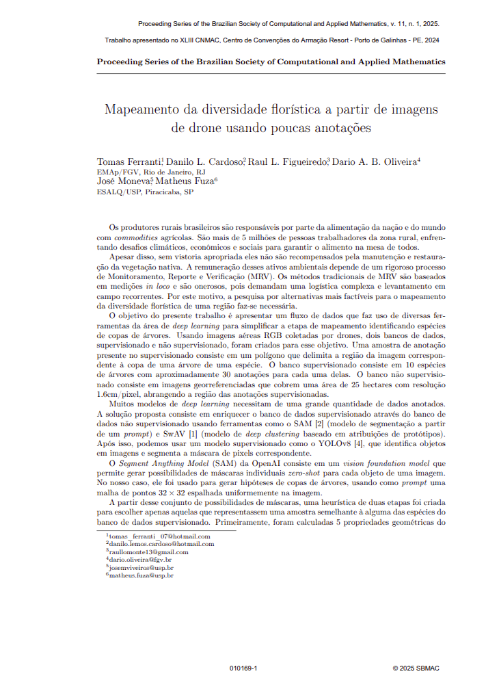
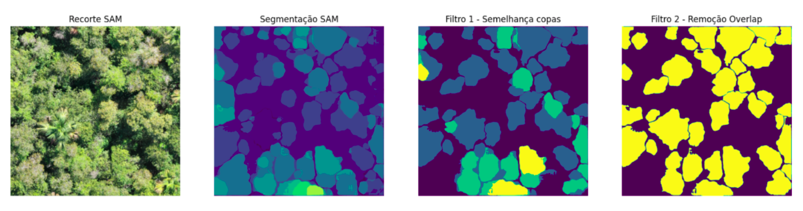

```{=html}
<div class="page-shell">
<div class="page-main">
```

:::: {.pub-detail}

::: {.pub-detail-thumb}
[](https://proceedings.sbmac.org.br/sbmac/article/view/4910)
:::

::: {.pub-detail-meta}
**Authors:** Tomas Ferranti, Danilo L. Cardoso, Raul L. Figueiredo, Dario A. B. Oliveira, José Moneva, Matheus Fuza

**Published:** January 2025, v. 11, n. 1, p. 1-2 (CNMAC 2024)

[Read the article](https://proceedings.sbmac.org.br/sbmac/article/view/4910){.pub-btn}
:::

::::

## Abstract

Brazilian rural producers are responsible for part of the food supply of the nation and of the world through agricultural commodities. More than 5 million people work in rural areas, facing climatic, economic and social challenges to keep food on everyone's table. Even so, without proper inspection they are not rewarded for maintaining and restoring native vegetation. Payment for these environmental assets depends on a rigorous Monitoring, Reporting and Verification (MRV) process. Traditional MRV methods rely on in situ measurements and are costly, since they require complex logistics and recurrent field surveys. For this reason, research into more feasible alternatives for mapping the floristic diversity of a region is needed. The aim of this work is to present a data pipeline that uses several deep learning tools to simplify the mapping stage by identifying tree crown species. Using RGB aerial images collected by drones, two datasets, one supervised and one unsupervised, were created for this purpose. An annotation sample in the supervised dataset consists of a polygon delimiting the image region that corresponds to the crown of a tree of a given species. The supervised dataset comprises 10 tree species with approximately 30 annotations each. The unsupervised dataset consists of georeferenced images covering an area of 25 hectares at a resolution of 1.6 cm/pixel, encompassing the region of the supervised annotations.

:::: {.pub-figures}

::::

## How to cite

```bibtex
@inproceedings{ferranti2025mapeamento,
  title     = {Mapeamento da diversidade florística a partir de imagens de drone usando poucas anotações},
  author    = {Ferranti, Tomas and Cardoso, Danilo L. and Figueiredo, Raul L. and Oliveira, Dario A. B. and Moneva, José and Fuza, Matheus},
  booktitle = {Proceeding Series of the Brazilian Society of Computational and Applied Mathematics},
  volume    = {11},
  number    = {1},
  pages     = {1--2},
  year      = {2025},
  url       = {https://proceedings.sbmac.org.br/sbmac/article/view/4910}
}
```

```{=html}
<a class="back-link" href="/publications/">
  <svg viewBox="0 0 24 24" fill="none" stroke="currentColor" stroke-width="2.2" stroke-linecap="round"><path d="M15 5l-7 7 7 7"/></svg>
  <span>Back to publications</span>
</a>
```

```{=html}
</div>
</div>
```
