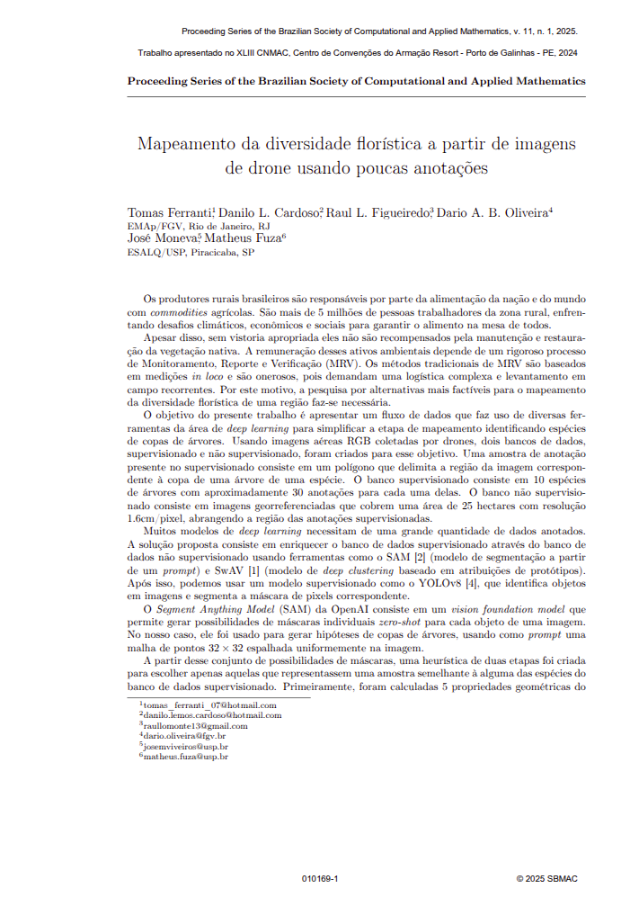
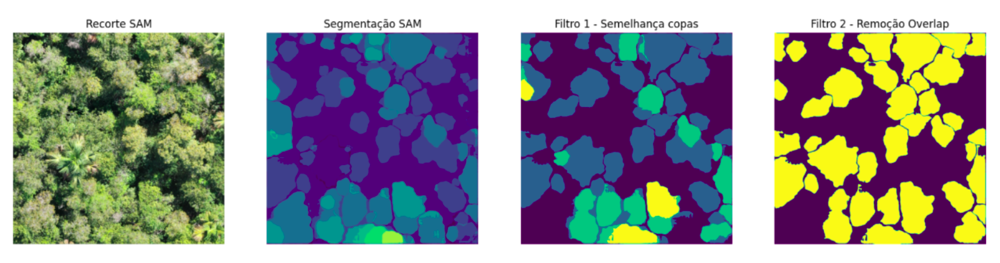

```{=html}
<div class="page-shell">
<div class="page-main">
```

:::: {.pub-detail}

::: {.pub-detail-thumb}
[](https://proceedings.sbmac.org.br/sbmac/article/view/4910)
:::

::: {.pub-detail-meta}
**Autores:** Tomas Ferranti, Danilo L. Cardoso, Raul L. Figueiredo, Dario A. B. Oliveira, José Moneva, Matheus Fuza

**Publicação:** Janeiro de 2025, v. 11, n. 1, p. 1-2 (CNMAC 2024)

[Acessar o artigo](https://proceedings.sbmac.org.br/sbmac/article/view/4910){.pub-btn}
:::

::::

## Resumo

Os produtores rurais brasileiros são responsáveis por parte da alimentação da nação e do mundo com commodities agrícolas. São mais de 5 milhões de pessoas trabalhadores da zona rural, enfrentando desafios climáticos, econômicos e sociais para garantir o alimento na mesa de todos. Apesar disso, sem vistoria apropriada eles não são recompensados pela manutenção e restauração da vegetação nativa. A remuneração desses ativos ambientais depende de um rigoroso processo de Monitoramento, Reporte e Verificação (MRV). Os métodos tradicionais de MRV são baseados em medições in loco e são onerosos, pois demandam uma logística complexa e levantamento em campo recorrentes. Por este motivo, a pesquisa por alternativas mais factíveis para o mapeamento da diversidade florística de uma região faz-se necessária. O objetivo do presente trabalho é apresentar um fluxo de dados que faz uso de diversas ferramentas da área de deep learning para simplificar a etapa de mapeamento identificando espécies de copas de árvores. Usando imagens aéreas RGB coletadas por drones, dois bancos de dados, supervisionado e não supervisionado, foram criados para esse objetivo. Uma amostra de anotação presente no supervisionado consiste em um polígono que delimita a região da imagem correspondente à copa de uma árvore de uma espécie. O banco supervisionado consiste em 10 espécies de árvores com aproximadamente 30 anotações para cada uma delas. O banco não supervisionado consiste em imagens georreferenciadas que cobrem uma área de 25 hectares com resolução 1.6cm/pixel, abrangendo a região das anotações supervisionadas.

:::: {.pub-figures}

::::

## Como citar

```bibtex
@inproceedings{ferranti2025mapeamento,
  title     = {Mapeamento da diversidade florística a partir de imagens de drone usando poucas anotações},
  author    = {Ferranti, Tomas and Cardoso, Danilo L. and Figueiredo, Raul L. and Oliveira, Dario A. B. and Moneva, José and Fuza, Matheus},
  booktitle = {Proceeding Series of the Brazilian Society of Computational and Applied Mathematics},
  volume    = {11},
  number    = {1},
  pages     = {1--2},
  year      = {2025},
  url       = {https://proceedings.sbmac.org.br/sbmac/article/view/4910}
}
```

```{=html}
<a class="back-link" href="/publications/">
  <svg viewBox="0 0 24 24" fill="none" stroke="currentColor" stroke-width="2.2" stroke-linecap="round"><path d="M15 5l-7 7 7 7"/></svg>
  <span>Voltar para as publicações</span>
</a>
```

```{=html}
</div>
</div>
```
