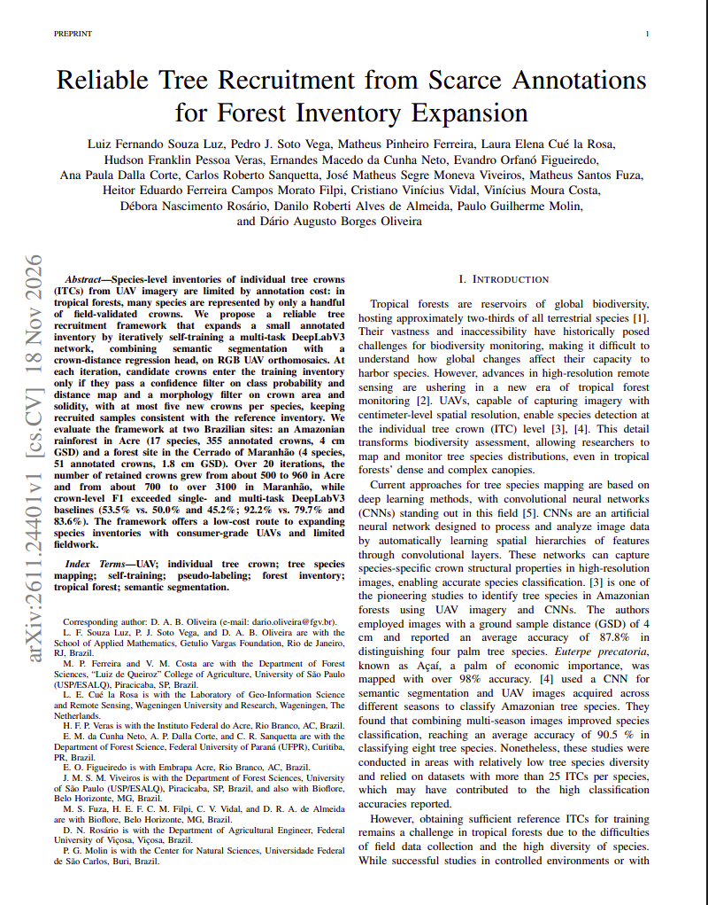
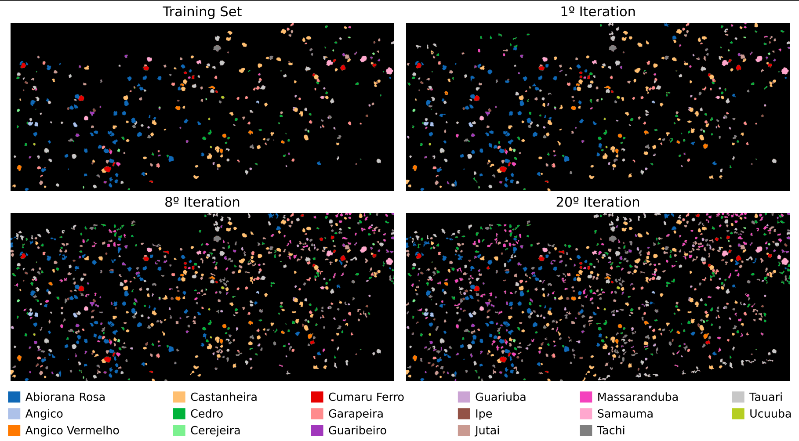
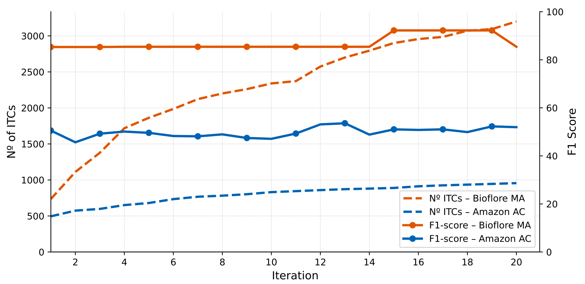

```{=html}
<div class="page-shell">
<div class="page-main">
```

:::: {.pub-detail}

::: {.pub-detail-thumb}
[](https://arxiv.org/abs/2611.24401)
:::

::: {.pub-detail-meta}
**Authors:** Luiz Fernando Souza Luz, Pedro J Soto Vega, Matheus Pinheiro Ferreira, Laura Elena Cué la Rosa, Hudson Franklin Pessoa Veras, Ernandes Macedo da Cunha Neto, Evandro Orfanó Figueiredo, Ana Paula Dalla Corte, Carlos Roberto Sanquetta, José Matheus Segre Moneva Viveiros, Matheus Santos Fuza, Heitor Eduardo Ferreira Campos Morato Filpi, Cristiano Vinícius Vidal, Vinícius Moura Costa, Débora Nascimento Rosário, Danilo Roberti Alves de Almeida, Paulo Guilherme Molin, Dário Augusto Borges Oliveira

**Published:** November 2026, arXiv preprint arXiv:2611.24401

[Read the article](https://arxiv.org/abs/2611.24401){.pub-btn}
:::

::::

## Abstract

Species-level inventories of individual tree crowns (ITCs) from UAV imagery are limited by annotation cost: in tropical forests, many species are represented by only a handful of field-validated crowns. We propose a reliable tree recruitment framework that expands a small annotated inventory by iteratively self-training a multi-task DeepLabV3 network, combining semantic segmentation with a crown-distance regression head, on RGB UAV orthomosaics. At each iteration, candidate crowns enter the training inventory only if they pass a confidence filter on class probability and distance map and a morphology filter on crown area and solidity, with at most five new crowns per species, keeping recruited samples consistent with the reference inventory. We evaluate the framework at two Brazilian sites: an Amazonian rainforest in Acre (17 species, 355 annotated crowns, 4 cm GSD) and a forest site in the Cerrado of Maranhão (4 species, 51 annotated crowns, 1.8 cm GSD). Over 20 iterations, the number of retained crowns grew from about 500 to 960 in Acre and from about 700 to over 3100 in Maranhão, while crown-level F1 exceeded single- and multi-task DeepLabV3 baselines (53.5% vs. 50.0% and 45.2%; 92.2% vs. 79.7% and 83.6%). The framework offers a low-cost route to expanding species inventories with consumer-grade UAVs and limited fieldwork.

:::: {.pub-figures}



::::

## How to cite

```bibtex
@misc{luz2026reliable,
  title         = {Reliable Tree Recruitment from Scarce Annotations for Forest Inventory Expansion},
  author        = {Luz, Luiz Fernando Souza and Soto Vega, Pedro J. and Ferreira, Matheus Pinheiro and Cué la Rosa, Laura Elena and Veras, Hudson Franklin Pessoa and Cunha Neto, Ernandes Macedo da and Figueiredo, Evandro Orfanó and Dalla Corte, Ana Paula and Sanquetta, Carlos Roberto and Viveiros, José Matheus Segre Moneva and Fuza, Matheus Santos and Filpi, Heitor Eduardo Ferreira Campos Morato and Vidal, Cristiano Vinícius and Costa, Vinícius Moura and Rosário, Débora Nascimento and Almeida, Danilo Roberti Alves de and Molin, Paulo Guilherme and Oliveira, Dário Augusto Borges},
  year          = {2026},
  eprint        = {2611.24401},
  archivePrefix = {arXiv}
}
```

```{=html}
<a class="back-link" href="/publications/">
  <svg viewBox="0 0 24 24" fill="none" stroke="currentColor" stroke-width="2.2" stroke-linecap="round"><path d="M15 5l-7 7 7 7"/></svg>
  <span>Back to publications</span>
</a>
```

```{=html}
</div>
</div>
```
