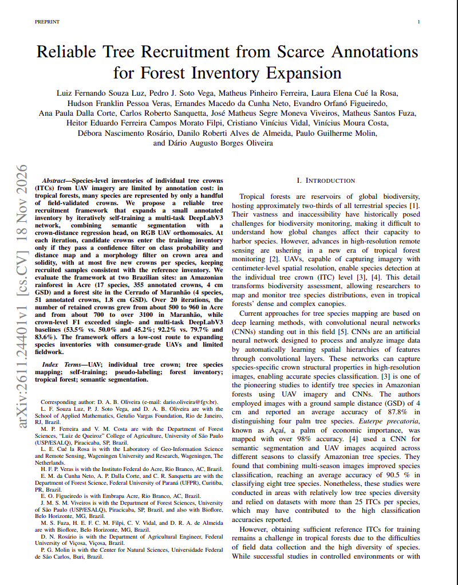
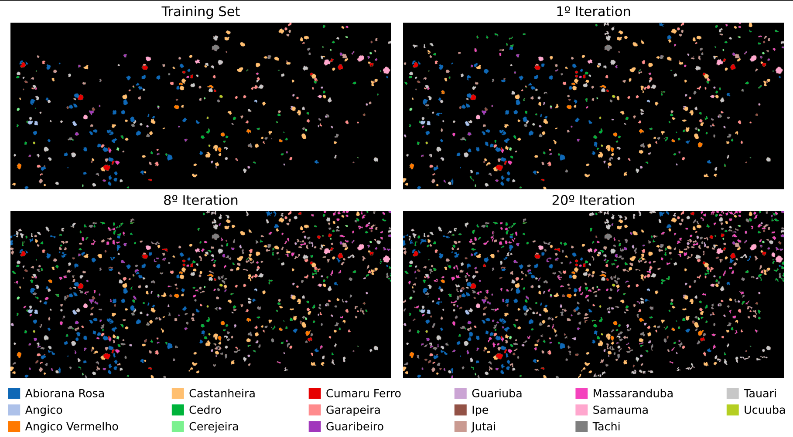
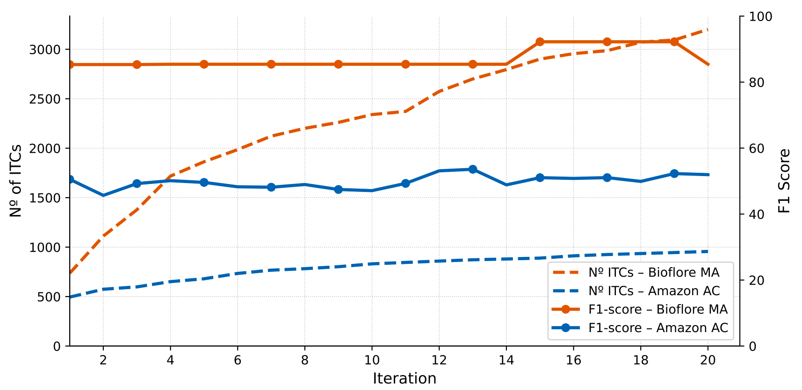

```{=html}
<div class="page-shell">
<div class="page-main">
```

:::: {.pub-detail}

::: {.pub-detail-thumb}
[](https://arxiv.org/abs/2611.24401)
:::

::: {.pub-detail-meta}
**Autores:** Luiz Fernando Souza Luz, Pedro J Soto Vega, Matheus Pinheiro Ferreira, Laura Elena Cué la Rosa, Hudson Franklin Pessoa Veras, Ernandes Macedo da Cunha Neto, Evandro Orfanó Figueiredo, Ana Paula Dalla Corte, Carlos Roberto Sanquetta, José Matheus Segre Moneva Viveiros, Matheus Santos Fuza, Heitor Eduardo Ferreira Campos Morato Filpi, Cristiano Vinícius Vidal, Vinícius Moura Costa, Débora Nascimento Rosário, Danilo Roberti Alves de Almeida, Paulo Guilherme Molin, Dário Augusto Borges Oliveira

**Publicação:** Novembro de 2026, arXiv preprint arXiv:2611.24401

[Acessar o artigo](https://arxiv.org/abs/2611.24401){.pub-btn}
:::

::::

## Resumo

Inventários em nível de espécie de copas individuais de árvores (ITCs) a partir de imagens de VANT são limitados pelo custo de anotação: em florestas tropicais, muitas espécies são representadas por apenas algumas copas validadas em campo. Propomos um framework de recrutamento confiável de árvores que expande um pequeno inventário anotado por meio do autotreinamento iterativo de uma rede DeepLabV3 multitarefa, que combina segmentação semântica com uma cabeça de regressão de distância à copa, sobre ortomosaicos RGB de VANT. A cada iteração, as copas candidatas entram no inventário de treinamento somente se passarem por um filtro de confiança sobre a probabilidade de classe e o mapa de distância e por um filtro de morfologia sobre a área e a solidez da copa, com no máximo cinco novas copas por espécie, o que mantém as amostras recrutadas consistentes com o inventário de referência. Avaliamos o framework em dois sítios brasileiros: uma floresta amazônica no Acre (17 espécies, 355 copas anotadas, GSD de 4 cm) e um sítio florestal no Cerrado do Maranhão (4 espécies, 51 copas anotadas, GSD de 1,8 cm). Ao longo de 20 iterações, o número de copas retidas cresceu de cerca de 500 para 960 no Acre e de cerca de 700 para mais de 3100 no Maranhão, enquanto o F1 em nível de copa superou as referências DeepLabV3 de tarefa única e multitarefa (53,5% contra 50,0% e 45,2%; 92,2% contra 79,7% e 83,6%). O framework oferece um caminho de baixo custo para expandir inventários de espécies com VANTs de uso comum e trabalho de campo limitado.

:::: {.pub-figures}



::::

## Como citar

```bibtex
@misc{luz2026reliable,
  title         = {Reliable Tree Recruitment from Scarce Annotations for Forest Inventory Expansion},
  author        = {Luz, Luiz Fernando Souza and Soto Vega, Pedro J. and Ferreira, Matheus Pinheiro and Cué la Rosa, Laura Elena and Veras, Hudson Franklin Pessoa and Cunha Neto, Ernandes Macedo da and Figueiredo, Evandro Orfanó and Dalla Corte, Ana Paula and Sanquetta, Carlos Roberto and Viveiros, José Matheus Segre Moneva and Fuza, Matheus Santos and Filpi, Heitor Eduardo Ferreira Campos Morato and Vidal, Cristiano Vinícius and Costa, Vinícius Moura and Rosário, Débora Nascimento and Almeida, Danilo Roberti Alves de and Molin, Paulo Guilherme and Oliveira, Dário Augusto Borges},
  year          = {2026},
  eprint        = {2611.24401},
  archivePrefix = {arXiv}
}
```

```{=html}
<a class="back-link" href="/publications/">
  <svg viewBox="0 0 24 24" fill="none" stroke="currentColor" stroke-width="2.2" stroke-linecap="round"><path d="M15 5l-7 7 7 7"/></svg>
  <span>Voltar para as publicações</span>
</a>
```

```{=html}
</div>
</div>
```
