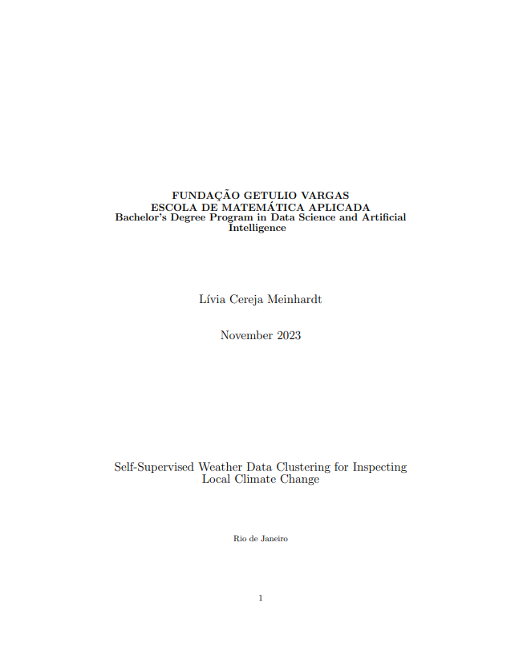

```{=html}
<div class="page-shell">
<div class="page-main">
```

:::: {.pub-detail}

::: {.pub-detail-thumb}
[](https://hdl.handle.net/10438/35365)
:::

::: {.pub-detail-meta}
**Author:** Lívia Cereja Meinhardt

**Capstone:** Bachelor's in Data Science and Artificial Intelligence, FGV EMAp

**Advisor:** Dário Oliveira

[View in the repository](https://hdl.handle.net/10438/35365){.pub-btn}
:::

::::

## Abstract

As global warming worsens, we observe an increase in the frequency, duration, and intensity of diverse weather phenomena like heavy rainfall, heatwaves, and droughts. These events often lead to severe consequences by either surpassing critical thresholds in social, ecological, or physical systems or coinciding with other adverse events. Recognizing the pressing need for adaptable models in the face of climate change effects, this project aims to examine these impacts using local climate data. By clustering climate patterns and analysing trends, the goal is to gather evidence of shifts in observed climate patterns over time. To conduct this analysis, a self-supervised technique called Swapping Assignments between multiple Views (SwAV) is employed. The methodology has shown promising outcomes by creating meaningful clusters based on temperature and precipitation parameters. These clusters can potentially enhance models or applications reliant on weather data and they demonstrate the impact of global warming with rising trends of more extreme groups in a region that encompasses parts of the southern, southeastern, and mid-western regions of Brazil, as well as parts of Paraguay and Argentina.

```{=html}
<a class="back-link" href="/publications/#theses">
  <svg viewBox="0 0 24 24" fill="none" stroke="currentColor" stroke-width="2.2" stroke-linecap="round"><path d="M15 5l-7 7 7 7"/></svg>
  <span>Back to theses and dissertations</span>
</a>
```

```{=html}
</div>
</div>
```
