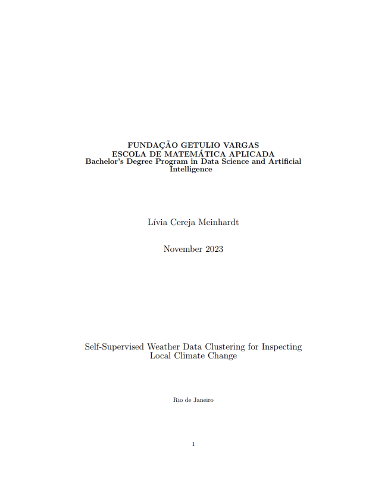

```{=html}
<div class="page-shell">
<div class="page-main">
```

:::: {.pub-detail}

::: {.pub-detail-thumb}
[](https://hdl.handle.net/10438/35365)
:::

::: {.pub-detail-meta}
**Autoria:** Lívia Cereja Meinhardt

**TCC:** Graduação em Ciência de Dados e Inteligência Artificial, FGV EMAp

**Orientação:** Dário Oliveira

[Acessar no repositório](https://hdl.handle.net/10438/35365){.pub-btn}
:::

::::

## Resumo

À medida que o aquecimento global se agrava, observamos um aumento na frequência, duração e intensidade de diversos fenômenos climáticos, como chuvas intensas, ondas de calor e secas. Esses eventos frequentemente resultam em graves consequências ao ultrapassar os limites críticos em sistemas sociais, ecológicos ou físicos, ou ao coincidir com outros eventos adversos. Reconhecendo a urgente necessidade de modelos adaptáveis diante dos efeitos das mudanças climáticas, este projeto tem como objetivo examinar esses impactos utilizando dados climáticos locais. Ao agrupar padrões climáticos e analisar tendências, a meta é reunir evidências de mudanças nos padrões climáticos observados ao longo do tempo. Para conduzir essa análise, emprega-se uma técnica autossupervisionada chamada Swapping Assignments between multiple Views (SwAV). A metodologia mostrou resultados promissores ao criar clusters significativos com base nos parâmetros de temperatura e precipitação. Esses clusters podem potencialmente aprimorar modelos ou aplicações dependentes de dados meteorológicos e demonstram o impacto do aquecimento global com tendências crescentes de grupos mais extremos em uma região que engloba partes das regiões sul, sudeste e centro-oeste do Brasil, além de partes do Paraguai e Argentina.

```{=html}
<a class="back-link" href="/publications/#teses">
  <svg viewBox="0 0 24 24" fill="none" stroke="currentColor" stroke-width="2.2" stroke-linecap="round"><path d="M15 5l-7 7 7 7"/></svg>
  <span>Voltar para as teses e dissertações</span>
</a>
```

```{=html}
</div>
</div>
```
