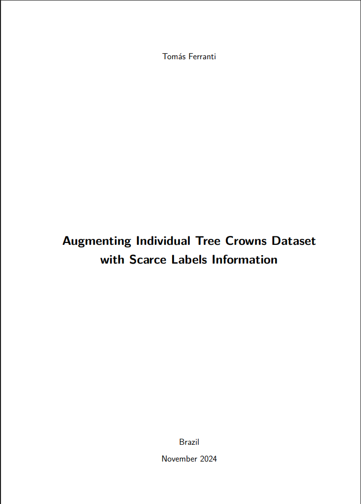

```{=html}
<div class="page-shell">
<div class="page-main">
```

:::: {.pub-detail}

::: {.pub-detail-thumb}
[](https://hdl.handle.net/10438/36413)
:::

::: {.pub-detail-meta}
**Author:** Tomás Ferranti

**Dissertation:** Master's in Applied Mathematics and Data Science, FGV EMAp

**Advisor:** Dário Oliveira

[View in the repository](https://hdl.handle.net/10438/36413){.pub-btn}
:::

::::

## Abstract

Spatial information about the distribution of tree species in tropical biomes is essential for the conservation and sustainable management of these ecosystems. Because of the difficult access to these densely forested regions and the need for botanical experts, individual tree crown (ITC) databases with labeled species are scarce and small. The objective of this work is to present a deep learning framework where three models of different tasks are combined in order to increase the size of a labeled ITCs dataset. Our technique is fully autonomous and uses only aerial drone images in the annotation region as additional data. Experiments in the cerrado biome demonstrate that it is possible to separate ITCs present in RGB images using a zero-shot object segmentation model, finding a total of 36181 possible masks from 25 hectares. These segmentations are grouped by a representation learning model, which learns visual aspects by comparing swapped predictions of the codes, calculated through optimal transport, from transformed versions of the same image. A robust encoder for downstream tasks is trained by this approach, along with 128 prototypes representing specific characteristics of the dataset (colors, shapes and textures). Finally, from the previously learned weights, a semi-supervised classification model generates a probability distribution for each segmentation across 9 species. Using a confidence threshold criterion 2817 new samples are generated, a significant increase compared to the initial 334 labels.

```{=html}
<a class="back-link" href="/publications/#theses">
  <svg viewBox="0 0 24 24" fill="none" stroke="currentColor" stroke-width="2.2" stroke-linecap="round"><path d="M15 5l-7 7 7 7"/></svg>
  <span>Back to theses and dissertations</span>
</a>
```

```{=html}
</div>
</div>
```
