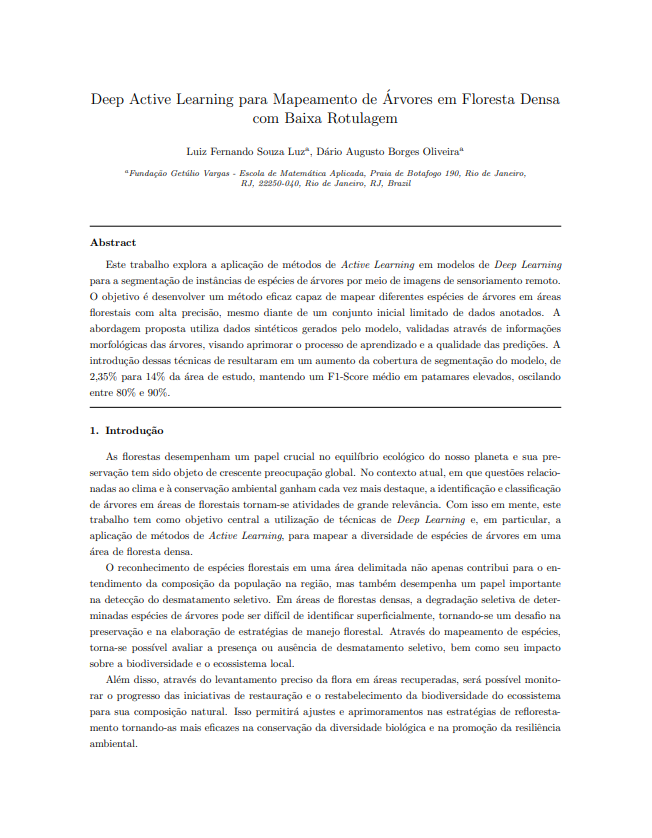

```{=html}
<div class="page-shell">
<div class="page-main">
```

:::: {.pub-detail}

::: {.pub-detail-thumb}
[](https://hdl.handle.net/10438/35412)
:::

::: {.pub-detail-meta}
**Autoria:** Luiz Fernando Souza Luz

**TCC:** Graduação em Ciência de Dados e Inteligência Artificial, FGV EMAp

**Orientação:** Dário Oliveira

[Acessar no repositório](https://hdl.handle.net/10438/35412){.pub-btn}
:::

::::

## Resumo

Este trabalho explora a aplicação de métodos de Active Learning em modelos de Deep Learning para a segmentação de instâncias de espécies de árvores por meio de imagens de sensoriamento remoto. O objetivo é desenvolver um método eficaz capaz de mapear diferentes espécies de árvores em áreas florestais com alta precisão, mesmo diante de um conjunto inicial limitado de dados anotados. A abordagem proposta utiliza dados sintéticos gerados pelo modelo, validados através de informações morfológicas das árvores, visando aprimorar o processo de aprendizado e a qualidade das predições. A introdução dessas técnicas resultou em um aumento da cobertura de segmentação do modelo, de 2,35% para 14% da área de estudo, mantendo um F1-Score médio em patamares elevados, oscilando entre 80% e 90%.

```{=html}
<a class="back-link" href="/publications/#teses">
  <svg viewBox="0 0 24 24" fill="none" stroke="currentColor" stroke-width="2.2" stroke-linecap="round"><path d="M15 5l-7 7 7 7"/></svg>
  <span>Voltar para as teses e dissertações</span>
</a>
```

```{=html}
</div>
</div>
```
