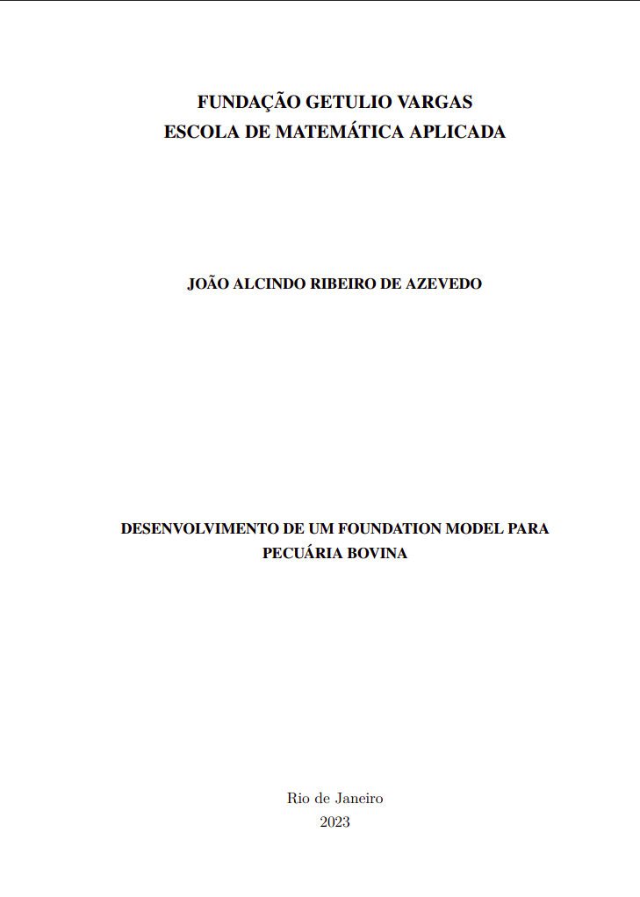

```{=html}
<div class="page-shell">
<div class="page-main">
```

:::: {.pub-detail}

::: {.pub-detail-thumb}
[](https://hdl.handle.net/10438/35381)
:::

::: {.pub-detail-meta}
**Autoria:** João Alcindo Ribeiro de Azevedo

**TCC:** Graduação em Matemática Aplicada, FGV EMAp

**Orientação:** Dário Oliveira

[Acessar no repositório](https://hdl.handle.net/10438/35381){.pub-btn}
:::

::::

## Resumo

A pecuária desempenha um papel fundamental como fonte de renda para diversas famílias brasileiras. No contexto dos avanços das técnicas de deep learning, observa-se uma evolução significativa em todas as esferas da economia, com a incorporação crescente de algoritmos e técnicas dessa natureza em atividades cotidianas. O propósito deste trabalho é propor um modelo base (foundation model) voltado para a pecuária, com potencial para auxiliar trabalhadores no seu dia a dia e simplificar processos.

```{=html}
<a class="back-link" href="/publications/#teses">
  <svg viewBox="0 0 24 24" fill="none" stroke="currentColor" stroke-width="2.2" stroke-linecap="round"><path d="M15 5l-7 7 7 7"/></svg>
  <span>Voltar para as teses e dissertações</span>
</a>
```

```{=html}
</div>
</div>
```
