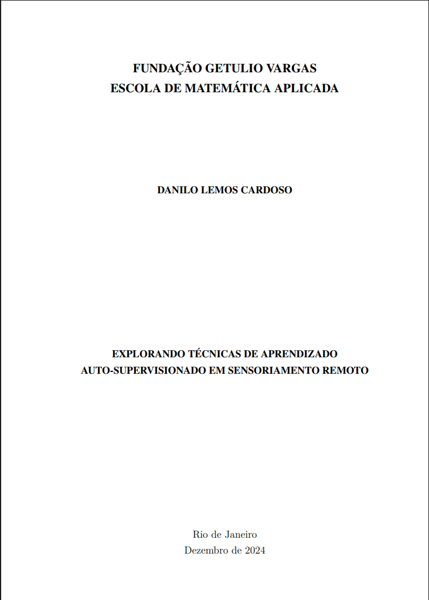

```{=html}
<div class="page-shell">
<div class="page-main">
```

:::: {.pub-detail}

::: {.pub-detail-thumb}
[](https://hdl.handle.net/10438/36355)
:::

::: {.pub-detail-meta}
**Author:** Danilo Lemos Cardoso

**Dissertation:** Master's in Applied Mathematics and Data Science, FGV EMAp

**Advisor:** Dário Oliveira

[View in the repository](https://hdl.handle.net/10438/36355){.pub-btn}
:::

::::

## Abstract

This work aims to show how Deep Learning techniques, such as self-supervised learning, can be applied to Remote Sensing data. We will discuss models that generate very informative latent representations from a large set of images without the need for annotations. These representations should be good enough for downstream tasks such as classification and regression to be done with few annotations. This work also presents a database of aerial and satellite imagery that covers the entire area of the municipalities of Belo Horizonte and São Paulo. These images were obtained from public sources and processed to contain about 8 thousand sectors of Belo Horizonte and about 40 thousand sectors of São Paulo in each modality annotated with population density and average income data from the IBGE Demographic Census. In the end, the generated dataset will be used to know if, from the representation learned by the model, it is possible to obtain an estimate of socioeconomic indicators such as population density and average income in each sector of those cities. It was shown that the model used is able to group images with similar socioeconomic data even without supervision, indicating that the model can learn useful latent representations for regression and classification tasks.

```{=html}
<a class="back-link" href="/publications/#theses">
  <svg viewBox="0 0 24 24" fill="none" stroke="currentColor" stroke-width="2.2" stroke-linecap="round"><path d="M15 5l-7 7 7 7"/></svg>
  <span>Back to theses and dissertations</span>
</a>
```

```{=html}
</div>
</div>
```
