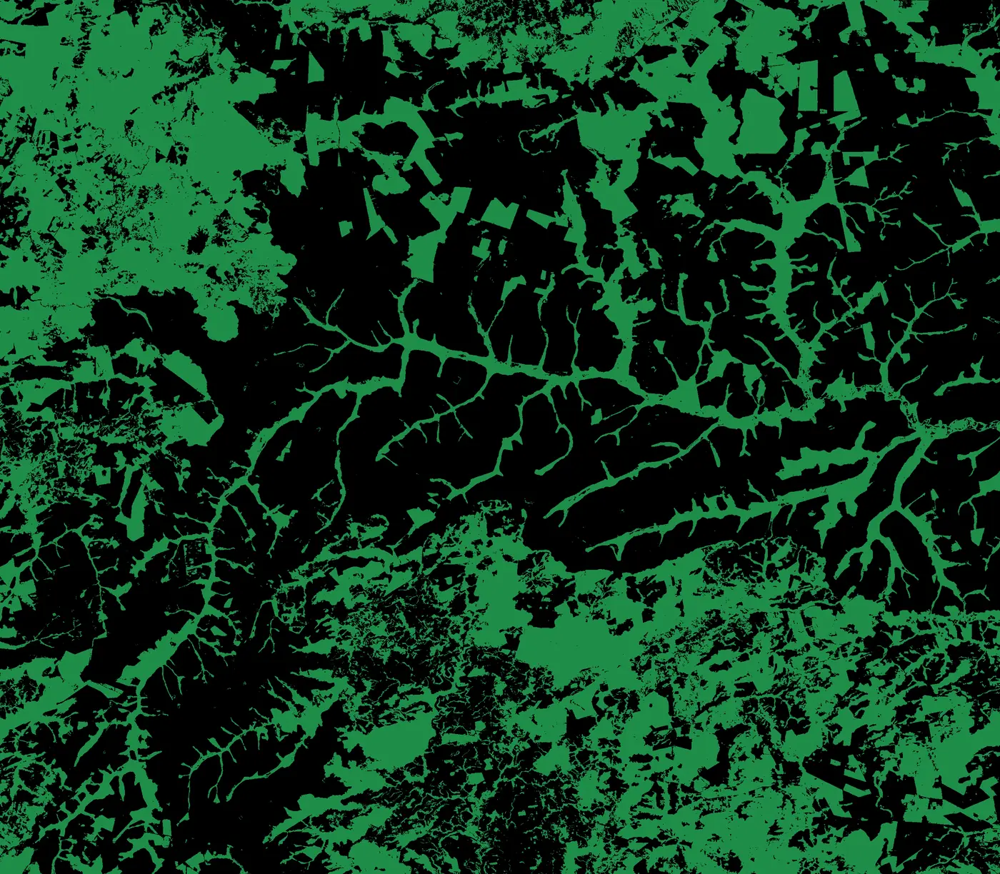
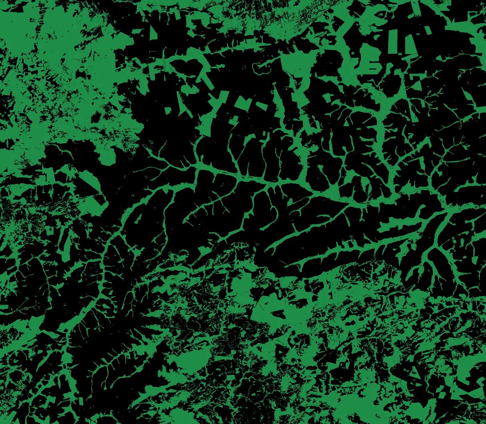
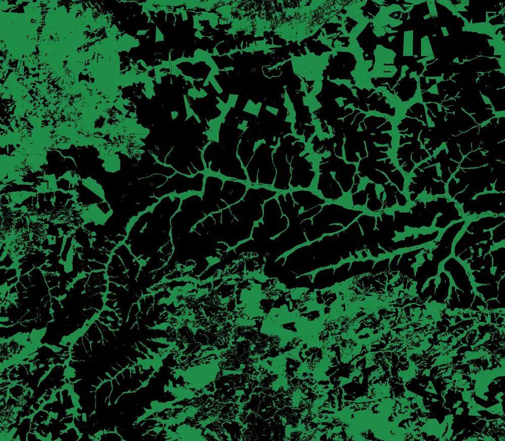
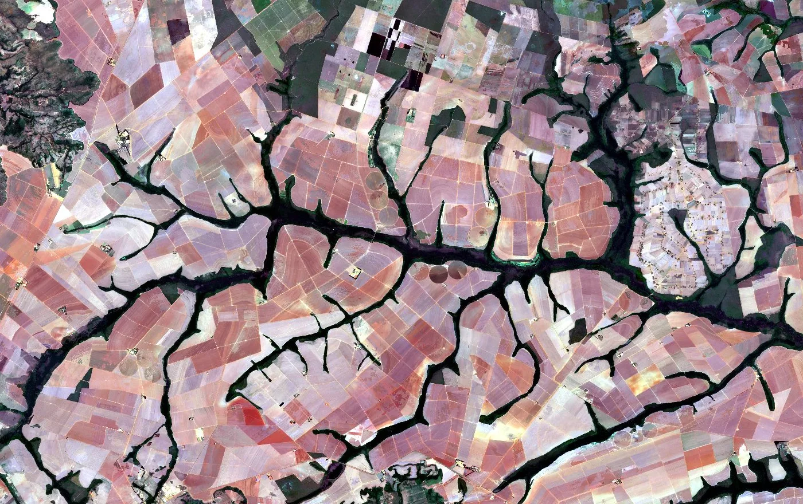
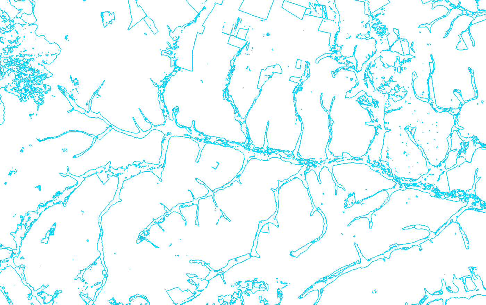
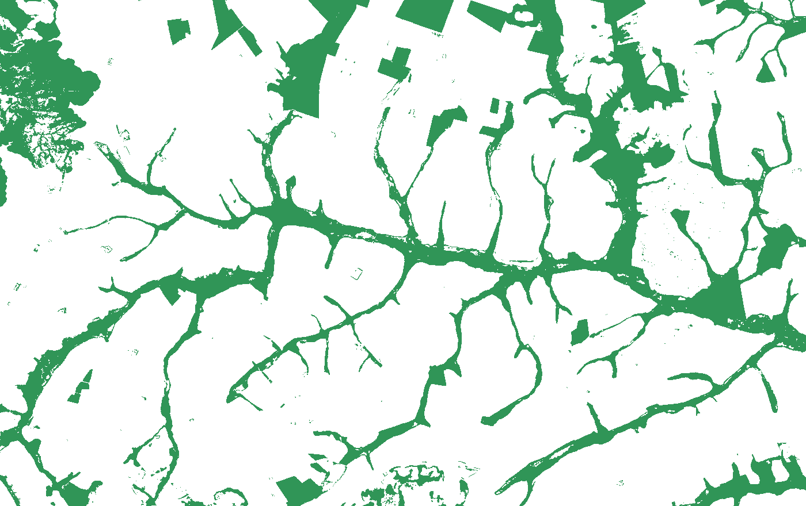
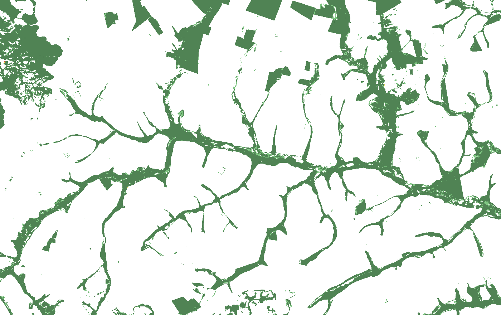
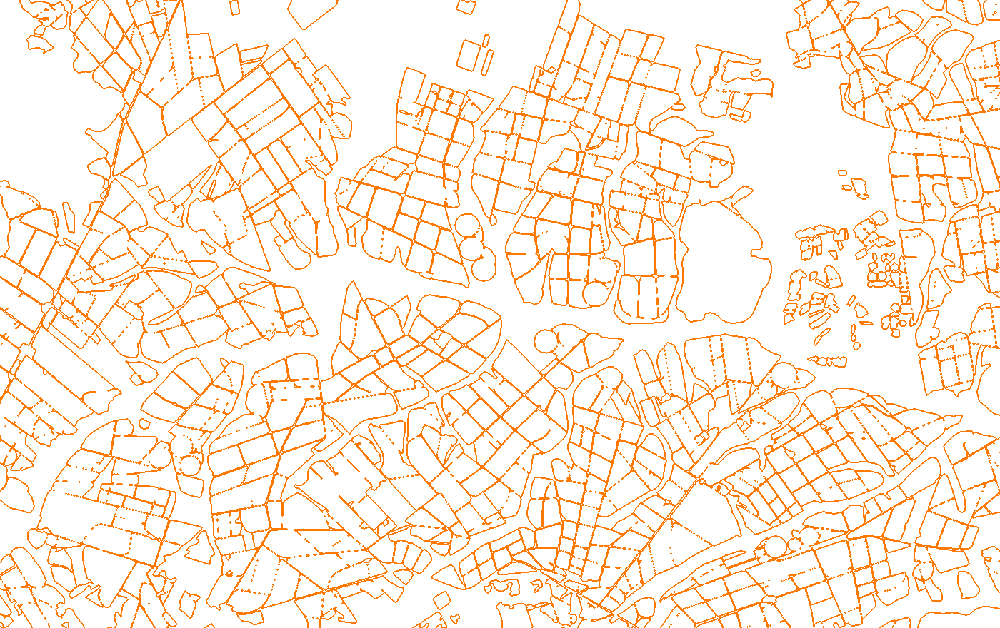

```{=html}
<div class="page-shell">
<div class="page-main">

<div class="research-intro reveal">
  <div class="research-intro-prose">
    <p>The laboratory's research is organized around two complementary axes: <em class="mark">five application areas</em> (Agriculture, Forests, Climate, Cities, and Technical and institutional documents) and <em class="mark">eight methodological research lines</em> addressing challenges such as learning with limited labels, domain adaptation, uncertainty modeling, textual data, and networks of specialist models.</p>
    <p>Members of the group work across these two axes in three complementary ways: some researchers focus exclusively on developing foundational methodology; others develop the method and apply it directly within an application area; and in many cases, a methodological advance created by one researcher is adopted by a colleague and carried into the application areas and partnered projects.</p>
  </div>
<div class="matrix-wrap reveal">
  <div class="matrix" role="table" aria-label="Methodological lines by application area">
    <div class="matrix-corner" role="columnheader"><span>Lines</span><span>Areas</span></div>
    <a class="matrix-col" role="columnheader" data-c="agricultura" href="#agriculture">Agriculture</a>
    <a class="matrix-col" role="columnheader" data-c="floresta" href="#forests">Forests</a>
    <a class="matrix-col" role="columnheader" data-c="clima" href="#climate">Climate</a>
    <a class="matrix-col" role="columnheader" data-c="cidades" href="#cities">Cities</a>
    <a class="matrix-col" role="columnheader" data-c="documentos" href="#documents">Documents</a>
    <div class="matrix-group" role="rowheader">Building blocks</div>
    <a class="matrix-row" role="rowheader" data-r="rotulagem" data-cols="agricultura cidades floresta" href="#lines">Learning with limited labels</a>
    <span class="matrix-cell is-link" role="cell" data-r="rotulagem" data-c="agricultura"></span>
    <span class="matrix-cell is-link" role="cell" data-r="rotulagem" data-c="floresta"></span>
    <span class="matrix-cell" role="cell" data-r="rotulagem" data-c="clima"></span>
    <span class="matrix-cell is-link" role="cell" data-r="rotulagem" data-c="cidades"></span>
    <span class="matrix-cell" role="cell" data-r="rotulagem" data-c="documentos"></span>
    <a class="matrix-row" role="rowheader" data-r="dominio" data-cols="agricultura cidades floresta" href="#lines">Domain adaptation</a>
    <span class="matrix-cell is-link" role="cell" data-r="dominio" data-c="agricultura"></span>
    <span class="matrix-cell is-link" role="cell" data-r="dominio" data-c="floresta"></span>
    <span class="matrix-cell" role="cell" data-r="dominio" data-c="clima"></span>
    <span class="matrix-cell is-link" role="cell" data-r="dominio" data-c="cidades"></span>
    <span class="matrix-cell" role="cell" data-r="dominio" data-c="documentos"></span>
    <a class="matrix-row" role="rowheader" data-r="openset" data-cols="floresta" href="#lines">Open-set and OOD</a>
    <span class="matrix-cell" role="cell" data-r="openset" data-c="agricultura"></span>
    <span class="matrix-cell is-link" role="cell" data-r="openset" data-c="floresta"></span>
    <span class="matrix-cell" role="cell" data-r="openset" data-c="clima"></span>
    <span class="matrix-cell" role="cell" data-r="openset" data-c="cidades"></span>
    <span class="matrix-cell" role="cell" data-r="openset" data-c="documentos"></span>
    <a class="matrix-row" role="rowheader" data-r="incerteza" data-cols="agricultura" href="#lines">Uncertainty modeling</a>
    <span class="matrix-cell is-link" role="cell" data-r="incerteza" data-c="agricultura"></span>
    <span class="matrix-cell" role="cell" data-r="incerteza" data-c="floresta"></span>
    <span class="matrix-cell" role="cell" data-r="incerteza" data-c="clima"></span>
    <span class="matrix-cell" role="cell" data-r="incerteza" data-c="cidades"></span>
    <span class="matrix-cell" role="cell" data-r="incerteza" data-c="documentos"></span>
    <a class="matrix-row" role="rowheader" data-r="textual" data-cols="documentos floresta" href="#lines">Textual data modeling</a>
    <span class="matrix-cell" role="cell" data-r="textual" data-c="agricultura"></span>
    <span class="matrix-cell is-link" role="cell" data-r="textual" data-c="floresta"></span>
    <span class="matrix-cell" role="cell" data-r="textual" data-c="clima"></span>
    <span class="matrix-cell" role="cell" data-r="textual" data-c="cidades"></span>
    <span class="matrix-cell is-link" role="cell" data-r="textual" data-c="documentos"></span>
    <div class="matrix-group" role="rowheader">Substrate</div>
    <a class="matrix-row" role="rowheader" data-r="redes" data-cols="clima" href="#lines">Networks of geolocated specialist models</a>
    <span class="matrix-cell" role="cell" data-r="redes" data-c="agricultura"></span>
    <span class="matrix-cell" role="cell" data-r="redes" data-c="floresta"></span>
    <span class="matrix-cell is-link" role="cell" data-r="redes" data-c="clima"></span>
    <span class="matrix-cell" role="cell" data-r="redes" data-c="cidades"></span>
    <span class="matrix-cell" role="cell" data-r="redes" data-c="documentos"></span>
    <div class="matrix-group" role="rowheader">Coupled systems</div>
    <a class="matrix-row" role="rowheader" data-r="sistemas" data-cols="agricultura clima" href="#lines">Geospatial systems interaction</a>
    <span class="matrix-cell is-link" role="cell" data-r="sistemas" data-c="agricultura"></span>
    <span class="matrix-cell" role="cell" data-r="sistemas" data-c="floresta"></span>
    <span class="matrix-cell is-link" role="cell" data-r="sistemas" data-c="clima"></span>
    <span class="matrix-cell" role="cell" data-r="sistemas" data-c="cidades"></span>
    <span class="matrix-cell" role="cell" data-r="sistemas" data-c="documentos"></span>
    <a class="matrix-row" role="rowheader" data-r="climatica" data-cols="clima" href="#lines">Climate modeling</a>
    <span class="matrix-cell" role="cell" data-r="climatica" data-c="agricultura"></span>
    <span class="matrix-cell" role="cell" data-r="climatica" data-c="floresta"></span>
    <span class="matrix-cell is-link" role="cell" data-r="climatica" data-c="clima"></span>
    <span class="matrix-cell" role="cell" data-r="climatica" data-c="cidades"></span>
    <span class="matrix-cell" role="cell" data-r="climatica" data-c="documentos"></span>
    <div class="matrix-group matrix-group-partners" role="rowheader">Partners</div>
    <div class="matrix-row matrix-row-partners" role="rowheader">Institutions by area</div>
    <div class="matrix-partners" role="cell" data-c="agricultura"><span>FGV Agro</span></div>
    <div class="matrix-partners" role="cell" data-c="floresta"><span>FGVces</span><span>Coiab</span><span>FGV Agro</span></div>
    <div class="matrix-partners" role="cell" data-c="clima"><span>FGV CERI</span><span>FGV Agro</span></div>
    <div class="matrix-partners" role="cell" data-c="cidades"><em>—</em></div>
    <div class="matrix-partners" role="cell" data-c="documentos"><span>FGV PMO</span><span>FGV Projetos</span></div>
  </div>
</div>
<script>
  // Map of connections: highlights the hovered line or area and whatever links to it.
  (function () {
    var m = document.querySelector(".matrix");
    if (!m) return;
    var todos = m.querySelectorAll("[data-r], [data-c]");
    function limpar() {
      m.classList.remove("is-hover");
      for (var i = 0; i < todos.length; i++) todos[i].classList.remove("is-on");
    }
    function marcar(sel) {
      var el = m.querySelectorAll(sel);
      for (var i = 0; i < el.length; i++) el[i].classList.add("is-on");
    }
    m.addEventListener("mouseover", function (e) {
      var row = e.target.closest(".matrix-row[data-r]");
      var col = e.target.closest(".matrix-col[data-c]");
      var cell = e.target.closest(".matrix-cell.is-link");
      if (cell) { row = m.querySelector('.matrix-row[data-r="' + cell.dataset.r + '"]'); }
      if (!row && !col) return;
      limpar();
      m.classList.add("is-hover");
      if (row) {
        marcar('[data-r="' + row.dataset.r + '"]');
        var cols = row.dataset.cols.split(" ");
        for (var i = 0; i < cols.length; i++) if (cols[i]) marcar('.matrix-col[data-c="' + cols[i] + '"], .matrix-partners[data-c="' + cols[i] + '"]');
      } else {
        marcar('[data-c="' + col.dataset.c + '"]');
        var cells = m.querySelectorAll('.matrix-cell.is-link[data-c="' + col.dataset.c + '"]');
        for (var j = 0; j < cells.length; j++) marcar('.matrix-row[data-r="' + cells[j].dataset.r + '"]');
      }
    });
    m.addEventListener("mouseleave", limpar);
  })();
</script>
</div>

<section id="agricultura" class="rsec">
  <span id="agriculture"></span>
  <div class="rsec-head reveal">
    <div class="rsec-num">01</div>
    <div>
      <h2>Agriculture</h2>
    </div>
  </div>

  <p class="rsec-lead reveal">Automated plot boundary delineation, crop classification combining radar and optical imagery, vegetation index time series extraction, start and end of season detection, and neighborhood-relative agricultural risk reading.</p>

  <div class="proj-block cv-story-block" data-cv-story>
  <div class="cv-story">
  <div class="cv-story-stage-col">
    <div class="iviz-card cv-stage is-locked" data-cv-agro-viewer data-lang="en" data-base="data/agro">
      <div class="iviz-top">
        <div>
          <h4 class="iviz-title">Campo Verde (MT): plots, inferred crops and vegetation index series</h4>
        </div>
        <div class="iviz-controls cv-main-controls">
          <button type="button" class="iviz-btn is-active" data-cv-colormode="gaia" aria-pressed="true">GAIA model (SAR + optical)</button>
          <button type="button" class="iviz-btn" data-cv-colormode="ref" aria-pressed="false">Reference (MapBiomas)</button>
          <button type="button" class="iviz-btn" data-cv-colormode="diverg" aria-pressed="false">Mismatches</button>
          <button type="button" class="iviz-btn" data-cv-colormode="indice" aria-pressed="false">Index peak</button>
          <button type="button" class="iviz-btn" data-cv-colormode="outline" aria-pressed="false">Outlines only</button>
        </div>
        <button type="button" class="iviz-btn cv-max-btn" data-cv-max data-label-on="Full screen" data-label-off="Exit full screen" aria-pressed="false">Full screen</button>
      </div>

      <div class="iviz-body">
        <div class="cv-sat-toolbar">
          <div class="cv-sat-group">
            <span class="cv-sat-label">Year:</span>
            <div class="cv-stepper">
              <button type="button" class="cv-step-btn" data-cv-year-prev aria-label="Previous year">‹</button>
              <span class="cv-step-val" data-cv-year-val>2021</span>
              <button type="button" class="cv-step-btn" data-cv-year-next aria-label="Next year">›</button>
            </div>
          </div>
          <div class="cv-sat-group">
            <span class="cv-sat-label">Season:</span>
            <button type="button" class="iviz-btn is-active" data-cv-season="1" aria-pressed="true">1st season</button>
            <button type="button" class="iviz-btn" data-cv-season="2" aria-pressed="false">2nd season</button>
          </div>
          <div class="cv-sat-group">
            <span class="cv-sat-label">Crop:</span>
            <button type="button" class="iviz-btn is-active" data-cv-cropfilter="all" aria-pressed="true">All</button>
            <button type="button" class="iviz-btn" data-cv-cropfilter="0" aria-pressed="false">Soybean</button>
            <button type="button" class="iviz-btn" data-cv-cropfilter="1" aria-pressed="false">Corn</button>
            <button type="button" class="iviz-btn" data-cv-cropfilter="2" aria-pressed="false">Cotton</button>
            <button type="button" class="iviz-btn" data-cv-cropfilter="3" aria-pressed="false">Other</button>
          </div>
          <div class="cv-sat-group">
            <span class="cv-sat-label">Basemap:</span>
            <button type="button" class="iviz-btn is-active" data-cv-basemap="s2" aria-pressed="true">Sentinel-2 of the year (10 m)</button>
            <button type="button" class="iviz-btn" data-cv-basemap="esri" aria-pressed="false">High-resolution imagery</button>
          </div>
          <div class="cv-sat-group">
            <span class="cv-sat-label">Opacity:</span>
            <input type="range" class="cv-opacity-slider" data-cv-opacity min="10" max="95" value="62" aria-label="Opacity of the plot fill">
            <span data-cv-opacity-val style="font-variant-numeric: tabular-nums; font-weight:700;">62%</span>
          </div>
        </div>

        <div class="cv-map-wrap">
          <div class="cv-map" data-cv-map role="region" aria-label="Interactive map of Campo Verde plots with zoom and pan"></div>
          <div class="cv-sat-hud">
            <button type="button" class="cv-hud-btn" data-cv-zoom-out title="Zoom out">−</button>
            <button type="button" class="cv-hud-btn" data-cv-zoom-in title="Zoom in">+</button>
            <button type="button" class="cv-hud-btn" data-cv-zoom-fit>Municipality</button>
          </div>
          <div class="cv-sat-badge" data-cv-sat-badge>Sentinel-2 cloudless 2021</div>
          <div class="cv-map-legend" data-cv-legend>
            <div class="cv-map-legend-row" data-cv-legend-classes>
              <span class="cv-map-legend-item"><i class="cv-map-swatch" style="background:#e4432f"></i>Soybean</span>
              <span class="cv-map-legend-item"><i class="cv-map-swatch" style="background:#f26fa8"></i>Corn</span>
              <span class="cv-map-legend-item"><i class="cv-map-swatch" style="background:#3fbf4f"></i>Cotton</span>
              <span class="cv-map-legend-item"><i class="cv-map-swatch" style="background:#8e5fd0"></i>Other</span>
              <span class="cv-map-legend-item"><i class="cv-map-swatch" style="background:#9fd6ef"></i>Unclassified</span>
              <span class="cv-map-legend-item" data-cv-legend-div hidden><i class="cv-map-swatch" style="border:2px dashed #ff4d42; background:transparent"></i>Model and reference disagree</span>
            </div>
            <div class="cv-map-legend-row" data-cv-legend-outline hidden>
              <span class="cv-map-legend-item"><i class="cv-map-swatch" style="border:2px solid #fff; background:transparent"></i>Outlines of the delineated plots</span>
            </div>
            <div class="cv-map-legend-row" data-cv-legend-index hidden>
              <span class="cv-map-legend-item"><span data-cv-legend-index-name>NDVI</span>: <span data-cv-legend-index-lo>0,2</span> <i class="cv-iv-gradient"></i> <span data-cv-legend-index-hi>0,9</span></span>
            </div>
            <div class="cv-map-legend-row" data-cv-legend-plots hidden></div>
          </div>
        </div>
        <div class="cv-caption" data-cv-caption></div>

        <div class="cv-series-wrap">
          <div class="cv-sat-toolbar cv-series-controls">
            <div class="cv-sat-group">
              <span class="cv-sat-label">Compare:</span>
              <button type="button" class="iviz-btn is-active" data-cv-compare="indices" aria-pressed="true">Indices of one plot</button>
              <button type="button" class="iviz-btn" data-cv-compare="plots" aria-pressed="false">One index across plots</button>
            </div>
            <div class="cv-sat-group">
              <span class="cv-sat-label">Plots:</span>
              <span class="cv-plot-chips" data-cv-plot-chips></span>
              <button type="button" class="iviz-btn" data-iv-random>Another plot</button>
            </div>
            <div class="cv-sat-group">
              <span class="cv-sat-label">Show:</span>
              <button type="button" class="iviz-btn is-active" data-iv-toggle="band" aria-pressed="true">Municipal P25 to P75 band</button>
              <button type="button" class="iviz-btn is-active" data-iv-toggle="median" aria-pressed="true">Municipal median</button>
              <button type="button" class="iviz-btn" data-iv-toggle="markers" aria-pressed="false">SOS, POS and EOS markers</button>
            </div>
          </div>
          <div class="iviz-controls cv-series-controls cv-index-chips" data-iv-index-group role="group" aria-label="Vegetation indices">
            <button type="button" class="iviz-btn" data-iv-index="ARVI" aria-pressed="false" title="ARVI">ARVI</button>
            <button type="button" class="iviz-btn" data-iv-index="CIRE" aria-pressed="false" title="CIRE (chlorophyll, red edge)">CIRE</button>
            <button type="button" class="iviz-btn" data-iv-index="CVI" aria-pressed="false" title="CVI (chlorophyll)">CVI</button>
            <button type="button" class="iviz-btn" data-iv-index="EVI" aria-pressed="false" title="EVI (biomass)">EVI</button>
            <button type="button" class="iviz-btn" data-iv-index="EVI2" aria-pressed="false" title="EVI2">EVI2</button>
            <button type="button" class="iviz-btn" data-iv-index="GNDVI" aria-pressed="false" title="GNDVI (green)">GNDVI</button>
            <button type="button" class="iviz-btn" data-iv-index="GARI" aria-pressed="false" title="GARI">GARI</button>
            <button type="button" class="iviz-btn" data-iv-index="GCVI" aria-pressed="false" title="GCVI (chlorophyll)">GCVI</button>
            <button type="button" class="iviz-btn" data-iv-index="GRVI" aria-pressed="false" title="GRVI">GRVI</button>
            <button type="button" class="iviz-btn" data-iv-index="MSAVI" aria-pressed="false" title="MSAVI (soil adjusted)">MSAVI</button>
            <button type="button" class="iviz-btn" data-iv-index="NBR" aria-pressed="false" title="NBR (burn)">NBR</button>
            <button type="button" class="iviz-btn" data-iv-index="NDRE" aria-pressed="false" title="NDRE (red edge)">NDRE</button>
            <button type="button" class="iviz-btn is-active" data-iv-index="NDVI" aria-pressed="true" title="NDVI (vigour)">NDVI</button>
            <button type="button" class="iviz-btn" data-iv-index="NDWI" aria-pressed="false" title="NDWI (canopy water)">NDWI</button>
            <button type="button" class="iviz-btn" data-iv-index="RBNDVI" aria-pressed="false" title="RBNDVI">RBNDVI</button>
            <button type="button" class="iviz-btn" data-iv-index="SAVI" aria-pressed="false" title="SAVI (soil adjusted)">SAVI</button>
            <button type="button" class="iviz-btn" data-iv-index="VARIgreen" aria-pressed="false" title="VARI (visible)">VARIgreen</button>
          </div>
          <div class="cv-iv-svg-wrap">
            <div data-iv-panels></div>
            <div class="cv-iv-empty" data-iv-empty hidden></div>
          </div>
        </div>

        <div class="iviz-below">
          <div class="parcel-inspector">
            <div class="parcel-inspector-head">
              <span class="parcel-inspector-title" data-parcel-title>Plot</span>
              <span class="parcel-inspector-meta" data-parcel-meta></span>
            </div>
            <div class="parcel-compare-row cv-insp-classes" data-cv-insp-classes>
              <div class="parcel-compare-cell"><span>1st season, GAIA model</span><strong data-parcel-s1></strong></div>
              <div class="parcel-compare-cell"><span>1st season, MapBiomas</span><strong data-parcel-mb1></strong></div>
              <div class="parcel-compare-cell"><span>2nd season, GAIA model</span><strong data-parcel-s2></strong></div>
              <div class="parcel-compare-cell"><span>2nd season, MapBiomas</span><strong data-parcel-mb2></strong></div>
              <div class="parcel-compare-cell"><span data-parcel-peak-label>Index peak in the year</span><strong data-parcel-peak></strong></div>
              <div class="parcel-compare-cell"><span>Peak date</span><strong data-parcel-peakdate></strong></div>
            </div>
            <div class="cv-insp-reading">
              <span class="parcel-inspector-title" style="font-size:0.84rem;">Reading for the date</span>
              <span class="parcel-inspector-meta" data-iv-insp-date></span>
            </div>
            <div data-iv-insp-rows></div>
            <div class="nota" style="margin-top:0;" data-iv-insp-status></div>
          </div>
        </div>
      </div>
    </div>
  </div>
  <div class="cv-story-steps">
  <section class="cv-story-step reveal" data-scene="delim">
    <div class="proj-header"><h3>Stage 1: Automatic plot delineation</h3></div>
    <div class="proj-prose">
      <p>The agriculture area is explored in the <em class="mark">Territorial AgroIntelligence</em> project, in partnership with <em class="mark">FGV Agro</em>, in which the laboratory builds territorial intelligence over large agricultural portfolios to answer what is planted, where it is and what behaves outside the pattern. Everything starts with drawing the units of analysis: the plots.</p>
      <p>The starting point is optical imagery. For each municipality of interest, the pipeline gathers the season's <em class="mark">Sentinel-2</em> scenes (10 m), <span class="story-blank">[how scenes are selected and combined: period, cloud criterion]</span>, and a segmentation model traces the outlines of the subareas that behave as one management unit: same crop, same calendar and same spectral response. The result is one polygon per plot, with area, municipality and an identifier that allows following it from one season to the next.</p>
      <p>The in-house dataset adds up to <em class="mark">359,596 plots</em> across <em class="mark">897 municipalities in five states</em> (Bahia, Maranhão, Mato Grosso, Paraná and Tocantins), regenerated every season from 2020 to 2025. The outlines were validated <span class="story-blank">[how: against hand-drawn plots, field data, metric used]</span>, with <span class="story-blank">[validation result]</span>. Processing a whole municipality takes <span class="story-blank">[time and infrastructure]</span>.</p>
    </div>
    <div data-cv-caption-text hidden>Outlines of the 2,132 Campo Verde (MT) plots in the 2021 season (223.5 thousand ha), over the cloudless Sentinel-2 mosaic of the same year. Hover a plot to see its area.</div>
  </section>
  <section class="cv-story-step reveal" data-scene="classe">
    <div class="proj-header"><h3>Stage 2: Crop classification with radar and optical imagery</h3></div>
    <div class="proj-prose">
      <p>On each polygon, a classifier assigns the crop planted in each of the two seasons of the agricultural year: soybean, corn, cotton or other uses. The main input is Sentinel-1 <em class="mark">synthetic aperture radar (SAR)</em>, which penetrates clouds and guarantees regular observation during the rainy months, combined with the Sentinel-2 optical response whenever the sky is clear. <span class="story-blank">[revisit period, polarisations or bands used and the time window of each season]</span>.</p>
      <p>The model was trained with <span class="story-blank">[source and size of the reference data]</span> and runs municipality by municipality, which allows regenerating the classification every season without new field work. In Campo Verde (MT), the 2021 season has 2,132 plots classified in the first season and 2,130 in both; the most common combination is soybean followed by corn (836 plots), then soybean followed by cotton (439).</p>
    </div>
    <div data-cv-caption-text hidden>Crop inferred by the model in the first season of 2021: red soybean, pink corn, green cotton, purple other uses and light blue unclassified. Click a plot to see both seasons.</div>
  </section>
  <section class="cv-story-step reveal" data-scene="diverg">
    <div class="proj-header"><h3>Stage 3: Comparison with the public reference</h3></div>
    <div class="proj-prose">
      <p>Validated against INPE field data in Campo Verde (MT), the classifier <em class="mark">outperforms the public reference (MapBiomas) on second-season crops</em>, whose calendar coincides with persistent cloud cover, and ties on soybean. The bars show the accuracy per crop.</p>
    <div class="acc-bench">
      <div class="acc-bench-title">Accuracy validated against INPE field data (Campo Verde, MT)</div>
      <div class="acc-crop-group">
        <div class="acc-crop-head"><span>Cotton</span><span>+25.6 p.p. over the reference</span></div>
        <div class="acc-dual-bars">
          <div class="acc-bar-row"><span>GAIA Lab</span><div class="acc-bar-track"><div class="acc-bar-fill gaia" style="width:90.0%"></div></div><span class="acc-bar-pct">90.0%</span></div>
          <div class="acc-bar-row"><span>Public ref.</span><div class="acc-bar-track"><div class="acc-bar-fill ref" style="width:64.4%"></div></div><span class="acc-bar-pct">64.4%</span></div>
        </div>
      </div>
      <div class="acc-crop-group">
        <div class="acc-crop-head"><span>Corn</span><span>+9.1 p.p. over the reference</span></div>
        <div class="acc-dual-bars">
          <div class="acc-bar-row"><span>GAIA Lab</span><div class="acc-bar-track"><div class="acc-bar-fill gaia" style="width:91.5%"></div></div><span class="acc-bar-pct">91.5%</span></div>
          <div class="acc-bar-row"><span>Public ref.</span><div class="acc-bar-track"><div class="acc-bar-fill ref" style="width:82.4%"></div></div><span class="acc-bar-pct">82.4%</span></div>
        </div>
      </div>
      <div class="acc-crop-group">
        <div class="acc-crop-head"><span>Soybean</span><span>98.7% vs. 99.3%</span></div>
        <div class="acc-dual-bars">
          <div class="acc-bar-row"><span>GAIA Lab</span><div class="acc-bar-track"><div class="acc-bar-fill gaia" style="width:98.7%"></div></div><span class="acc-bar-pct">98.7%</span></div>
          <div class="acc-bar-row"><span>Public ref.</span><div class="acc-bar-track"><div class="acc-bar-fill ref" style="width:99.3%"></div></div><span class="acc-bar-pct">99.3%</span></div>
        </div>
      </div>
    </div>
      <p>On the map, plots where the model and the reference disagree in the second season get a dashed red outline and are filled with the model's class. Mismatches concentrate in <span class="story-blank">[where and why: corn and cotton, small plots, edges, calendar]</span>.</p>
    </div>
    <div data-cv-caption-text hidden>Mismatches between the model and MapBiomas in the second season of 2021. The fill shows the model's class; concordant plots are left uncoloured.</div>
  </section>
  <section class="cv-story-step reveal" data-scene="series">
    <div class="proj-header"><h3>Stage 4: Vegetation index time series</h3></div>
    <div class="proj-prose">
      <p>With the polygons delineated, the pipeline reconstructs the spectral evolution of each plot across seasons. <em class="mark">Sentinel-2</em> reflectances are extracted over each polygon from the <em class="mark">Brazil Data Cube (BDC)</em>, in 16-day composites, and converted into <em class="mark">17 complementary vegetation indices</em> (among them NDVI, EVI, EVI2, NDWI, NDRE, SAVI, MSAVI and GNDVI), covering photosynthetic vigour, canopy water content and the red edge. The consolidated dataset holds <em class="mark">499.7 thousand per-plot series</em> and <em class="mark">11.5 million records</em>.</p>
      <p>Even in regular composites, the persistent summer cloudiness leaves observations contaminated by residual clouds that artificially depress the indices. So that atmospheric noise is not read as crop loss, the system discards passes with insufficient clear coverage (<em class="mark">5.55%</em> of the observations) and applies penalised temporal smoothing to reconstruct the continuous vigour curve. Each curve is read against the band between the municipality's 25th and 75th percentiles on the same date, which tells whether the plot tracks, exceeds or falls below the central half of its neighbours.</p>
    </div>
    <div data-cv-caption-text hidden>2021 NDVI series of the plot highlighted on the map (dark line), P25 to P75 band (green area) and median (dashed) of the {n} Campo Verde plots with a series. Hover the points to read the dates.</div>
  </section>
  <section class="cv-story-step reveal" data-scene="fenol">
    <div class="proj-header"><h3>Stage 5: Start and end of season and the ZARC window</h3></div>
    <div class="proj-prose">
      <p>On each plot's continuous curve, the detector identifies the phenological milestones of each cycle: the <em class="mark">start of season (SOS)</em> at post-planting emergence, the <em class="mark">peak of season (POS)</em> at maximum canopy closure and the <em class="mark">end of season (EOS)</em> at senescence and harvest, separating the first and second crops of the agricultural year. <span class="story-blank">[detector criterion in one sentence, without the recipe]</span>.</p>
      <p>Cross-referencing the start-of-season dates with the official planting window of <em class="mark">ZARC (Agricultural Climate Risk Zoning)</em> enables municipal-scale auditing of calendar compliance: in Campo Verde (MT), <em class="mark">65.5% of soybean plots</em> start the season within the official window (between <em class="mark">72.7% and 84.5%</em> in other evaluated municipalities), whereas second-season crops (cotton at 7.6% and second-crop corn at 3.3%) reflect their direct dependence on when the first crop is harvested.</p>
    </div>
    <div class="acc-bench" style="gap: 0.55rem;">
      <div class="acc-bench-title">Planting (SOS) within the official ZARC window</div>
      <div class="acc-crop-group">
        <div class="acc-crop-head" style="font-size:0.78rem;"><span>Soybean (Campo Verde, MT)</span><span>65.5% (up to 84.5% in other mun.)</span></div>
        <div class="acc-bar-track"><div class="acc-bar-fill gaia" style="width:65.5%"></div></div>
      </div>
      <div class="acc-crop-group">
        <div class="acc-crop-head" style="font-size:0.78rem;"><span>Cotton</span><span>7.6%</span></div>
        <div class="acc-bar-track"><div class="acc-bar-fill ref" style="width:7.6%"></div></div>
      </div>
      <div class="acc-crop-group">
        <div class="acc-crop-head" style="font-size:0.78rem;"><span>Second-crop corn</span><span>3.3%</span></div>
        <div class="acc-bar-track"><div class="acc-bar-fill ref" style="width:3.3%"></div></div>
      </div>
    </div>
    <div data-cv-caption-text hidden>Markers of each cycle on the same series, computed by the project's detector from NDVI: SOS in blue, POS in green and EOS in amber.</div>
  </section>
  <section class="cv-story-step reveal" data-scene="viz">
    <div class="proj-header"><h3>Stage 6: Reading a plot against its neighbourhood</h3></div>
    <div class="proj-prose">
      <p>To turn phenological tracking into portfolio risk diagnosis, the product combines the spectral and climatic indicators of each plot-season and groups plots into <em class="mark">behavioural profiles</em> by spectral and climatic similarity. Every plot is read <em class="mark">in relation to its neighbourhood</em>, which separates two phenomena that are often conflated:</p>
      <ul>
        <li><em class="mark">Operational risk:</em> management, pests or producer-specific conditions. One plot does poorly while its neighbours do well.</li>
        <li><em class="mark">Systemic risk:</em> regional drought, frost or dry spell. The whole neighbourhood loses vigour at the same time. Comparing with the surroundings tells whose problem it is, without on-site inspection of every area.</li>
      </ul>
      <p>The stage compares two Campo Verde plots in the second season of 2021: one that tracks the municipal band and one that drops below the 25th percentile while the band stays high. Since the neighbourhood does not follow the drop, the deviation is local. <span class="story-blank">[what explains the case, if verified: inspection, producer, high-resolution imagery]</span>.</p>
    </div>
    <div data-cv-caption-text hidden>2021 NDVI of two plots on the same axis, with the municipal P25 to P75 band behind them. Plot {a} follows the band; plot {b} falls below it during the second season.</div>
  </section>
  </div>
  </div>
  <section class="cv-story-step cv-story-free reveal" data-scene="explore">
    <div class="proj-header"><h3>Explore the data</h3></div>
    <div class="proj-prose">
      <p>The panel below unlocks every control over the same data: the six seasons from 2020 to 2025, the two seasons of each year, the model's or the reference's class, the mismatches, each index's peak on the map and the Sentinel-2 basemap of the year or high-resolution imagery. The series can be compared in two ways: up to three indices of the same plot, in stacked panels, or the same index across up to three plots, on one axis. Click plots on the map to select them.</p>
      <p>Index series available for the 2020 to 2025 seasons. <span class="story-blank">[note on coverage and limits of the subset]</span>.</p>
    </div>
    <div data-cv-caption-text hidden></div>
  </section>
  <div class="cv-story-slot" data-cv-stage-slot></div>
  </div>

</section>

<section id="floresta" class="rsec">
  <span id="forests"></span>
  <div class="rsec-head reveal">
    <div class="rsec-num">02</div>
    <div>
      <h2>Forests</h2>
    </div>
  </div>

  <p class="rsec-lead reveal">Quarterly forest canopy monitoring with spatiotemporal context, property-level environmental liability quantification across the CAR registry, semantic uncertainty layers, and automated territorial report generation.</p>

  <div class="proj-block reveal">
    <div class="proj-header">
      <h3>Stage 1: Quarterly forest canopy monitoring and intra-annual suppression</h3>
    </div>
    <div class="proj-prose">
      <p>The forest area is explored in the <em class="mark">Territorial AgroIntelligence</em> project in partnership with <em class="mark">FGV Agro</em>, aimed at identifying environmental liabilities across large rural portfolios through intra-annual monitoring of forest cover and legally protected areas. Rather than relying solely on annual maps or isolated images subject to seasonal variations, the product operates quarter by quarter by combining consecutive <em class="mark">Sentinel-2</em> optical observations (10-meter resolution) with multi-sensor annual representations that integrate radar, topography, and climate.</p>
      <p>Evaluated across 20 test quarters in an independent spatial region in Campo Verde (MT), the model achieves <em class="mark">0.850 mean IoU</em> (88.0% precision and <em class="mark">96.3% recall</em> in mapping forest canopy), reducing false positives in pasture areas by <em class="mark">31.6%</em> and in cropland by <em class="mark">20.9%</em>. The operational series produced by the laboratory spans <em class="mark">26 continuous quarterly maps (2020 Q1 to 2026 Q2)</em>.</p>
    </div>

    <div class="metrics reveal">
      <div>
        <div class="m-val" data-count="0.850" data-decimals="3">0.850</div>
        <div class="m-lab">mean IoU across 20 test quarters</div>
      </div>
      <div>
        <div class="m-val" data-count="96.3" data-decimals="1" data-suffix="%">96.3%</div>
        <div class="m-lab">forest canopy recall</div>
      </div>
      <div>
        <div class="m-val" data-count="31.6" data-decimals="1" data-prefix="-" data-suffix="%">-31.6%</div>
        <div class="m-lab">false positives in pasture</div>
      </div>
      <div>
        <div class="m-val" data-count="26">26</div>
        <div class="m-lab">mapped quarters (2020 Q1 to 2026 Q2)</div>
      </div>
    </div>

    <div class="iviz-card reveal" data-tab-group>
      <div class="iviz-top">
        <div>
          <h4 class="iviz-title">Forest cover in Campo Verde (MT), 26 quarters from 2020 to 2026</h4>
        </div>
        <div class="iviz-controls" role="tablist">
          <button type="button" class="iviz-btn is-active" data-tab-target="floresta-compare" role="tab" aria-selected="true">2020 Q1 vs. 2026 Q2 comparison</button>
          <button type="button" class="iviz-btn" data-tab-target="floresta-scrub" role="tab" aria-selected="false">26-quarter time series</button>
        </div>
      </div>

      <div class="iviz-body">
        <div data-tab-pane="floresta-compare" class="is-active">
          <div class="compare" style="margin-top:0;">
            
            
            <div class="compare-handle"></div>
            <span class="compare-label left">2020 Q1</span>
            <span class="compare-label right">2026 Q2</span>
            <input class="compare-range" type="range" min="0" max="100" value="50" aria-label="Compare forest cover between 2020 Q1 and 2026 Q2">
          </div>
          <p class="compare-caption" style="margin-bottom:0;">Drag the central divider: green areas show native forest canopy estimated by the model on Sentinel-2 imagery; dark patches advancing between 2020 Q1 and 2026 Q2 indicate vegetation suppression.</p>
        </div>
        <div data-tab-pane="floresta-scrub" hidden>
          <div class="scrub" style="margin-top:0;" data-scrub
               data-base="images/floresta/trim-"
               data-ext=".webp"
               data-play-label="Play series"
               data-pause-label="Pause series"
               data-quarters="2020q1,2020q2,2020q3,2020q4,2021q1,2021q2,2021q3,2021q4,2022q1,2022q2,2022q3,2022q4,2023q1,2023q2,2023q3,2023q4,2024q1,2024q2,2024q3,2024q4,2025q1,2025q2,2025q3,2025q4,2026q1,2026q2">
            <div class="scrub-stage">
              
              <span class="scrub-badge">2026 Q2</span>
            </div>
            <div class="scrub-controls">
              <button class="scrub-play" type="button" aria-label="Play series">▶</button>
              <input class="scrub-range" type="range" min="0" max="25" value="25" aria-label="Select quarter between 2020 Q1 and 2026 Q2">
              <span class="scrub-label">2026 Q2</span>
            </div>
          </div>
        </div>
      </div>
    </div>
  </div>

  <div class="proj-block reveal">
    <div class="proj-header">
      <h3>Stage 2: Property-level environmental liability (CAR) and semantic uncertainty layer</h3>
    </div>
    <div class="proj-prose">
      <p>In the second stage, the quarterly forest cover maps are intersected with rural property boundaries declared in the <em class="mark">Rural Environmental Registry (CAR)</em> to analyze environmental liabilities (recent suppression and legally protected areas lacking native cover) with the <em class="mark">rural property as the unit of analysis</em>. Evaluated across <em class="mark">1,432 rural properties</em> in Campo Verde, the product achieves <em class="mark">0.797 IoU</em> within registered property boundaries.</p>
      <p>To support portfolio auditing without triggering false deforestation alerts during the Cerrado dry season, the system quantifies pixel-level predictive uncertainty and organizes the landscape into six operational classes: it separates <em>consolidated forest</em>, <em>transition and edge zones</em>, <em>suppression alerts</em>, <em>seasonal water stress</em> (when deciduous forest loses foliage during drought without clearing), <em>stable non-forest</em>, and <em>probable non-forest</em>, enabling analysts to prioritize verification and cross-check alerts against official databases such as DETER and PRODES.</p>
    </div>

    <div class="iviz-card reveal" data-cv-forest-viewer>
      <div class="iviz-top">
        <div>
          <h4 class="iviz-title">Forest canopy, CAR boundaries and per-property uncertainty in Campo Verde (MT)</h4>
        </div>
        <div class="iviz-controls">
          <button type="button" class="iviz-btn is-active" data-cv-f-clip="completo" aria-pressed="true">Full-scene prediction</button>
          <button type="button" class="iviz-btn" data-cv-f-clip="car" aria-pressed="false">Clipped to CAR properties (1,432 properties)</button>
        </div>
      </div>
      <div class="iviz-body">
        <div class="cv-sat-toolbar">
          <div class="cv-sat-group">
            <span class="cv-sat-label">Quarter:</span>
            <button type="button" class="iviz-btn is-active" data-cv-f-quarter="2023q3" data-badge="Sentinel-2 RGB · 2023 Q3 (Dry season)" aria-pressed="true">2023 Q3 (Dry)</button>
            <button type="button" class="iviz-btn" data-cv-f-quarter="2020q1" data-badge="Sentinel-2 RGB · 2020 Q1 (Series start)" aria-pressed="false">2020 Q1</button>
            <button type="button" class="iviz-btn" data-cv-f-quarter="2026q2" data-badge="Sentinel-2 RGB · 2026 Q2 (Series end)" aria-pressed="false">2026 Q2</button>
          </div>
          <div class="cv-sat-group">
            <span class="cv-sat-label">Overlay layers:</span>
            <button type="button" class="iviz-btn is-active" data-cv-f-toggle="pred" aria-pressed="true">Forest canopy (10 m)</button>
            <button type="button" class="iviz-btn" data-cv-f-toggle="incerteza" aria-pressed="false">Uncertainty &amp; alert classes</button>
            <button type="button" class="iviz-btn" data-cv-f-toggle="talhoes" aria-pressed="false">Agricultural plots</button>
            <button type="button" class="iviz-btn" data-cv-f-toggle="rotulo" aria-pressed="false">MapBiomas reference</button>
          </div>
          <div class="cv-sat-group">
            <span class="cv-sat-label">Opacity:</span>
            <input type="range" class="cv-opacity-slider" data-cv-f-opacity min="10" max="100" value="78" aria-label="Forest layer opacity">
            <span data-cv-f-opacity-val style="font-variant-numeric: tabular-nums; font-weight:700;">78%</span>
          </div>
        </div>

        <div class="cv-sat-viewport" style="height:430px;" role="region" aria-label="Interactive satellite viewer for forest canopy, CAR, and uncertainty in Campo Verde">
          <div class="cv-sat-stage">
            
            
            
            
            
          </div>
          <div class="cv-sat-hud">
            <button type="button" class="cv-hud-btn" data-cv-zoom-out title="Zoom out">−</button>
            <span data-cv-zoom-val style="min-width:2.7rem; text-align:center; font-variant-numeric:tabular-nums;">100%</span>
            <button type="button" class="cv-hud-btn" data-cv-zoom-in title="Zoom in">+</button>
            <button type="button" class="cv-hud-btn" data-cv-zoom-fit title="Fit to view">Fit</button>
          </div>
          <div class="cv-sat-badge" data-cv-sat-badge>Sentinel-2 RGB · 2023 Q3 (Dry season)</div>
        </div>

        <div class="parcel-legend" style="margin-top:0.6rem;">
          <span class="parcel-legend-item"><i class="parcel-swatch" style="background:#1b5e20"></i> Consolidated forest / predicted canopy</span>
          <span class="parcel-legend-item"><i class="parcel-swatch" style="background:#66bb6a"></i> Edge and transition zone</span>
          <span class="parcel-legend-item"><i class="parcel-swatch" style="background:#fdd835"></i> Dry-season water stress</span>
          <span class="parcel-legend-item"><i class="parcel-swatch" style="background:#e53935"></i> Suppression alert</span>
        </div>
      </div>
    </div>
  </div>

  <div class="proj-block reveal">
    <div class="proj-header">
      <h3>Stage 3: Automated territorial report generation and narrative autonomy</h3>
    </div>
    <div class="proj-prose">
      <p>The forest area is also explored in our project with <em class="mark">FGVces</em> (Center for Sustainability Studies at FGV) and <em class="mark">Coiab</em> (Coordination of Indigenous Organizations of the Brazilian Amazon), in which we built a <em class="mark">tool for automated generation and editing of territorial reports</em> from two inputs: official public datasets and explicit narrative structures. The system tracks the status and risks of deforestation, fire, mining, and climate change across the scales of Brazil, states, and Indigenous Lands, producing outputs as PDF reports, media clippings, or observatory pages. It is the only project in the laboratory where a technical counterpart from the partner organization works directly alongside our researchers on geospatial platform integration.</p>
      <p><em class="mark">Narrative depends on the audience:</em> the same public data, the same territory, and the same facts require different story structures depending on the reader. A press release must be direct and synthetic; a technical report must expose methodology and uncertainty margins; a formal submission to the Public Prosecutor's Office (Ministério Público) must back every paragraph with traceable evidence linked to the primary source.</p>
      <p><em class="mark">What gives the product meaning is control over who writes the story:</em> reports on Indigenous territories have historically been written by third parties. A tool that organizes public data into an explicit, editable narrative structure <em class="mark">transfers authorship</em>: Coiab operates the editing tool, decides the narrative, and signs the document about its own territory, supported by training and technology transfer carried out by the project.</p>
    </div>

    <div class="iviz-card reveal" data-tab-group>
      <div class="iviz-top">
        <div>
          <h4 class="iviz-title">One set of indicators, three report structures (FGVces and Coiab)</h4>
        </div>
        <div class="iviz-controls" role="tablist">
          <button type="button" class="iviz-btn is-active" data-tab-target="aud-midia" role="tab" aria-selected="true">For press and clipping</button>
          <button type="button" class="iviz-btn" data-tab-target="aud-tecnico" role="tab" aria-selected="false">For technical staff</button>
          <button type="button" class="iviz-btn" data-tab-target="aud-mp" role="tab" aria-selected="false">For Public Prosecutors</button>
        </div>
      </div>

      <div class="iviz-body">
        <div class="iviz-stack">
          <div class="iviz-stage">
            <div style="font-size: 0.76rem; font-weight: 700; text-transform: uppercase; letter-spacing: 0.06em; color: var(--gaia-muted); margin-bottom: 0.55rem;">Monitored axes from official public databases</div>
            <div class="trend-grid" style="margin-top:0;">
              <div class="trend-card">
                <div class="trend-name">Deforestation</div>
                <div class="trend-value" style="font-size:1.25rem;">DETER / PRODES</div>
                <div class="trend-note">cutout by Indigenous Land, state, and Legal Amazon</div>
              </div>
              <div class="trend-card">
                <div class="trend-name">Fire</div>
                <div class="trend-value" style="font-size:1.25rem;">Hotspots &amp; scars</div>
                <div class="trend-note">tracking active fires and surrounding pressure</div>
              </div>
              <div class="trend-card">
                <div class="trend-name">Mining</div>
                <div class="trend-value" style="font-size:1.25rem;">Illegal mining &amp; claims</div>
                <div class="trend-note">cross-referencing alerts and official public records</div>
              </div>
              <div class="trend-card">
                <div class="trend-name">Climate change</div>
                <div class="trend-value" style="font-size:1.25rem;">Drought &amp; temperature</div>
                <div class="trend-note">climatic anomalies across the territory</div>
              </div>
            </div>
          </div>
          <div class="iviz-below">
            <div data-tab-pane="aud-midia" class="coiab-report-pane is-active">
              <div class="coiab-doc-kicker">Structure 1 · Press and public communication</div>
              <h5 class="coiab-doc-title">Executive synthesis with key takeaways and immediate territorial context</h5>
              <p class="coiab-doc-body">Prioritizes rapid reading of the period's facts: highlights recent variations in deforestation and fire within the selected Indigenous Land or state, contextualizes territorial pressure in accessible language, and prepares visual cutouts ready for press bulletins and observatory pages.</p>
              <div class="coiab-doc-meta">
                <span>Output: Clipping and outreach bulletin</span>
                <span>Authorship and final editing: Coiab</span>
              </div>
            </div>

            <div data-tab-pane="aud-tecnico" class="coiab-report-pane" hidden>
              <div class="coiab-doc-kicker">Structure 2 · Technical staff and territorial management</div>
              <h5 class="coiab-doc-title">Detailed historical time series, methodology, and cross-threat analysis</h5>
              <p class="coiab-doc-body">Presents the full evolution of deforestation, fire, mining, and climate time series, detailing the consulted public databases, spatial aggregation criteria (Brazil, state, or Indigenous Land), and methodological notes required for technical monitoring.</p>
              <div class="coiab-doc-meta">
                <span>Output: Analytical PDF report and observatory</span>
                <span>Authorship and final editing: Coiab</span>
              </div>
            </div>

            <div data-tab-pane="aud-mp" class="coiab-report-pane" hidden>
              <div class="coiab-doc-kicker">Structure 3 · Oversight bodies and Public Prosecutor's Office</div>
              <h5 class="coiab-doc-title">Formal statement with traceable links to each official public record</h5>
              <p class="coiab-doc-body">Organizes documented territorial facts with direct, verifiable references to the official public source of each data point (deforestation alerts, fire records, and mining indicators), ensuring every statement in the document is auditable at its origin.</p>
              <div class="coiab-doc-meta">
                <span>Output: Evidentiary dossier with cited primary sources</span>
                <span>Authorship and final editing: Coiab</span>
              </div>
            </div>
          </div>
        </div>
      </div>
    </div>
  </div>

</section>

<section id="clima" class="rsec">
  <span id="climate"></span>
  <div class="rsec-head reveal">
    <div class="rsec-num">03</div>
    <div>
      <h2>Climate</h2>
    </div>
  </div>

  <p class="rsec-lead reveal">Extreme events, climate regimes, and physical climate risk, from reanalysis data and global model projections to applied indicators across infrastructure and agriculture.</p>

  <div class="proj-block reveal">
    <div class="proj-header">
      <h3>Exposure of electric power infrastructure to extreme climate threats</h3>
    </div>
    <div class="proj-prose">
      <p>The climate area is explored in a project developed in partnership with <em class="mark">FGV CERI</em> (Center for Regulation and Infrastructure Studies at FGV), focused on modeling the exposure of electric power infrastructure to <em class="mark">extreme climate threats</em>.</p>
      <p>The full project covers <em class="mark">seven threats</em>, each with its own methodology: storms and lightning, wildfires, river flooding, landslides, maximum temperatures, extreme winds, and sea-level rise. Projections combine an ensemble of <em class="mark">six global climate models</em> across <em class="mark">three emission scenarios</em> with national and international observational datasets.</p>
      <p><em class="mark">The laboratory's contribution focuses on modeling five of those threats</em> (extreme winds, storms, heavy rainfall, wildfires, and maximum temperatures) and building the <em class="mark">interactive dashboard of maps and indicators</em>.</p>
    </div>

    <div class="iviz-card reveal" data-ceri-explorer>
      <div class="iviz-top">
        <div>
          <h4 class="iviz-title">Five climate threats in three emission scenarios, by grid segment (FGV CERI)</h4>
        </div>
        <div class="iviz-controls">
          <button type="button" class="iviz-btn" data-ceri-scen="hist" aria-pressed="false">Observational baseline</button>
          <button type="button" class="iviz-btn is-active" data-ceri-scen="ssp245" aria-pressed="true">Intermediate scenario</button>
          <button type="button" class="iviz-btn" data-ceri-scen="ssp585" aria-pressed="false">High-emission scenario</button>
        </div>
      </div>

      <div class="iviz-body">
        <div class="iviz-controls" style="margin-bottom: 1.1rem;">
          <button type="button" class="iviz-btn is-active" data-ceri-threat="ventos" aria-pressed="true"
            data-title="1. Extreme winds"
            data-indicator="Modeled by Green AI Lab · Ensemble of 6 global models across 3 scenarios"
            data-method="Modeling the exposure of electric power assets to extreme wind events, combining projections from six global climate models across three emission scenarios with national and international observational bases in the interactive dashboard.">
            1. Extreme winds
          </button>
          <button type="button" class="iviz-btn" data-ceri-threat="tempestades" aria-pressed="false"
            data-title="2. Storms and lightning"
            data-indicator="Modeled by Green AI Lab · Ensemble of 6 global models across 3 scenarios"
            data-method="Modeling exposure to storms and atmospheric discharges across the power grid, integrating national and international observational datasets with projections from six global climate models.">
            2. Storms
          </button>
          <button type="button" class="iviz-btn" data-ceri-threat="chuva" aria-pressed="false"
            data-title="3. Heavy rainfall"
            data-indicator="Modeled by Green AI Lab · Ensemble of 6 global models across 3 scenarios"
            data-method="Modeling heavy rainfall events to evaluate physical exposure of electric power infrastructure under three emission scenarios and six global climate models.">
            3. Heavy rainfall
          </button>
          <button type="button" class="iviz-btn" data-ceri-threat="incendios" aria-pressed="false"
            data-title="4. Wildfires"
            data-indicator="Modeled by Green AI Lab · Ensemble of 6 global models across 3 scenarios"
            data-method="Modeling wildfire risk surrounding electric power infrastructure, delivered through interactive maps and indicators in the project dashboard.">
            4. Wildfires
          </button>
          <button type="button" class="iviz-btn" data-ceri-threat="temperatura" aria-pressed="false"
            data-title="5. Maximum temperatures"
            data-indicator="Modeled by Green AI Lab · Ensemble of 6 global models across 3 scenarios"
            data-method="Modeling maximum temperature extremes from observational datasets and the ensemble of six global climate models across three emission scenarios.">
            5. Maximum temperatures
          </button>
        </div>

        <div class="iviz-stack">
          <div class="iviz-stage">
            <div style="font-size: 0.76rem; font-weight: 700; text-transform: uppercase; letter-spacing: 0.06em; color: var(--gaia-muted); margin-bottom: 0.5rem;">Schematic representation of relative segment indicator in the dashboard (0 to 100)</div>
            <div class="ceri-bars-stage">
              <div class="grid-seg-col"><span class="grid-seg-val">39/100</span><div class="grid-seg-track"><div class="grid-seg-bar" data-level="low" style="height:39%"></div></div><span class="grid-seg-label">Segment 1</span></div>
              <div class="grid-seg-col"><span class="grid-seg-val">58/100</span><div class="grid-seg-track"><div class="grid-seg-bar" data-level="med" style="height:58%"></div></div><span class="grid-seg-label">Segment 2</span></div>
              <div class="grid-seg-col"><span class="grid-seg-val">48/100</span><div class="grid-seg-track"><div class="grid-seg-bar" data-level="low" style="height:48%"></div></div><span class="grid-seg-label">Segment 3</span></div>
              <div class="grid-seg-col"><span class="grid-seg-val">76/100</span><div class="grid-seg-track"><div class="grid-seg-bar" data-level="high" style="height:76%"></div></div><span class="grid-seg-label">Segment 4</span></div>
              <div class="grid-seg-col"><span class="grid-seg-val">67/100</span><div class="grid-seg-track"><div class="grid-seg-bar" data-level="med" style="height:67%"></div></div><span class="grid-seg-label">Segment 5</span></div>
              <div class="grid-seg-col"><span class="grid-seg-val">44/100</span><div class="grid-seg-track"><div class="grid-seg-bar" data-level="low" style="height:44%"></div></div><span class="grid-seg-label">Segment 6</span></div>
            </div>
          </div>

          <div class="iviz-below">
            <div class="parcel-inspector" style="margin-bottom:0;">
              <div class="parcel-inspector-title" data-ceri-title style="margin-bottom:0.35rem;">1. Extreme winds</div>
              <div style="font-size:0.82rem; font-weight:600; color:var(--gaia-accent); margin-bottom:0.55rem;" data-ceri-indicator>Modeled by Green AI Lab · Ensemble of 6 global models across 3 scenarios</div>
              <p style="font-size:0.88rem; line-height:1.58; margin:0 0 0.7rem;" data-ceri-method>Modeling the exposure of electric power assets to extreme wind events, combining projections from six global climate models across three emission scenarios with national and international observational bases in the interactive dashboard.</p>
              <div style="font-size:0.78rem; color:var(--gaia-muted); border-top:1px solid var(--gaia-border); padding-top:0.55rem;">
                Division across the full project (7 threats): the laboratory models these 5 threats and the interactive dashboard; river flooding, landslides, and sea-level rise are conducted by the other project streams.
              </div>
            </div>
          </div>
        </div>
      </div>
    </div>
  </div>

  <div class="proj-block reveal">
    <div class="proj-header">
      <h3>Municipal climate trends and coupling with the agricultural calendar (2011 to 2025)</h3>
    </div>
    <div class="proj-prose">
      <p>At the interface between climate and agriculture within our partnership with <em class="mark">FGV Agro</em>, the laboratory analyzes historical time series of climate indicators by municipality to quantify warming and the increase in dry days during the agricultural window. The indicators below summarize the change observed over <em class="mark">15 years (2011 to 2025)</em> in Nova Mutum (MT).</p>
    </div>

    <div class="trend-grid reveal">
      <div class="trend-card">
        <div class="trend-name">Maximum temperature</div>
        <div class="trend-value" data-count="1.1" data-decimals="1" data-prefix="+" data-suffix=" °C">+1.1 °C</div>
        <div class="trend-note">+0.76 °C per decade across the 2011 to 2025 series</div>
      </div>
      <div class="trend-card">
        <div class="trend-name">Warm nights (&gt; 22 °C)</div>
        <div class="trend-value" data-count="108" data-prefix="+">+108</div>
        <div class="trend-note">nights per year above 22 °C after 15 years</div>
      </div>
      <div class="trend-card">
        <div class="trend-name">Annual precipitation</div>
        <div class="trend-value" data-count="7.7" data-decimals="1" data-prefix="-" data-suffix="%">-7.7%</div>
        <div class="trend-note">roughly 151 mm less rainfall per year over the period</div>
      </div>
      <div class="trend-card">
        <div class="trend-name">Dry days in the rainy season</div>
        <div class="trend-value" data-count="5.3" data-decimals="1" data-prefix="+" data-suffix=" days">+5.3 days</div>
        <div class="trend-note">of dry spells inside the rainy season</div>
      </div>
    </div>
  </div>
  <div class="proj-block reveal">
    <div class="proj-header">
      <h3>Climate regimes learned without labels and ENSO teleconnections</h3>
    </div>
    <div class="proj-prose">
      <p>Raw climate variables are noisy and related in non-linear ways, which makes recurring regimes hard to extract from them. Instead of predicting point by point, the lab discretizes daily fields of minimum and maximum temperature into a finite set of <em class="mark">climate states</em>, learned without any labels. The model is a <em class="mark">Masked Siamese Network</em> (MSN) with a Vision Transformer backbone, trained over the Brazilian Cerrado: each day is assigned a state, and the sequence of states becomes a compact, interpretable representation of regional variability.</p>
      <p>The states are mutually consistent, allow specific scenarios to be sampled and carry a <em class="mark">statistical association with El Niño</em>, even though no index of the phenomenon entered the training. A lagged probability analysis, 12 months to either side of the Oceanic Niño Index, separates precursor regimes, more frequent before the ENSO peak, from response regimes, which only appear after it. The teleconnection emerges from the data.</p>
      <p>The line began in 2023 with the SwAV method over temperature and precipitation across a region covering Brazil's South, Southeast and Centre-West and parts of Paraguay and Argentina, where the most extreme groups grow more frequent along the series, local evidence of warming. The discrete states feed the two fronts above: the modelling of extreme threats and the coupling with the agricultural calendar.</p>
      <p><em class="mark">Deliverables:</em> <a href="../publications/articles/deep-clustering-for-climate-analyzing-teleconnections/deep-clustering-for-climate-analyzing-teleconnections.html">arXiv preprint</a> (2026), <a href="../publications/theses/agrupamento-espacial-de-clima-por-meio-de-aprendizado/agrupamento-espacial-de-clima-por-meio-de-aprendizado.html">master's dissertation</a> (2026), <a href="../publications/theses/agrupamento-de-dados-meteorologicos-por-meio-de-aprendizado/agrupamento-de-dados-meteorologicos-por-meio-de-aprendizado.html">undergraduate thesis</a> (2023) and <a href="https://github.com/Green-AI-Lab-GAIA/climate-clustering-for-ENSO-teleconnections">open code</a>.</p>
    </div>
  </div>
</section>

<section id="cidades" class="rsec">
  <span id="cities"></span>
  <div class="rsec-head reveal">
    <div class="rsec-num">04</div>
    <div>
      <h2>Cities</h2>
    </div>
  </div>

  <p class="rsec-lead reveal">Characterization of urban settlements and socioeconomic reading from satellite imagery.</p>

  <div class="proj-block reveal">
    <div class="proj-header">
      <h3>Urban characterization and super-resolution in representation space</h3>
    </div>
    <div class="proj-prose">
      <p>In the cities area, the laboratory investigates the characterization of urban settlements and socioeconomic reading from satellite imagery, developing methods for <em class="mark">super-resolution directly in embedding space</em> combined with <em class="mark">domain adaptation</em> techniques to transfer learned representations across distinct urban contexts.</p>
    </div>

  </div>
</section>

<section id="documentos" class="rsec">
  <span id="documents"></span>
  <div class="rsec-head reveal">
    <div class="rsec-num">05</div>
    <div>
      <h2>Technical and institutional documents</h2>
    </div>
  </div>

  <p class="rsec-lead reveal">Language models operating on technical documents with traceable evidence and under strict confidentiality constraints: every statement points to the passage that supports it, and the corpus never leaves the institutional environment.</p>

  <div class="proj-block reveal">
    <div class="proj-header">
      <h3>Automated analysis of proposals and contracts with cited evidence</h3>
    </div>
    <div class="proj-prose">
      <p>In partnership with <em class="mark">FGV PMO</em>, we develop a system for automated analysis of proposals and contracts covering the full document chain: OCR text extraction preserving table structures, <em class="mark">two-layer anonymization</em> (deterministic rules for fixed patterns such as tax IDs and monetary values; a language model for person names, companies, and addresses), classification across the taxonomy of segments and service types, and <em class="mark">identification of contractual risks with cited documentary evidence</em> via RAG.</p>
      <p>What sets this work apart is <em class="mark">traceability</em>: no risk flag is emitted without pointing to the cause, the potential effect, and the exact passage of the document that supports it.</p>
    </div>
  </div>

  <div class="proj-block reveal">
    <div class="proj-header">
      <h3>Certification question banks and virtual student simulation</h3>
    </div>
    <div class="proj-prose">
      <p>In partnership with <em class="mark">FGV Projetos</em> (a completed project), we applied natural language processing to certification exam question banks for generating, reviewing, and calibrating multiple-choice items.</p>
      <p>Two traits define the project. First, <em class="mark">the entire pipeline runs in a 100% closed environment</em>, using open-weight models on internal servers so that no document ever leaves the institution. Second, the <em class="mark">virtual student cohort simulation</em> method: agents given partial, controlled access to the reference material answer the generated questions, and their response patterns estimate the difficulty of each item before it is administered to real candidates.</p>
    </div>
  </div>

</section>

<section id="linhas" class="rsec">
  <span id="lines"></span>
  <div class="rsec-head reveal">
    <div class="rsec-num">06</div>
    <div>
      <h2>Methodological lines in four layers</h2>
    </div>
  </div>

  <p class="rsec-lead reveal">Methodological research is described by line rather than application area: uncertainty, domain adaptation, and model architecture are methods, and methods cut across domains instead of belonging to a single sector. The lines form layers that feed into one another.</p>

  <div class="layers-stack reveal">
    <div class="layer-card">
      <div class="layer-card-head">
        <h3 class="layer-card-title">Layer 1 · Methodological components</h3>
        <span class="layer-card-sub">Each line develops a core method in depth</span>
      </div>
      <div class="lines-grid">
        <div class="line-item">
          <h4>Learning with limited labels</h4>
          <p>Environmental data almost never comes labeled, and when it does, it arrives only in the aggregate, biased, or for a few samples. This line trades manual annotation for structure: known regional proportions, similarity across samples, and the shape of the vegetation vigor curve.</p>
        </div>
        <div class="line-item">
          <h4>Domain adaptation</h4>
          <p>Making a model trained in one context work in another: another region, another sensor, or another year.</p>
        </div>
        <div class="line-item">
          <h4>Open-set and OOD</h4>
          <p>Recognizing what the model has never seen, instead of forcing it to classify everything among known options.</p>
        </div>
        <div class="line-item">
          <h4>Uncertainty modeling</h4>
          <p>Quantifying and calibrating how much the model does not know across classification, segmentation, and regression.</p>
        </div>
        <div class="line-item">
          <h4>Textual data modeling</h4>
          <p>Making language models operate on technical documents with traceable evidence and under confidentiality constraints: every claim points to the passage that supports it, and the corpus never leaves the environment.</p>
        </div>
      </div>
    </div>
    <div class="layer-card">
      <div class="layer-card-head">
        <h3 class="layer-card-title">Layer 2 · Substrate</h3>
        <span class="layer-card-sub">Combines the methodological components into an operable apparatus</span>
      </div>
      <div class="lines-grid">
        <div class="line-item">
          <h4>Networks of geolocated specialist models</h4>
          <p>A network of context-specialized models that routes, weights, and generates specialists on demand, using foundation models as a shared reference space.</p>
        </div>
      </div>
    </div>
    <div class="layer-card">
      <div class="layer-card-head">
        <h3 class="layer-card-title">Layer 3 · Coupled systems science</h3>
        <span class="layer-card-sub">The founding vocation enabled by the model substrate</span>
      </div>
      <div class="lines-grid">
        <div class="line-item">
          <h4>Geospatial systems interaction</h4>
          <p>Measuring how climate, forests, and agriculture influence one another in chains, and how the strength of each link varies by biome.</p>
        </div>
        <div class="line-item">
          <h4>Climate modeling (spans layers 1 and 3)</h4>
          <p>Extreme events, teleconnections, and climate regimes treated as modeling objects in their own right.</p>
        </div>
      </div>
    </div>
  </div>
</section>

</div>

<aside class="side-toc" data-spy aria-label="Contents">
<div class="side-toc-body">
  <div class="side-toc-title">Contents</div>
  <ul>
    <li><a class="side-toc-link active" href="#agricultura">Agriculture</a></li>
    <li><a class="side-toc-link" href="#floresta">Forests</a></li>
    <li><a class="side-toc-link" href="#clima">Climate</a></li>
    <li><a class="side-toc-link" href="#cidades">Cities</a></li>
    <li><a class="side-toc-link" href="#documentos">Documents</a></li>
    <li><a class="side-toc-link" href="#linhas">Research lines</a></li>
  </ul>
</div>
</aside>

</div>
```
