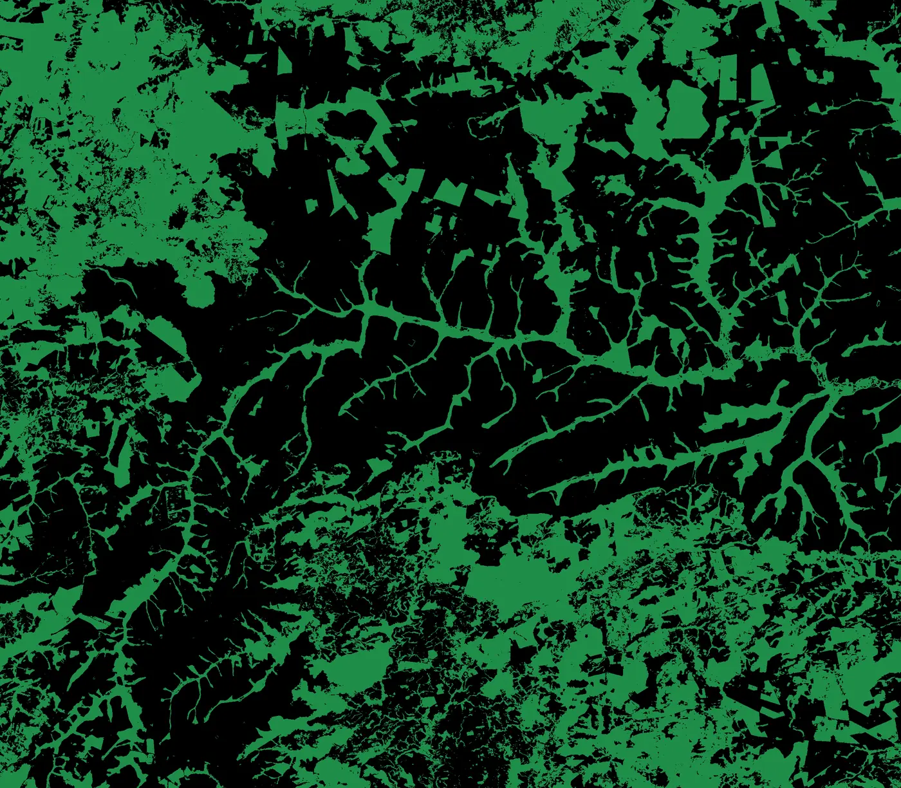
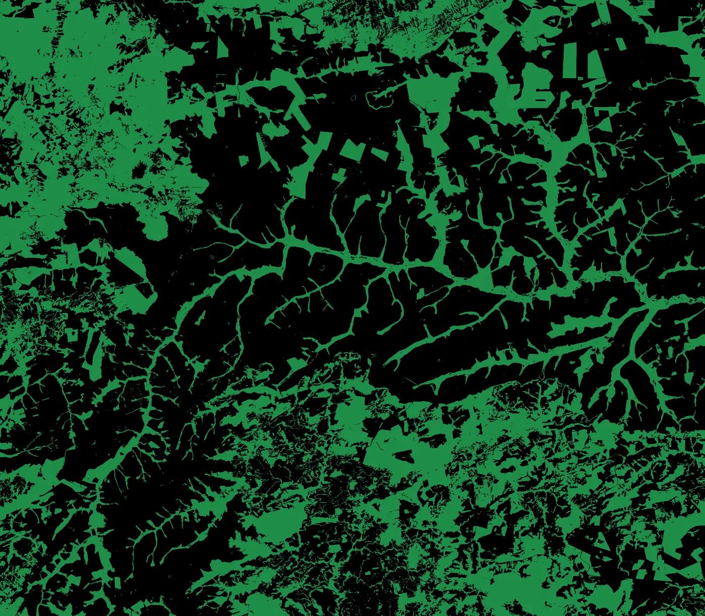
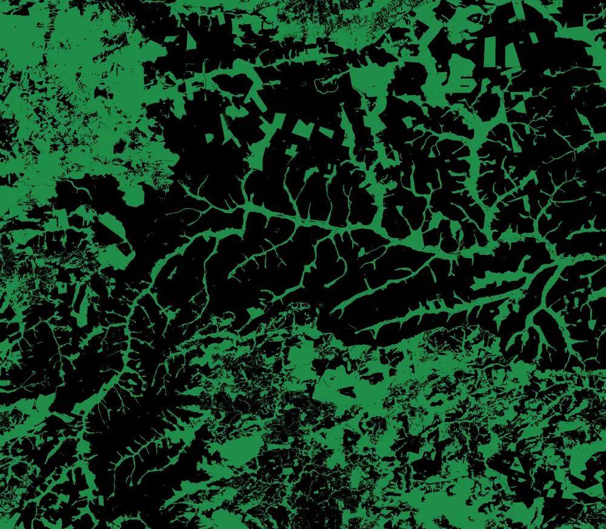
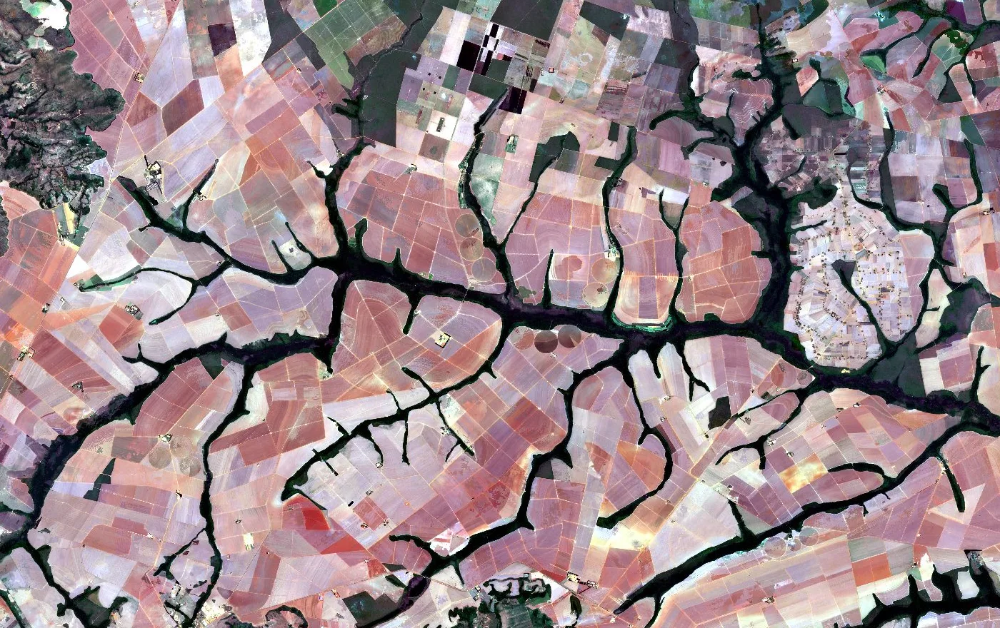
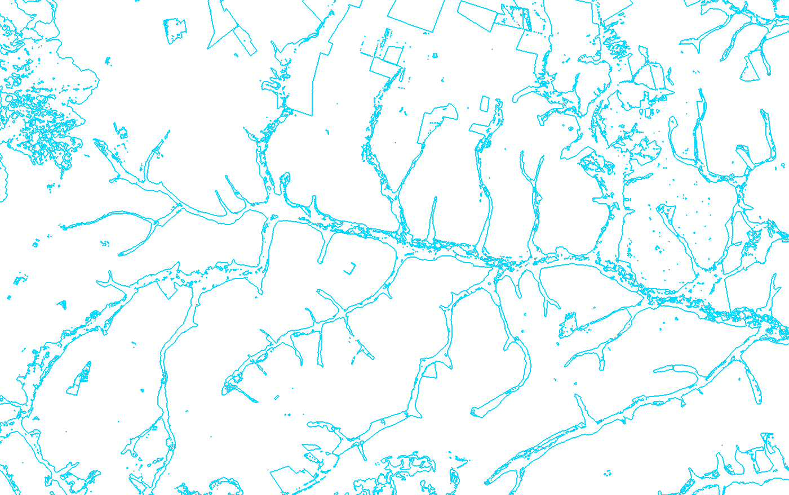
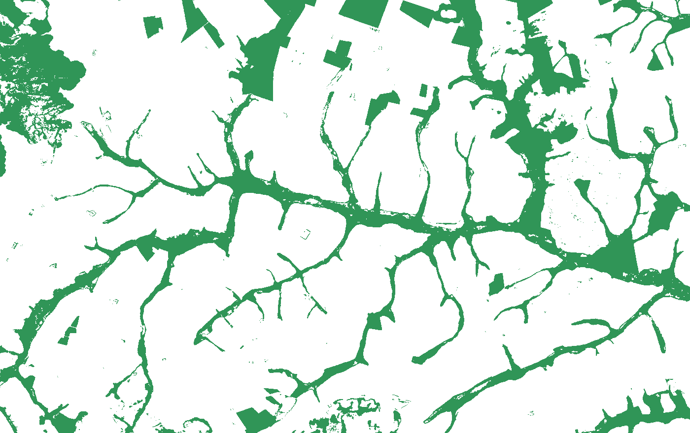
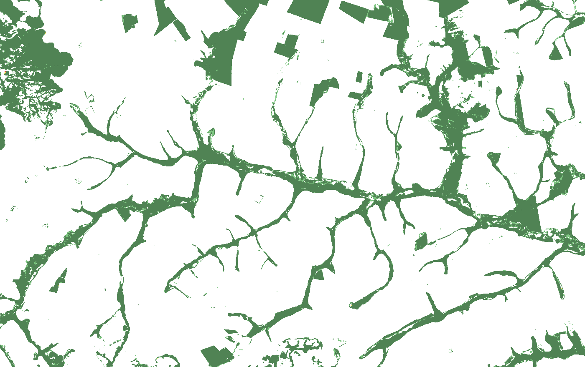
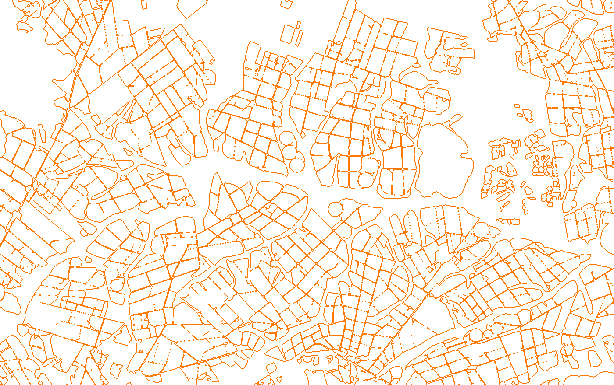

```{=html}
<div class="page-shell">
<div class="page-main">

<div class="research-intro reveal">
  <div class="research-intro-prose">
    <p>O trabalho do laboratório se organiza em duas dimensões complementares, as <em class="mark">áreas de aplicação</em> socioambientais e de texto e as <em class="mark">linhas metodológicas</em> em aprendizado de máquina.</p>
    <p>Os membros do grupo transitam entre essas dimensões, participando do desenvolvimento metodológico e aplicando os métodos diretamente nos problemas de cada área.</p>
  </div>
<div class="matrix-wrap reveal">
  <div class="matrix" role="table" aria-label="Linhas metodológicas por área de aplicação">
    <div class="matrix-corner" role="columnheader"><span>Linhas</span><span>Áreas</span></div>
    <a class="matrix-col" role="columnheader" data-c="agricultura" href="#agricultura">Agricultura</a>
    <a class="matrix-col" role="columnheader" data-c="floresta" href="#floresta">Floresta</a>
    <a class="matrix-col" role="columnheader" data-c="clima" href="#clima">Clima</a>
    <a class="matrix-col" role="columnheader" data-c="cidades" href="#cidades">Cidades</a>
    <a class="matrix-col" role="columnheader" data-c="documentos" href="#documentos">Documentos</a>
    <div class="matrix-group" role="rowheader">Componentes</div>
    <a class="matrix-row" role="rowheader" data-r="rotulagem" data-cols="agricultura cidades floresta" href="#linhas">Aprendizado com baixa rotulagem</a>
    <span class="matrix-cell is-link" role="cell" data-r="rotulagem" data-c="agricultura"></span>
    <span class="matrix-cell is-link" role="cell" data-r="rotulagem" data-c="floresta"></span>
    <span class="matrix-cell" role="cell" data-r="rotulagem" data-c="clima"></span>
    <span class="matrix-cell is-link" role="cell" data-r="rotulagem" data-c="cidades"></span>
    <span class="matrix-cell" role="cell" data-r="rotulagem" data-c="documentos"></span>
    <a class="matrix-row" role="rowheader" data-r="dominio" data-cols="agricultura cidades floresta" href="#linhas">Adaptação de domínio</a>
    <span class="matrix-cell is-link" role="cell" data-r="dominio" data-c="agricultura"></span>
    <span class="matrix-cell is-link" role="cell" data-r="dominio" data-c="floresta"></span>
    <span class="matrix-cell" role="cell" data-r="dominio" data-c="clima"></span>
    <span class="matrix-cell is-link" role="cell" data-r="dominio" data-c="cidades"></span>
    <span class="matrix-cell" role="cell" data-r="dominio" data-c="documentos"></span>
    <a class="matrix-row" role="rowheader" data-r="openset" data-cols="floresta" href="#linhas">Open-set e OOD</a>
    <span class="matrix-cell" role="cell" data-r="openset" data-c="agricultura"></span>
    <span class="matrix-cell is-link" role="cell" data-r="openset" data-c="floresta"></span>
    <span class="matrix-cell" role="cell" data-r="openset" data-c="clima"></span>
    <span class="matrix-cell" role="cell" data-r="openset" data-c="cidades"></span>
    <span class="matrix-cell" role="cell" data-r="openset" data-c="documentos"></span>
    <a class="matrix-row" role="rowheader" data-r="incerteza" data-cols="agricultura" href="#linhas">Modelagem de incerteza</a>
    <span class="matrix-cell is-link" role="cell" data-r="incerteza" data-c="agricultura"></span>
    <span class="matrix-cell" role="cell" data-r="incerteza" data-c="floresta"></span>
    <span class="matrix-cell" role="cell" data-r="incerteza" data-c="clima"></span>
    <span class="matrix-cell" role="cell" data-r="incerteza" data-c="cidades"></span>
    <span class="matrix-cell" role="cell" data-r="incerteza" data-c="documentos"></span>
    <a class="matrix-row" role="rowheader" data-r="textual" data-cols="documentos floresta" href="#linhas">Modelagem de dados textuais</a>
    <span class="matrix-cell" role="cell" data-r="textual" data-c="agricultura"></span>
    <span class="matrix-cell is-link" role="cell" data-r="textual" data-c="floresta"></span>
    <span class="matrix-cell" role="cell" data-r="textual" data-c="clima"></span>
    <span class="matrix-cell" role="cell" data-r="textual" data-c="cidades"></span>
    <span class="matrix-cell is-link" role="cell" data-r="textual" data-c="documentos"></span>
    <div class="matrix-group" role="rowheader">Substrato</div>
    <a class="matrix-row" role="rowheader" data-r="redes" data-cols="clima" href="#linhas">Redes de modelos especialistas geolocalizados</a>
    <span class="matrix-cell" role="cell" data-r="redes" data-c="agricultura"></span>
    <span class="matrix-cell" role="cell" data-r="redes" data-c="floresta"></span>
    <span class="matrix-cell is-link" role="cell" data-r="redes" data-c="clima"></span>
    <span class="matrix-cell" role="cell" data-r="redes" data-c="cidades"></span>
    <span class="matrix-cell" role="cell" data-r="redes" data-c="documentos"></span>
    <div class="matrix-group" role="rowheader">Sistemas acoplados</div>
    <a class="matrix-row" role="rowheader" data-r="sistemas" data-cols="agricultura clima" href="#linhas">Interação de sistemas geoespaciais</a>
    <span class="matrix-cell is-link" role="cell" data-r="sistemas" data-c="agricultura"></span>
    <span class="matrix-cell" role="cell" data-r="sistemas" data-c="floresta"></span>
    <span class="matrix-cell is-link" role="cell" data-r="sistemas" data-c="clima"></span>
    <span class="matrix-cell" role="cell" data-r="sistemas" data-c="cidades"></span>
    <span class="matrix-cell" role="cell" data-r="sistemas" data-c="documentos"></span>
    <a class="matrix-row" role="rowheader" data-r="climatica" data-cols="clima" href="#linhas">Modelagem climática</a>
    <span class="matrix-cell" role="cell" data-r="climatica" data-c="agricultura"></span>
    <span class="matrix-cell" role="cell" data-r="climatica" data-c="floresta"></span>
    <span class="matrix-cell is-link" role="cell" data-r="climatica" data-c="clima"></span>
    <span class="matrix-cell" role="cell" data-r="climatica" data-c="cidades"></span>
    <span class="matrix-cell" role="cell" data-r="climatica" data-c="documentos"></span>
    <div class="matrix-group matrix-group-partners" role="rowheader">Parceiros</div>
    <div class="matrix-row matrix-row-partners" role="rowheader">Instituições por área</div>
    <div class="matrix-partners" role="cell" data-c="agricultura"><span>FGV Agro</span></div>
    <div class="matrix-partners" role="cell" data-c="floresta"><span>FGVces</span><span>Coiab</span><span>FGV Agro</span></div>
    <div class="matrix-partners" role="cell" data-c="clima"><span>FGV CERI</span><span>FGV Agro</span></div>
    <div class="matrix-partners" role="cell" data-c="cidades"><em>—</em></div>
    <div class="matrix-partners" role="cell" data-c="documentos"><span>FGV PMO</span><span>FGV Projetos</span></div>
  </div>
</div>
<script>
  // Mapa das conexões: realce da linha ou da área sob o mouse e do que se liga a ela.
  (function () {
    var m = document.querySelector(".matrix");
    if (!m) return;
    var todos = m.querySelectorAll("[data-r], [data-c]");
    function limpar() {
      m.classList.remove("is-hover");
      for (var i = 0; i < todos.length; i++) todos[i].classList.remove("is-on");
    }
    function marcar(sel) {
      var el = m.querySelectorAll(sel);
      for (var i = 0; i < el.length; i++) el[i].classList.add("is-on");
    }
    m.addEventListener("mouseover", function (e) {
      var row = e.target.closest(".matrix-row[data-r]");
      var col = e.target.closest(".matrix-col[data-c]");
      var cell = e.target.closest(".matrix-cell.is-link");
      if (cell) { row = m.querySelector('.matrix-row[data-r="' + cell.dataset.r + '"]'); }
      if (!row && !col) return;
      limpar();
      m.classList.add("is-hover");
      if (row) {
        marcar('[data-r="' + row.dataset.r + '"]');
        var cols = row.dataset.cols.split(" ");
        for (var i = 0; i < cols.length; i++) if (cols[i]) marcar('.matrix-col[data-c="' + cols[i] + '"], .matrix-partners[data-c="' + cols[i] + '"]');
      } else {
        marcar('[data-c="' + col.dataset.c + '"]');
        var cells = m.querySelectorAll('.matrix-cell.is-link[data-c="' + col.dataset.c + '"]');
        for (var j = 0; j < cells.length; j++) marcar('.matrix-row[data-r="' + cells[j].dataset.r + '"]');
      }
    });
    m.addEventListener("mouseleave", limpar);
  })();
</script>
</div>

<section id="agricultura" class="rsec">
  <span id="agriculture"></span>
  <div class="rsec-head reveal">
    <div class="rsec-num">01</div>
    <div>
      <h2>Agricultura</h2>
    </div>
  </div>

  <p class="rsec-lead reveal">Delimitação automática de talhões, classificação de cultivo com radar e imagem óptica, extração de séries de índices de vegetação, detecção de início e fim de safra, leitura de risco agrícola em relação à vizinhança e previsão de produtividade da soja.</p>

  <div class="proj-block cv-story-block" data-cv-story>
  <div class="cv-story">
  <div class="cv-story-stage-col">
    <div class="iviz-card cv-stage is-locked" data-cv-agro-viewer data-lang="pt" data-base="data/agro">
      <div class="iviz-top">
        <div>
          <h4 class="iviz-title">Campo Verde (MT): talhões, culturas inferidas e séries de índices de vegetação</h4>
        </div>
        <div class="iviz-controls cv-main-controls">
          <button type="button" class="iviz-btn is-active" data-cv-colormode="gaia" aria-pressed="true">Modelo GAIA (SAR + óptico)</button>
          <button type="button" class="iviz-btn" data-cv-colormode="ref" aria-pressed="false">Referência (MapBiomas)</button>
          <button type="button" class="iviz-btn" data-cv-colormode="diverg" aria-pressed="false">Divergências</button>
          <button type="button" class="iviz-btn" data-cv-colormode="indice" aria-pressed="false">Pico do índice</button>
          <button type="button" class="iviz-btn" data-cv-colormode="outline" aria-pressed="false">Apenas contornos</button>
        </div>
        <button type="button" class="iviz-btn cv-max-btn" data-cv-max data-label-on="Tela cheia" data-label-off="Sair da tela cheia" aria-pressed="false">Tela cheia</button>
      </div>

      <div class="iviz-body">
        <div class="cv-sat-toolbar">
          <div class="cv-sat-group">
            <span class="cv-sat-label">Ano:</span>
            <div class="cv-stepper">
              <button type="button" class="cv-step-btn" data-cv-year-prev aria-label="Ano anterior">‹</button>
              <span class="cv-step-val" data-cv-year-val>2021</span>
              <button type="button" class="cv-step-btn" data-cv-year-next aria-label="Próximo ano">›</button>
            </div>
          </div>
          <div class="cv-sat-group">
            <span class="cv-sat-label">Safra:</span>
            <button type="button" class="iviz-btn is-active" data-cv-season="1" aria-pressed="true">1ª safra</button>
            <button type="button" class="iviz-btn" data-cv-season="2" aria-pressed="false">2ª safra</button>
          </div>
          <div class="cv-sat-group">
            <span class="cv-sat-label">Cultura:</span>
            <button type="button" class="iviz-btn is-active" data-cv-cropfilter="all" aria-pressed="true">Todas</button>
            <button type="button" class="iviz-btn" data-cv-cropfilter="0" aria-pressed="false">Soja</button>
            <button type="button" class="iviz-btn" data-cv-cropfilter="1" aria-pressed="false">Milho</button>
            <button type="button" class="iviz-btn" data-cv-cropfilter="2" aria-pressed="false">Algodão</button>
            <button type="button" class="iviz-btn" data-cv-cropfilter="3" aria-pressed="false">Outros</button>
          </div>
          <div class="cv-sat-group">
            <span class="cv-sat-label">Fundo:</span>
            <button type="button" class="iviz-btn is-active" data-cv-basemap="s2" aria-pressed="true">Sentinel-2 do ano (10 m)</button>
            <button type="button" class="iviz-btn" data-cv-basemap="esri" aria-pressed="false">Imagem de alta resolução</button>
          </div>
          <div class="cv-sat-group">
            <span class="cv-sat-label">Opacidade:</span>
            <input type="range" class="cv-opacity-slider" data-cv-opacity min="10" max="95" value="62" aria-label="Opacidade do preenchimento dos talhões">
            <span data-cv-opacity-val style="font-variant-numeric: tabular-nums; font-weight:700;">62%</span>
          </div>
        </div>

        <div class="cv-map-wrap">
          <div class="cv-map" data-cv-map role="region" aria-label="Mapa interativo dos talhões de Campo Verde com zoom e arrasto"></div>
          <div class="cv-sat-hud">
            <button type="button" class="cv-hud-btn" data-cv-zoom-out title="Reduzir zoom">−</button>
            <button type="button" class="cv-hud-btn" data-cv-zoom-in title="Ampliar zoom">+</button>
            <button type="button" class="cv-hud-btn" data-cv-zoom-fit>Município</button>
          </div>
          <div class="cv-sat-badge" data-cv-sat-badge>Sentinel-2 cloudless 2021</div>
          <div class="cv-map-legend" data-cv-legend>
            <div class="cv-map-legend-row" data-cv-legend-classes>
              <span class="cv-map-legend-item"><i class="cv-map-swatch" style="background:#e4432f"></i>Soja</span>
              <span class="cv-map-legend-item"><i class="cv-map-swatch" style="background:#f26fa8"></i>Milho</span>
              <span class="cv-map-legend-item"><i class="cv-map-swatch" style="background:#3fbf4f"></i>Algodão</span>
              <span class="cv-map-legend-item"><i class="cv-map-swatch" style="background:#8e5fd0"></i>Outros</span>
              <span class="cv-map-legend-item"><i class="cv-map-swatch" style="background:#9fd6ef"></i>Sem classificação</span>
              <span class="cv-map-legend-item" data-cv-legend-div hidden><i class="cv-map-swatch" style="border:2px dashed #ff4d42; background:transparent"></i>Modelo e referência discordam</span>
            </div>
            <div class="cv-map-legend-row" data-cv-legend-outline hidden>
              <span class="cv-map-legend-item"><i class="cv-map-swatch" style="border:2px solid #fff; background:transparent"></i>Contornos dos talhões delimitados</span>
            </div>
            <div class="cv-map-legend-row" data-cv-legend-index hidden>
              <span class="cv-map-legend-item"><span data-cv-legend-index-name>NDVI</span>: <span data-cv-legend-index-lo>0,2</span> <i class="cv-iv-gradient"></i> <span data-cv-legend-index-hi>0,9</span></span>
            </div>
            <div class="cv-map-legend-row" data-cv-legend-plots hidden></div>
          </div>
        </div>
        <div class="cv-caption" data-cv-caption></div>

        <div class="cv-series-wrap">
          <div class="cv-sat-toolbar cv-series-controls">
            <div class="cv-sat-group">
              <span class="cv-sat-label">Comparar:</span>
              <button type="button" class="iviz-btn is-active" data-cv-compare="indices" aria-pressed="true">Índices de um talhão</button>
              <button type="button" class="iviz-btn" data-cv-compare="plots" aria-pressed="false">Um índice em vários talhões</button>
            </div>
            <div class="cv-sat-group">
              <span class="cv-sat-label">Talhões:</span>
              <span class="cv-plot-chips" data-cv-plot-chips></span>
              <button type="button" class="iviz-btn" data-iv-random>Outro talhão</button>
            </div>
            <div class="cv-sat-group">
              <span class="cv-sat-label">Mostrar:</span>
              <button type="button" class="iviz-btn is-active" data-iv-toggle="band" aria-pressed="true">Faixa municipal P25 a P75</button>
              <button type="button" class="iviz-btn is-active" data-iv-toggle="median" aria-pressed="true">Mediana municipal</button>
              <button type="button" class="iviz-btn" data-iv-toggle="markers" aria-pressed="false">Marcos SOS, POS e EOS</button>
            </div>
          </div>
          <div class="iviz-controls cv-series-controls cv-index-chips" data-iv-index-group role="group" aria-label="Índices de vegetação">
            <button type="button" class="iviz-btn" data-iv-index="ARVI" aria-pressed="false" title="ARVI">ARVI</button>
            <button type="button" class="iviz-btn" data-iv-index="CIRE" aria-pressed="false" title="CIRE (clorofila, borda vermelha)">CIRE</button>
            <button type="button" class="iviz-btn" data-iv-index="CVI" aria-pressed="false" title="CVI (clorofila)">CVI</button>
            <button type="button" class="iviz-btn" data-iv-index="EVI" aria-pressed="false" title="EVI (biomassa)">EVI</button>
            <button type="button" class="iviz-btn" data-iv-index="EVI2" aria-pressed="false" title="EVI2">EVI2</button>
            <button type="button" class="iviz-btn" data-iv-index="GNDVI" aria-pressed="false" title="GNDVI (verde)">GNDVI</button>
            <button type="button" class="iviz-btn" data-iv-index="GARI" aria-pressed="false" title="GARI">GARI</button>
            <button type="button" class="iviz-btn" data-iv-index="GCVI" aria-pressed="false" title="GCVI (clorofila)">GCVI</button>
            <button type="button" class="iviz-btn" data-iv-index="GRVI" aria-pressed="false" title="GRVI">GRVI</button>
            <button type="button" class="iviz-btn" data-iv-index="MSAVI" aria-pressed="false" title="MSAVI (ajuste de solo)">MSAVI</button>
            <button type="button" class="iviz-btn" data-iv-index="NBR" aria-pressed="false" title="NBR (queimada)">NBR</button>
            <button type="button" class="iviz-btn" data-iv-index="NDRE" aria-pressed="false" title="NDRE (borda vermelha)">NDRE</button>
            <button type="button" class="iviz-btn is-active" data-iv-index="NDVI" aria-pressed="true" title="NDVI (vigor)">NDVI</button>
            <button type="button" class="iviz-btn" data-iv-index="NDWI" aria-pressed="false" title="NDWI (água no dossel)">NDWI</button>
            <button type="button" class="iviz-btn" data-iv-index="RBNDVI" aria-pressed="false" title="RBNDVI">RBNDVI</button>
            <button type="button" class="iviz-btn" data-iv-index="SAVI" aria-pressed="false" title="SAVI (ajuste de solo)">SAVI</button>
            <button type="button" class="iviz-btn" data-iv-index="VARIgreen" aria-pressed="false" title="VARI (visível)">VARIgreen</button>
          </div>
          <div class="cv-iv-svg-wrap">
            <div data-iv-panels></div>
            <div class="cv-iv-empty" data-iv-empty hidden></div>
          </div>
        </div>

        <div class="iviz-below">
          <div class="parcel-inspector">
            <div class="parcel-inspector-head">
              <span class="parcel-inspector-title" data-parcel-title>Talhão</span>
              <span class="parcel-inspector-meta" data-parcel-meta></span>
            </div>
            <div class="parcel-compare-row cv-insp-classes" data-cv-insp-classes>
              <div class="parcel-compare-cell"><span>1ª safra, modelo GAIA</span><strong data-parcel-s1></strong></div>
              <div class="parcel-compare-cell"><span>1ª safra, MapBiomas</span><strong data-parcel-mb1></strong></div>
              <div class="parcel-compare-cell"><span>2ª safra, modelo GAIA</span><strong data-parcel-s2></strong></div>
              <div class="parcel-compare-cell"><span>2ª safra, MapBiomas</span><strong data-parcel-mb2></strong></div>
              <div class="parcel-compare-cell"><span data-parcel-peak-label>Pico do índice no ano</span><strong data-parcel-peak></strong></div>
              <div class="parcel-compare-cell"><span>Data do pico</span><strong data-parcel-peakdate></strong></div>
            </div>
            <div class="cv-insp-reading">
              <span class="parcel-inspector-title" style="font-size:0.84rem;">Leitura da data</span>
              <span class="parcel-inspector-meta" data-iv-insp-date></span>
            </div>
            <div data-iv-insp-rows></div>
            <div class="nota" style="margin-top:0;" data-iv-insp-status></div>
          </div>
        </div>
      </div>
    </div>
  </div>
  <div class="cv-story-steps">
  <section class="cv-story-step reveal" data-scene="delim">
    <div class="proj-header"><h3>Etapa 1: Delimitação automática de talhões</h3></div>
    <div class="proj-prose">
      <p>A área de agricultura é explorada no projeto <em class="mark">AgroInteligência Territorial</em>, em parceria com o <em class="mark">FGV Agro</em>, no qual o laboratório constrói inteligência territorial sobre grandes carteiras agrícolas para responder o que está plantado, onde está e o que se comporta fora do padrão. Tudo começa pelo desenho das unidades de análise: os talhões.</p>
      <p>O ponto de partida é a imagem óptica. Para cada município de interesse, o pipeline reúne as cenas do <em class="mark">Sentinel-2</em> (10 m) da safra, <span class="story-blank">[como as cenas são selecionadas e combinadas: período, critério de nuvem]</span>, e um modelo de segmentação traça os contornos das subáreas que se comportam como uma unidade de manejo: mesma cultura, mesmo calendário e mesma resposta espectral. O resultado é um polígono por talhão, com área, município e um identificador que permite acompanhá-lo de uma safra para a outra.</p>
      <p>A base própria soma <em class="mark">359.596 talhões</em> em <em class="mark">897 municípios de cinco estados</em> (Bahia, Maranhão, Mato Grosso, Paraná e Tocantins), regenerada a cada safra de 2020 a 2025. Os contornos foram validados <span class="story-blank">[como: contra talhões traçados manualmente, dados de campo, métrica usada]</span>, com <span class="story-blank">[resultado da validação]</span>. O processamento de um município completo leva <span class="story-blank">[tempo e infraestrutura]</span>.</p>
    </div>
    <div data-cv-caption-text hidden>Contornos dos 2.132 talhões de Campo Verde (MT) na safra 2021 (223,5 mil ha), sobre o mosaico Sentinel-2 sem nuvens do mesmo ano. Passe o mouse sobre um talhão para ver a área.</div>
  </section>
  <section class="cv-story-step reveal" data-scene="classe">
    <div class="proj-header"><h3>Etapa 2: Classificação de cultura com radar e imagem óptica</h3></div>
    <div class="proj-prose">
      <p>Sobre cada polígono, um classificador atribui a cultura plantada em cada uma das duas safras do ano agrícola: soja, milho, algodão ou outros usos. A entrada principal é o <em class="mark">radar de abertura sintética (SAR)</em> do Sentinel-1, que atravessa nuvens e garante observação regular nos meses chuvosos, combinada com a resposta óptica do Sentinel-2 quando há céu limpo. <span class="story-blank">[periodicidade das passagens, polarizações ou bandas usadas e janela temporal de cada safra]</span>.</p>
      <p>O modelo foi treinado com <span class="story-blank">[origem e tamanho dos dados de referência]</span> e é aplicado município a município, o que permite regenerar a classificação a cada safra sem novo trabalho de campo. Em Campo Verde (MT), a safra 2021 reúne 2.132 talhões classificados na 1ª safra e 2.130 nas duas safras; a combinação mais comum é soja seguida de milho (836 talhões), depois soja seguida de algodão (439).</p>
    </div>
    <div data-cv-caption-text hidden>Cultura inferida pelo modelo na 1ª safra de 2021: vermelho soja, rosa milho, verde algodão, roxo outros usos e azul claro sem classificação. Clique em um talhão para ver as duas safras.</div>
  </section>
  <section class="cv-story-step reveal" data-scene="diverg">
    <div class="proj-header"><h3>Etapa 3: Comparação com a referência pública</h3></div>
    <div class="proj-prose">
      <p>Validado contra dados de campo do INPE em Campo Verde (MT), o classificador <em class="mark">supera a referência pública (MapBiomas) nas culturas de segunda safra</em>, cuja janela coincide com a persistência de nebulosidade, e empata na soja. As barras mostram a acurácia por cultura.</p>
    <div class="acc-bench">
      <div class="acc-bench-title">Acurácia validada contra dados de campo do INPE (Campo Verde, MT)</div>
      <div class="acc-crop-group">
        <div class="acc-crop-head"><span>Algodão</span><span>+25,6 p.p. sobre a referência</span></div>
        <div class="acc-dual-bars">
          <div class="acc-bar-row"><span>GAIA Lab</span><div class="acc-bar-track"><div class="acc-bar-fill gaia" style="width:90.0%"></div></div><span class="acc-bar-pct">90,0%</span></div>
          <div class="acc-bar-row"><span>Ref. pública</span><div class="acc-bar-track"><div class="acc-bar-fill ref" style="width:64.4%"></div></div><span class="acc-bar-pct">64,4%</span></div>
        </div>
      </div>
      <div class="acc-crop-group">
        <div class="acc-crop-head"><span>Milho</span><span>+9,1 p.p. sobre a referência</span></div>
        <div class="acc-dual-bars">
          <div class="acc-bar-row"><span>GAIA Lab</span><div class="acc-bar-track"><div class="acc-bar-fill gaia" style="width:91.5%"></div></div><span class="acc-bar-pct">91,5%</span></div>
          <div class="acc-bar-row"><span>Ref. pública</span><div class="acc-bar-track"><div class="acc-bar-fill ref" style="width:82.4%"></div></div><span class="acc-bar-pct">82,4%</span></div>
        </div>
      </div>
      <div class="acc-crop-group">
        <div class="acc-crop-head"><span>Soja</span><span>98,7% vs. 99,3%</span></div>
        <div class="acc-dual-bars">
          <div class="acc-bar-row"><span>GAIA Lab</span><div class="acc-bar-track"><div class="acc-bar-fill gaia" style="width:98.7%"></div></div><span class="acc-bar-pct">98,7%</span></div>
          <div class="acc-bar-row"><span>Ref. pública</span><div class="acc-bar-track"><div class="acc-bar-fill ref" style="width:99.3%"></div></div><span class="acc-bar-pct">99,3%</span></div>
        </div>
      </div>
    </div>
      <p>No mapa, os talhões em que o modelo e a referência discordam na 2ª safra aparecem com contorno vermelho tracejado e preenchidos com a classe do modelo. As divergências se concentram em <span class="story-blank">[onde e por quê: milho e algodão, talhões pequenos, bordas, calendário]</span>.</p>
    </div>
    <div data-cv-caption-text hidden>Divergências entre o modelo e o MapBiomas na 2ª safra de 2021. O preenchimento mostra a classe do modelo; os talhões concordantes ficam sem cor.</div>
  </section>
  <section class="cv-story-step reveal" data-scene="series">
    <div class="proj-header"><h3>Etapa 4: Séries temporais de índices de vegetação</h3></div>
    <div class="proj-prose">
      <p>Com os polígonos delimitados, o pipeline reconstrói a evolução espectral de cada talhão ao longo das safras. As refletâncias do <em class="mark">Sentinel-2</em> são extraídas sobre cada polígono a partir dos cubos de dados do <em class="mark">Brazil Data Cube (BDC)</em>, em composições de 16 dias, e convertidas em <em class="mark">17 índices de vegetação complementares</em> (entre eles NDVI, EVI, EVI2, NDWI, NDRE, SAVI, MSAVI e GNDVI), que cobrem vigor fotossintético, conteúdo de água no dossel e borda vermelha. A base consolidada soma <em class="mark">499,7 mil séries por talhão</em> e <em class="mark">11,5 milhões de registros</em>.</p>
      <p>Mesmo em composições regulares, a nebulosidade persistente do verão deixa observações contaminadas por nuvens residuais que derrubam artificialmente os índices. Para que ruído atmosférico não seja lido como perda de lavoura, o sistema descarta as passagens com cobertura limpa insuficiente (<em class="mark">5,55%</em> das observações) e aplica suavização temporal penalizada para reconstruir a curva contínua de vigor. Cada curva é lida contra a faixa entre os percentis 25 e 75 do município na mesma data, o que diz se o talhão acompanha, supera ou fica abaixo da metade central dos vizinhos.</p>
    </div>
    <div data-cv-caption-text hidden>Série NDVI de 2021 do talhão destacado no mapa (linha escura), faixa P25 a P75 (área verde) e mediana (tracejada) dos {n} talhões de Campo Verde com série. Passe o mouse sobre os pontos para ler as datas.</div>
  </section>
  <section class="cv-story-step reveal" data-scene="fenol">
    <div class="proj-header"><h3>Etapa 5: Início e fim de safra e janela do ZARC</h3></div>
    <div class="proj-prose">
      <p>Sobre a curva contínua de cada talhão, o detector identifica os marcos fenológicos de cada ciclo: o <em class="mark">início da safra (SOS)</em> na emergência pós-plantio, o <em class="mark">pico vegetativo (POS)</em> no fechamento máximo do dossel e o <em class="mark">fim da safra (EOS)</em> na senescência e colheita, separando o primeiro e o segundo cultivo do ano agrícola. <span class="story-blank">[critério do detector em uma frase, sem a receita]</span>.</p>
      <p>O cruzamento das datas de início de safra com a janela oficial de plantio do <em class="mark">ZARC (Zoneamento Agrícola de Risco Climático)</em> permite auditar a aderência ao calendário agrícola em escala municipal: em Campo Verde (MT), <em class="mark">65,5% dos talhões de soja</em> iniciam a safra dentro da janela oficial (entre <em class="mark">72,7% e 84,5%</em> em outros municípios avaliados), enquanto as culturas de segunda safra (algodão com 7,6% e milho safrinha com 3,3%) refletem a dependência direta do momento de colheita da primeira safra.</p>
    </div>
    <div class="acc-bench" style="gap: 0.55rem;">
      <div class="acc-bench-title">Plantio (SOS) dentro da janela oficial do ZARC</div>
      <div class="acc-crop-group">
        <div class="acc-crop-head" style="font-size:0.78rem;"><span>Soja (Campo Verde, MT)</span><span>65,5% (até 84,5% em outros mun.)</span></div>
        <div class="acc-bar-track"><div class="acc-bar-fill gaia" style="width:65.5%"></div></div>
      </div>
      <div class="acc-crop-group">
        <div class="acc-crop-head" style="font-size:0.78rem;"><span>Algodão</span><span>7,6%</span></div>
        <div class="acc-bar-track"><div class="acc-bar-fill ref" style="width:7.6%"></div></div>
      </div>
      <div class="acc-crop-group">
        <div class="acc-crop-head" style="font-size:0.78rem;"><span>Milho 2ª safra (safrinha)</span><span>3,3%</span></div>
        <div class="acc-bar-track"><div class="acc-bar-fill ref" style="width:3.3%"></div></div>
      </div>
    </div>
    <div data-cv-caption-text hidden>Marcos de cada ciclo sobre a mesma série, calculados pelo detector do projeto a partir do NDVI: SOS em azul, POS em verde e EOS em âmbar.</div>
  </section>
  <section class="cv-story-step reveal" data-scene="viz">
    <div class="proj-header"><h3>Etapa 6: Leitura em relação à vizinhança</h3></div>
    <div class="proj-prose">
      <p>Para transformar o acompanhamento fenológico em diagnóstico de risco de carteira, o produto combina os indicadores espectrais e climáticos de cada talhão-safra e agrupa talhões em <em class="mark">perfis de comportamento</em> por similaridade espectral e climática. A leitura é sempre <em class="mark">em relação à vizinhança</em>, o que separa dois fenômenos que costumam ser confundidos:</p>
      <ul>
        <li><em class="mark">Risco operacional:</em> manejo, praga ou condição específica do produtor. Um talhão vai mal enquanto os vizinhos vão bem.</li>
        <li><em class="mark">Risco sistêmico:</em> seca, geada ou veranico regional. A vizinhança inteira perde vigor ao mesmo tempo. É a comparação com o entorno que diz de quem é o problema, sem vistoria presencial em cada área.</li>
      </ul>
      <p>O palco compara dois talhões de Campo Verde na 2ª safra de 2021: um que acompanha a faixa do município e outro que cai abaixo do percentil 25 enquanto a faixa segue alta. Como a vizinhança não acompanha a queda, o desvio é local. <span class="story-blank">[o que explica o caso, se houver verificação: vistoria, produtor, imagem de alta resolução]</span>.</p>
    </div>
    <div data-cv-caption-text hidden>NDVI de 2021 de dois talhões no mesmo eixo, com a faixa P25 a P75 do município ao fundo. O talhão {a} segue a faixa; o talhão {b} fica abaixo dela durante a 2ª safra.</div>
  </section>
  </div>
  </div>
  <section class="cv-story-step cv-story-free reveal" data-scene="explore">
    <div class="proj-header"><h3>Explore os dados</h3></div>
    <div class="proj-prose">
      <p>O painel abaixo libera todos os controles sobre os mesmos dados: as seis safras de 2020 a 2025, as duas safras de cada ano, a classe do modelo ou da referência, as divergências, o pico de cada índice no mapa e o fundo Sentinel-2 do ano ou a imagem de alta resolução. Nas séries há duas formas de comparar: até três índices do mesmo talhão, em painéis empilhados, ou o mesmo índice em até três talhões, no mesmo eixo. Clique nos talhões do mapa para selecioná-los.</p>
      <p>Séries de índices disponíveis para as safras de 2020 a 2025. <span class="story-blank">[observação sobre cobertura e limites do recorte]</span>.</p>
    </div>
    <div data-cv-caption-text hidden></div>
  </section>
  <div class="cv-story-slot" data-cv-stage-slot></div>
  </div>

  <div class="proj-block reveal">
    <div class="proj-header">
      <h3>Etapa 7: Previsão de produtividade da soja por município</h3>
    </div>
    <div class="proj-prose">
      <p>A produtividade da soja é estimada por município a partir de três entradas. A primeira é a série de imagens do <em class="mark">Sentinel-2</em> ao longo da safra, em dez bandas espectrais, reduzida à média do município em cada data. A segunda é o clima diário de 1º de outubro a 31 de março: precipitação, evapotranspiração de referência, radiação solar e temperaturas máxima e mínima, da base Xavier. A terceira é o solo na camada de 0 a 30 cm: teores de argila, silte e areia e estoque de carbono orgânico, do MapBiomas Solo. O alvo do modelo é a produtividade em toneladas por hectare da Produção Agrícola Municipal (PAM), do IBGE.</p>
      <p>A base reúne <em class="mark">5.908 amostras de município e safra</em> do Paraná, Rio Grande do Sul, São Paulo, Goiás e Santa Catarina, nas safras colhidas de 2020 a 2024. Na avaliação, um ano inteiro fica fora do treinamento e serve apenas de teste, de modo que o modelo é medido em uma safra que não viu. No Paraná, com a safra de 2021 reservada para teste, o erro médio em 123 municípios é de <em class="mark">0,24 t/ha</em>, o equivalente a <em class="mark">7,3% da produtividade observada</em>.</p>
      <p>Treinado com a produtividade municipal como rótulo, o mesmo modelo é aplicado aos pixels do Sentinel-2 para gerar mapas de produtividade dentro do município e estimativas por talhão, hoje disponíveis para o Paraná.</p>
      <p>O gráfico abaixo mostra Campina da Lagoa, no Paraná, com cerca de 34 mil hectares de soja. A quebra da safra de 2022 aparece no dado oficial e na estimativa do modelo.</p>
    </div>

    <div class="iviz-card reveal">
      <div class="iviz-top">
        <div>
          <h4 class="iviz-title">Campina da Lagoa (PR): produtividade da soja observada e estimada, safras de 2020 a 2024</h4>
        </div>
      </div>
      <div class="iviz-body">
        <svg viewBox="0 0 740 232" style="width:100%; height:auto; display:block;" role="img" aria-label="Produtividade da soja em Campina da Lagoa, em toneladas por hectare, observada pelo IBGE e estimada pelo modelo, de 2020 a 2024">
          <line x1="70" y1="178.0" x2="680" y2="178.0" stroke="currentColor" stroke-opacity="0.25" />
          <text x="60" y="181.5" text-anchor="end" font-size="10" fill="currentColor" opacity="0.65">2,0</text>
          <line x1="70" y1="148.0" x2="680" y2="148.0" stroke="currentColor" stroke-opacity="0.12" stroke-dasharray="3 3" />
          <text x="60" y="151.5" text-anchor="end" font-size="10" fill="currentColor" opacity="0.65">2,5</text>
          <line x1="70" y1="118.0" x2="680" y2="118.0" stroke="currentColor" stroke-opacity="0.12" stroke-dasharray="3 3" />
          <text x="60" y="121.5" text-anchor="end" font-size="10" fill="currentColor" opacity="0.65">3,0</text>
          <line x1="70" y1="88.0" x2="680" y2="88.0" stroke="currentColor" stroke-opacity="0.12" stroke-dasharray="3 3" />
          <text x="60" y="91.5" text-anchor="end" font-size="10" fill="currentColor" opacity="0.65">3,5</text>
          <line x1="70" y1="58.0" x2="680" y2="58.0" stroke="currentColor" stroke-opacity="0.12" stroke-dasharray="3 3" />
          <text x="60" y="61.5" text-anchor="end" font-size="10" fill="currentColor" opacity="0.65">4,0</text>
          <line x1="70" y1="28.0" x2="680" y2="28.0" stroke="currentColor" stroke-opacity="0.12" stroke-dasharray="3 3" />
          <text x="60" y="31.5" text-anchor="end" font-size="10" fill="currentColor" opacity="0.65">4,5</text>
          <text x="70" y="14" font-size="10" fill="currentColor" opacity="0.65">t/ha</text>
          <polyline fill="none" stroke="currentColor" stroke-opacity="0.55" stroke-width="2.2" stroke-dasharray="5 4" points="110,88.0 240,88.0 370,148.0 500,55.6 630,112.0" />
          <polyline fill="none" stroke="var(--gaia-accent)" stroke-width="3" points="110,77.2 240,99.4 370,155.2 500,76.0 630,104.8" />
          <circle cx="110" cy="88.0" r="4" fill="var(--gaia-surface)" stroke="currentColor" stroke-opacity="0.6" stroke-width="2" />
          <circle cx="110" cy="77.2" r="4.2" fill="var(--gaia-accent)" />
          <text x="110" y="68.2" text-anchor="middle" font-size="11" font-weight="700" fill="var(--gaia-accent)">3,68</text>
          <text x="110" y="105.0" text-anchor="middle" font-size="11" fill="currentColor" opacity="0.75">3,50</text>
          <text x="110" y="200" text-anchor="middle" font-size="10.5" fill="currentColor" opacity="0.75">2020</text>
          <circle cx="240" cy="88.0" r="4" fill="var(--gaia-surface)" stroke="currentColor" stroke-opacity="0.6" stroke-width="2" />
          <circle cx="240" cy="99.4" r="4.2" fill="var(--gaia-accent)" />
          <text x="240" y="79.0" text-anchor="middle" font-size="11" fill="currentColor" opacity="0.75">3,50</text>
          <text x="240" y="116.4" text-anchor="middle" font-size="11" font-weight="700" fill="var(--gaia-accent)">3,31</text>
          <text x="240" y="200" text-anchor="middle" font-size="10.5" fill="currentColor" opacity="0.75">2021</text>
          <circle cx="370" cy="148.0" r="4" fill="var(--gaia-surface)" stroke="currentColor" stroke-opacity="0.6" stroke-width="2" />
          <circle cx="370" cy="155.2" r="4.2" fill="var(--gaia-accent)" />
          <text x="370" y="139.0" text-anchor="middle" font-size="11" fill="currentColor" opacity="0.75">2,50</text>
          <text x="370" y="172.2" text-anchor="middle" font-size="11" font-weight="700" fill="var(--gaia-accent)">2,38</text>
          <text x="370" y="200" text-anchor="middle" font-size="10.5" fill="currentColor" opacity="0.75">2022</text>
          <circle cx="500" cy="55.6" r="4" fill="var(--gaia-surface)" stroke="currentColor" stroke-opacity="0.6" stroke-width="2" />
          <circle cx="500" cy="76.0" r="4.2" fill="var(--gaia-accent)" />
          <text x="500" y="46.6" text-anchor="middle" font-size="11" fill="currentColor" opacity="0.75">4,04</text>
          <text x="500" y="93.0" text-anchor="middle" font-size="11" font-weight="700" fill="var(--gaia-accent)">3,70</text>
          <text x="500" y="200" text-anchor="middle" font-size="10.5" fill="currentColor" opacity="0.75">2023</text>
          <circle cx="630" cy="112.0" r="4" fill="var(--gaia-surface)" stroke="currentColor" stroke-opacity="0.6" stroke-width="2" />
          <circle cx="630" cy="104.8" r="4.2" fill="var(--gaia-accent)" />
          <text x="630" y="95.8" text-anchor="middle" font-size="11" font-weight="700" fill="var(--gaia-accent)">3,22</text>
          <text x="630" y="129.0" text-anchor="middle" font-size="11" fill="currentColor" opacity="0.75">3,10</text>
          <text x="630" y="200" text-anchor="middle" font-size="10.5" fill="currentColor" opacity="0.75">2024</text>
          <line x1="150" y1="222" x2="178" y2="222" stroke="var(--gaia-accent)" stroke-width="3" />
          <text x="184" y="225.5" font-size="10.5" fill="currentColor" opacity="0.8">Estimada pelo modelo</text>
          <line x1="330" y1="222" x2="358" y2="222" stroke="currentColor" stroke-opacity="0.55" stroke-width="2.2" stroke-dasharray="5 4" />
          <text x="364" y="225.5" font-size="10.5" fill="currentColor" opacity="0.8">Observada (PAM, IBGE)</text>
        </svg>
        <div class="nota">Valores da rodada do modelo treinada só com o Paraná. A safra de 2021 ficou fora do treinamento; as outras quatro foram usadas nele.</div>
      </div>
    </div>
  </div>

</section>

<section id="floresta" class="rsec">
  <span id="forests"></span>
  <div class="rsec-head reveal">
    <div class="rsec-num">02</div>
    <div>
      <h2>Floresta</h2>
    </div>
  </div>

  <p class="rsec-lead reveal">Monitoramento trimestral de dossel florestal com contexto espaço-temporal, quantificação de passivo ambiental por imóvel rural no CAR, camada semântica de incerteza e geração automática de relatórios territoriais.</p>

  <div class="proj-block reveal">
    <div class="proj-header">
      <h3>Etapa 1: Monitoramento trimestral de dossel florestal e supressão intra-anual</h3>
    </div>
    <div class="proj-prose">
      <p>A área de floresta é explorada no projeto <em class="mark">AgroInteligência Territorial</em> em parceria com o <em class="mark">FGV Agro</em>, voltado a identificar onde há passivo ambiental sobre grandes carteiras rurais por meio do monitoramento intra-anual de cobertura florestal e de áreas protegidas por lei. Em vez de depender apenas de mapas anuais ou de imagens isoladas sujeitas a variações sazonais, o produto opera trimestre a trimestre combinando observações ópticas consecutivas do satélite <em class="mark">Sentinel-2</em> (10 metros de resolução) a representações anuais multissensor que integram radar, relevo e clima.</p>
      <p>Avaliado ao longo de 20 trimestres de teste em região espacial independente em Campo Verde (MT), o modelo atinge <em class="mark">0,850 de IoU médio</em> (precisão de 88,0% e <em class="mark">revocação de 96,3%</em> no mapeamento do dossel florestal), reduzindo os falsos positivos em áreas de pastagem em <em class="mark">31,6%</em> e em áreas de lavoura em <em class="mark">20,9%</em>. A série operacional produzida pelo laboratório abrange <em class="mark">26 mapas trimestrais contínuos (2020 Q1 a 2026 Q2)</em>.</p>
    </div>

    <div class="metrics reveal">
      <div>
        <div class="m-val" data-count="0.850" data-decimals="3">0,850</div>
        <div class="m-lab">IoU médio em 20 trimestres de teste</div>
      </div>
      <div>
        <div class="m-val" data-count="96.3" data-decimals="1" data-suffix="%">96,3%</div>
        <div class="m-lab">revocação em dossel florestal</div>
      </div>
      <div>
        <div class="m-val" data-count="31.6" data-decimals="1" data-prefix="-" data-suffix="%">-31,6%</div>
        <div class="m-lab">falsos positivos em pastagem</div>
      </div>
      <div>
        <div class="m-val" data-count="26">26</div>
        <div class="m-lab">trimestres mapeados (2020 Q1 a 2026 Q2)</div>
      </div>
    </div>

    <div class="iviz-card reveal" data-tab-group>
      <div class="iviz-top">
        <div>
          <h4 class="iviz-title">Cobertura florestal em Campo Verde (MT), 26 trimestres de 2020 a 2026</h4>
        </div>
        <div class="iviz-controls" role="tablist">
          <button type="button" class="iviz-btn is-active" data-tab-target="floresta-compare" role="tab" aria-selected="true">Comparador 2020 Q1 vs. 2026 Q2</button>
          <button type="button" class="iviz-btn" data-tab-target="floresta-scrub" role="tab" aria-selected="false">Série contínua de 26 trimestres</button>
        </div>
      </div>

      <div class="iviz-body">
        <div data-tab-pane="floresta-compare" class="is-active">
          <div class="compare" style="margin-top:0;">
            
            
            <div class="compare-handle"></div>
            <span class="compare-label left">2020 Q1</span>
            <span class="compare-label right">2026 Q2</span>
            <input class="compare-range" type="range" min="0" max="100" value="50" aria-label="Comparar cobertura florestal entre 2020 Q1 e 2026 Q2">
          </div>
          <p class="compare-caption" style="margin-bottom:0;">Arraste o divisor central: em verde, a cobertura florestal nativa estimada pelo modelo sobre mosaico Sentinel-2; as áreas escuras que avançam entre 2020 Q1 e 2026 Q2 indicam supressão de vegetação.</p>
        </div>
        <div data-tab-pane="floresta-scrub" hidden>
          <div class="scrub" style="margin-top:0;" data-scrub
               data-base="images/floresta/trim-"
               data-ext=".webp"
               data-play-label="Reproduzir série"
               data-pause-label="Pausar série"
               data-quarters="2020q1,2020q2,2020q3,2020q4,2021q1,2021q2,2021q3,2021q4,2022q1,2022q2,2022q3,2022q4,2023q1,2023q2,2023q3,2023q4,2024q1,2024q2,2024q3,2024q4,2025q1,2025q2,2025q3,2025q4,2026q1,2026q2">
            <div class="scrub-stage">
              
              <span class="scrub-badge">2026 Q2</span>
            </div>
            <div class="scrub-controls">
              <button class="scrub-play" type="button" aria-label="Reproduzir série">▶</button>
              <input class="scrub-range" type="range" min="0" max="25" value="25" aria-label="Escolher trimestre entre 2020 Q1 e 2026 Q2">
              <span class="scrub-label">2026 Q2</span>
            </div>
          </div>
        </div>
      </div>
    </div>
  </div>

  <div class="proj-block reveal">
    <div class="proj-header">
      <h3>Etapa 2: Passivo ambiental por imóvel rural (CAR) e camada semântica de incerteza</h3>
    </div>
    <div class="proj-prose">
      <p>Na segunda etapa, os mapas trimestrais de cobertura florestal são cruzados com os perímetros declarados no <em class="mark">Cadastro Ambiental Rural (CAR)</em> para analisar o passivo ambiental (supressão recente e áreas protegidas por lei sem cobertura nativa) tendo o <em class="mark">imóvel rural como unidade de análise</em>. Avaliado sobre <em class="mark">1.432 imóveis rurais</em> em Campo Verde, o produto alcança <em class="mark">0,797 de IoU</em> dentro dos limites das propriedades cadastradas.</p>
      <p>Para apoiar a auditoria de carteira sem gerar falsos alertas de desmatamento durante a estação seca do Cerrado, o sistema quantifica a incerteza preditiva pixel a pixel e organiza o território em seis classes operacionais: diferencia <em>floresta consolidada</em>, <em>zonas de transição e borda</em>, <em>alerta de supressão</em>, <em>estresse hídrico sazonal</em> (quando a mata decídua perde folhagem na seca sem ter sofrido corte), <em>não-floresta estável</em> e <em>não-floresta provável</em>, permitindo priorizar a verificação e cruzar os alertas com bases oficiais como DETER e PRODES.</p>
    </div>

    <div class="iviz-card reveal" data-cv-forest-viewer>
      <div class="iviz-top">
        <div>
          <h4 class="iviz-title">Dossel florestal, perímetros do CAR e incerteza por imóvel em Campo Verde (MT)</h4>
        </div>
        <div class="iviz-controls">
          <button type="button" class="iviz-btn is-active" data-cv-f-clip="completo" aria-pressed="true">Predição em toda a cena</button>
          <button type="button" class="iviz-btn" data-cv-f-clip="car" aria-pressed="false">Recorte apenas nos imóveis do CAR (1.432 imóveis)</button>
        </div>
      </div>
      <div class="iviz-body">
        <div class="cv-sat-toolbar">
          <div class="cv-sat-group">
            <span class="cv-sat-label">Trimestre:</span>
            <button type="button" class="iviz-btn is-active" data-cv-f-quarter="2023q3" data-badge="Sentinel-2 RGB · 2023 Q3 (Estação seca)" aria-pressed="true">2023 Q3 (Seca)</button>
            <button type="button" class="iviz-btn" data-cv-f-quarter="2020q1" data-badge="Sentinel-2 RGB · 2020 Q1 (Início da série)" aria-pressed="false">2020 Q1</button>
            <button type="button" class="iviz-btn" data-cv-f-quarter="2026q2" data-badge="Sentinel-2 RGB · 2026 Q2 (Fim da série)" aria-pressed="false">2026 Q2</button>
          </div>
          <div class="cv-sat-group">
            <span class="cv-sat-label">Camadas sobrepostas:</span>
            <button type="button" class="iviz-btn is-active" data-cv-f-toggle="pred" aria-pressed="true">Dossel florestal (10 m)</button>
            <button type="button" class="iviz-btn" data-cv-f-toggle="incerteza" aria-pressed="false">Classes de incerteza e alerta</button>
            <button type="button" class="iviz-btn" data-cv-f-toggle="talhoes" aria-pressed="false">Talhões agrícolas</button>
            <button type="button" class="iviz-btn" data-cv-f-toggle="rotulo" aria-pressed="false">Referência MapBiomas</button>
          </div>
          <div class="cv-sat-group">
            <span class="cv-sat-label">Opacidade:</span>
            <input type="range" class="cv-opacity-slider" data-cv-f-opacity min="10" max="100" value="78" aria-label="Opacidade das camadas florestais">
            <span data-cv-f-opacity-val style="font-variant-numeric: tabular-nums; font-weight:700;">78%</span>
          </div>
        </div>

        <div class="cv-sat-viewport" style="height:430px;" role="region" aria-label="Visualizador interativo de satélite para dossel florestal, CAR e incerteza em Campo Verde">
          <div class="cv-sat-stage">
            
            
            
            
            
          </div>
          <div class="cv-sat-hud">
            <button type="button" class="cv-hud-btn" data-cv-zoom-out title="Reduzir zoom">−</button>
            <span data-cv-zoom-val style="min-width:2.7rem; text-align:center; font-variant-numeric:tabular-nums;">100%</span>
            <button type="button" class="cv-hud-btn" data-cv-zoom-in title="Ampliar zoom">+</button>
            <button type="button" class="cv-hud-btn" data-cv-zoom-fit title="Ajustar ao quadro">Ajustar</button>
          </div>
          <div class="cv-sat-badge" data-cv-sat-badge>Sentinel-2 RGB · 2023 Q3 (Estação seca)</div>
        </div>

        <div class="parcel-legend" style="margin-top:0.6rem;">
          <span class="parcel-legend-item"><i class="parcel-swatch" style="background:#1b5e20"></i> Floresta consolidada / dossel predito</span>
          <span class="parcel-legend-item"><i class="parcel-swatch" style="background:#66bb6a"></i> Zona de borda e transição</span>
          <span class="parcel-legend-item"><i class="parcel-swatch" style="background:#fdd835"></i> Estresse hídrico sazonal na seca</span>
          <span class="parcel-legend-item"><i class="parcel-swatch" style="background:#e53935"></i> Alerta de supressão</span>
        </div>
      </div>
    </div>
  </div>

  <div class="proj-block reveal">
    <div class="proj-header">
      <h3>Etapa 3: Geração automática de relatórios territoriais e autonomia narrativa</h3>
    </div>
    <div class="proj-prose">
      <p>A área de floresta também é explorada no projeto desenvolvido em parceria com o <em class="mark">FGVces</em> (Centro de Estudos em Sustentabilidade da FGV) e a <em class="mark">Coiab</em> (Coordenação das Organizações Indígenas da Amazônia Brasileira), no qual construímos uma <em class="mark">ferramenta de geração automática e edição de relatórios territoriais</em> a partir de dois insumos: dados públicos oficiais e estruturas explícitas de narrativa. O sistema acompanha status e riscos de desmatamento, fogo, mineração e mudança climática nas escalas do Brasil, dos estados e das terras indígenas, gerando saídas em PDF, clipping ou página de observatório. É o único projeto do laboratório com contraparte técnica do parceiro trabalhando diretamente ao lado dos pesquisadores na integração com a plataforma geoespacial.</p>
      <p><em class="mark">A narrativa depende da audiência:</em> os mesmos dados públicos, o mesmo território e os mesmos fatos exigem estruturas de história distintas conforme o leitor. Um documento para a imprensa precisa ser direto e sintético; um relatório técnico precisa expor metodologia e margens de incerteza; uma representação para o Ministério Público precisa sustentar cada parágrafo com evidência rastreável até a fonte primária.</p>
      <p><em class="mark">O ponto que dá sentido ao produto é o controle de quem escreve a história:</em> relatórios sobre territórios indígenas historicamente são escritos por terceiros. Uma ferramenta que organiza dados públicos em uma estrutura narrativa explícita e editável <em class="mark">transfere a autoria</em>: a Coiab opera a ferramenta de edição, decide a história e assina o documento sobre o próprio território, apoiada pelo treinamento e pela transferência tecnológica realizados pelo projeto.</p>
    </div>

    <div class="iviz-card reveal" data-tab-group>
      <div class="iviz-top">
        <div>
          <h4 class="iviz-title">Um mesmo conjunto de indicadores, três estruturas de relatório (FGVces e Coiab)</h4>
        </div>
        <div class="iviz-controls" role="tablist">
          <button type="button" class="iviz-btn is-active" data-tab-target="aud-midia" role="tab" aria-selected="true">Para imprensa e clipping</button>
          <button type="button" class="iviz-btn" data-tab-target="aud-tecnico" role="tab" aria-selected="false">Para equipe técnica</button>
          <button type="button" class="iviz-btn" data-tab-target="aud-mp" role="tab" aria-selected="false">Para Ministério Público</button>
        </div>
      </div>

      <div class="iviz-body">
        <div class="iviz-stack">
          <div class="iviz-stage">
            <div style="font-size: 0.76rem; font-weight: 700; text-transform: uppercase; letter-spacing: 0.06em; color: var(--gaia-muted); margin-bottom: 0.55rem;">Eixos monitorados a partir de bases públicas oficiais</div>
            <div class="trend-grid" style="margin-top:0;">
              <div class="trend-card">
                <div class="trend-name">Desmatamento</div>
                <div class="trend-value" style="font-size:1.25rem;">DETER / PRODES</div>
                <div class="trend-note">recorte por terra indígena, estado e Amazônia Legal</div>
              </div>
              <div class="trend-card">
                <div class="trend-name">Fogo</div>
                <div class="trend-value" style="font-size:1.25rem;">Focos e cicatrizes</div>
                <div class="trend-note">acompanhamento de queimadas e pressão no entorno</div>
              </div>
              <div class="trend-card">
                <div class="trend-name">Mineração</div>
                <div class="trend-value" style="font-size:1.25rem;">Garimpo e processos</div>
                <div class="trend-note">cruzamento de alertas e bases públicas oficiais</div>
              </div>
              <div class="trend-card">
                <div class="trend-name">Mudança climática</div>
                <div class="trend-value" style="font-size:1.25rem;">Seca e temperatura</div>
                <div class="trend-note">anomalias climáticas sobre o território</div>
              </div>
            </div>
          </div>
          <div class="iviz-below">
            <div data-tab-pane="aud-midia" class="coiab-report-pane is-active">
              <div class="coiab-doc-kicker">Estrutura 1 · Imprensa e comunicação pública</div>
              <h5 class="coiab-doc-title">Síntese executiva com mensagens-chave e recorte territorial imediato</h5>
              <p class="coiab-doc-body">Prioriza leitura rápida dos fatos do período: destaca a variação recente de desmatamento e fogo na terra indígena ou estado selecionado, contextualiza a pressão em linguagem acessível e prepara recortes visuais prontos para boletins de imprensa e páginas de observatório.</p>
              <div class="coiab-doc-meta">
                <span>Saída: Clipping e boletim de divulgação</span>
                <span>Autoria e edição final: Coiab</span>
              </div>
            </div>

            <div data-tab-pane="aud-tecnico" class="coiab-report-pane" hidden>
              <div class="coiab-doc-kicker">Estrutura 2 · Corpo técnico e gestão territorial</div>
              <h5 class="coiab-doc-title">Detalhamento de séries históricas, metodologia e cruzamento entre ameaças</h5>
              <p class="coiab-doc-body">Apresenta a evolução completa das séries temporais de desmatamento, fogo, mineração e clima, explicitando as bases públicas consultadas, os critérios de agregação espacial (Brasil, estado ou terra indígena) e as notas metodológicas necessárias para acompanhamento pelas equipes técnicas.</p>
              <div class="coiab-doc-meta">
                <span>Saída: Relatório analítico em PDF e observatório</span>
                <span>Autoria e edição final: Coiab</span>
              </div>
            </div>

            <div data-tab-pane="aud-mp" class="coiab-report-pane" hidden>
              <div class="coiab-doc-kicker">Estrutura 3 · Órgãos de controle e Ministério Público</div>
              <h5 class="coiab-doc-title">Exposição formal com vínculo rastreável até cada registro público oficial</h5>
              <p class="coiab-doc-body">Organiza os fatos constatados no território com referência direta e verificável à fonte pública oficial de cada dado (alertas de desmatamento, registros de fogo e indícios de mineração), garantindo que cada afirmação do documento seja auditável na origem.</p>
              <div class="coiab-doc-meta">
                <span>Saída: Relatório instruído com fontes primárias citadas</span>
                <span>Autoria e edição final: Coiab</span>
              </div>
            </div>
          </div>
        </div>
      </div>
    </div>
  </div>

</section>

<section id="clima" class="rsec">
  <span id="climate"></span>
  <div class="rsec-head reveal">
    <div class="rsec-num">03</div>
    <div>
      <h2>Clima</h2>
    </div>
  </div>

  <p class="rsec-lead reveal">Eventos extremos, regimes e risco climático, do dado de reanálise e das projeções de modelos globais ao indicador aplicado sobre infraestrutura e agricultura.</p>

  <div class="proj-block reveal">
    <div class="proj-header">
      <h3>Exposição de infraestrutura de energia elétrica a ameaças climáticas extremas</h3>
    </div>
    <div class="proj-prose">
      <p>A área de clima é explorada no projeto desenvolvido em parceria com o <em class="mark">FGV CERI</em> (Centro de Estudos em Regulação e Infraestrutura da FGV), voltado à modelagem da exposição de infraestrutura de energia elétrica a <em class="mark">ameaças climáticas extremas</em>.</p>
      <p>O projeto completo cobre <em class="mark">sete ameaças</em>, cada uma com metodologia própria: tempestades e descargas atmosféricas, incêndios florestais, inundações fluviais, deslizamentos, temperaturas máximas, ventos extremos e elevação do nível do mar. As projeções combinam um conjunto de <em class="mark">seis modelos climáticos globais</em> em <em class="mark">três cenários de emissão</em> com bases observacionais nacionais e internacionais.</p>
      <p><em class="mark">A contribuição do laboratório está na modelagem de cinco dessas ameaças</em> (ventos extremos, tempestades, chuva intensa, incêndios florestais e temperaturas máximas) e na construção do <em class="mark">painel interativo de mapas e indicadores</em>.</p>
    </div>

    <div class="iviz-card reveal" data-ceri-explorer>
      <div class="iviz-top">
        <div>
          <h4 class="iviz-title">Cinco ameaças climáticas em três cenários de emissão, por trecho de rede (FGV CERI)</h4>
        </div>
        <div class="iviz-controls">
          <button type="button" class="iviz-btn" data-ceri-scen="hist" aria-pressed="false">Base observacional</button>
          <button type="button" class="iviz-btn is-active" data-ceri-scen="ssp245" aria-pressed="true">Cenário intermediário</button>
          <button type="button" class="iviz-btn" data-ceri-scen="ssp585" aria-pressed="false">Cenário de alta emissão</button>
        </div>
      </div>

      <div class="iviz-body">
        <div class="iviz-controls" style="margin-bottom: 1.1rem;">
          <button type="button" class="iviz-btn is-active" data-ceri-threat="ventos" aria-pressed="true"
            data-title="1. Ventos extremos"
            data-indicator="Frente modelada pelo Green AI Lab · Conjunto de 6 modelos globais em 3 cenários"
            data-method="Modelagem da exposição de ativos de energia elétrica a eventos de ventos extremos, combinando projeções de seis modelos climáticos globais em três cenários de emissão com bases observacionais nacionais e internacionais no painel interativo.">
            1. Ventos extremos
          </button>
          <button type="button" class="iviz-btn" data-ceri-threat="tempestades" aria-pressed="false"
            data-title="2. Tempestades e descargas atmosféricas"
            data-indicator="Frente modelada pelo Green AI Lab · Conjunto de 6 modelos globais em 3 cenários"
            data-method="Modelagem da exposição a tempestades e descargas atmosféricas sobre a rede elétrica, integrando bases observacionais nacionais e internacionais às projeções dos seis modelos climáticos globais.">
            2. Tempestades
          </button>
          <button type="button" class="iviz-btn" data-ceri-threat="chuva" aria-pressed="false"
            data-title="3. Chuva intensa"
            data-indicator="Frente modelada pelo Green AI Lab · Conjunto de 6 modelos globais em 3 cenários"
            data-method="Modelagem de eventos de chuva intensa para avaliação de exposição física da infraestrutura elétrica sob três cenários de emissão e seis modelos climáticos globais.">
            3. Chuva intensa
          </button>
          <button type="button" class="iviz-btn" data-ceri-threat="incendios" aria-pressed="false"
            data-title="4. Incêndios florestais"
            data-indicator="Frente modelada pelo Green AI Lab · Conjunto de 6 modelos globais em 3 cenários"
            data-method="Modelagem do risco de incêndios florestais no entorno de infraestruturas de energia elétrica, disponibilizada em mapas e indicadores no painel interativo do projeto.">
            4. Incêndios florestais
          </button>
          <button type="button" class="iviz-btn" data-ceri-threat="temperatura" aria-pressed="false"
            data-title="5. Temperaturas máximas"
            data-indicator="Frente modelada pelo Green AI Lab · Conjunto de 6 modelos globais em 3 cenários"
            data-method="Modelagem de extremos de temperatura máxima a partir de bases observacionais e do conjunto de seis modelos climáticos globais em três cenários de emissão.">
            5. Temperaturas máximas
          </button>
        </div>

        <div class="iviz-stack">
          <div class="iviz-stage">
            <div style="font-size: 0.76rem; font-weight: 700; text-transform: uppercase; letter-spacing: 0.06em; color: var(--gaia-muted); margin-bottom: 0.5rem;">Representação esquemática de indicador relativo por trecho no painel (0 a 100)</div>
            <div class="ceri-bars-stage">
              <div class="grid-seg-col"><span class="grid-seg-val">39/100</span><div class="grid-seg-track"><div class="grid-seg-bar" data-level="low" style="height:39%"></div></div><span class="grid-seg-label">Trecho 1</span></div>
              <div class="grid-seg-col"><span class="grid-seg-val">58/100</span><div class="grid-seg-track"><div class="grid-seg-bar" data-level="med" style="height:58%"></div></div><span class="grid-seg-label">Trecho 2</span></div>
              <div class="grid-seg-col"><span class="grid-seg-val">48/100</span><div class="grid-seg-track"><div class="grid-seg-bar" data-level="low" style="height:48%"></div></div><span class="grid-seg-label">Trecho 3</span></div>
              <div class="grid-seg-col"><span class="grid-seg-val">76/100</span><div class="grid-seg-track"><div class="grid-seg-bar" data-level="high" style="height:76%"></div></div><span class="grid-seg-label">Trecho 4</span></div>
              <div class="grid-seg-col"><span class="grid-seg-val">67/100</span><div class="grid-seg-track"><div class="grid-seg-bar" data-level="med" style="height:67%"></div></div><span class="grid-seg-label">Trecho 5</span></div>
              <div class="grid-seg-col"><span class="grid-seg-val">44/100</span><div class="grid-seg-track"><div class="grid-seg-bar" data-level="low" style="height:44%"></div></div><span class="grid-seg-label">Trecho 6</span></div>
            </div>
          </div>

          <div class="iviz-below">
            <div class="parcel-inspector" style="margin-bottom:0;">
              <div class="parcel-inspector-title" data-ceri-title style="margin-bottom:0.35rem;">1. Ventos extremos</div>
              <div style="font-size:0.82rem; font-weight:600; color:var(--gaia-accent); margin-bottom:0.55rem;" data-ceri-indicator>Frente modelada pelo Green AI Lab · Conjunto de 6 modelos globais em 3 cenários</div>
              <p style="font-size:0.88rem; line-height:1.58; margin:0 0 0.7rem;" data-ceri-method>Modelagem da exposição de ativos de energia elétrica a eventos de ventos extremos, combinando projeções de seis modelos climáticos globais em três cenários de emissão com bases observacionais nacionais e internacionais no painel interativo.</p>
              <div style="font-size:0.78rem; color:var(--gaia-muted); border-top:1px solid var(--gaia-border); padding-top:0.55rem;">
                Divisão no projeto completo (7 ameaças): o laboratório modela estas 5 ameaças e o painel interativo; inundações fluviais, deslizamentos e elevação do nível do mar compõem as demais frentes do projeto.
              </div>
            </div>
          </div>
        </div>
      </div>
    </div>
  </div>

  <div class="proj-block reveal">
    <div class="proj-header">
      <h3>Tendências climáticas municipais e acoplamento com o calendário agrícola (2011 a 2025)</h3>
    </div>
    <div class="proj-prose">
      <p>Na interface entre clima e agricultura dentro da parceria com o <em class="mark">FGV Agro</em>, o laboratório analisa séries históricas de indicadores climáticos por município para quantificar o aquecimento e o aumento de dias secos durante a janela agrícola. Os indicadores abaixo sintetizam a variação observada ao longo de <em class="mark">15 anos (2011 a 2025)</em> em Nova Mutum (MT).</p>
    </div>

    <div class="trend-grid reveal">
      <div class="trend-card">
        <div class="trend-name">Temperatura máxima</div>
        <div class="trend-value" data-count="1.1" data-decimals="1" data-prefix="+" data-suffix=" °C">+1,1 °C</div>
        <div class="trend-note">+0,76 °C por década na série de 2011 a 2025</div>
      </div>
      <div class="trend-card">
        <div class="trend-name">Noites quentes (&gt; 22 °C)</div>
        <div class="trend-value" data-count="108" data-prefix="+">+108</div>
        <div class="trend-note">noites por ano acima de 22 °C ao fim de 15 anos</div>
      </div>
      <div class="trend-card">
        <div class="trend-name">Precipitação anual</div>
        <div class="trend-value" data-count="7.7" data-decimals="1" data-prefix="-" data-suffix="%">-7,7%</div>
        <div class="trend-note">cerca de 151 mm a menos por ano no período</div>
      </div>
      <div class="trend-card">
        <div class="trend-name">Dias secos na estação chuvosa</div>
        <div class="trend-value" data-count="5.3" data-decimals="1" data-prefix="+" data-suffix=" dias">+5,3 dias</div>
        <div class="trend-note">de estiagem dentro da estação chuvosa</div>
      </div>
    </div>
  </div>
  <div class="proj-block reveal">
    <div class="proj-header">
      <h3>Regimes climáticos aprendidos sem rótulos e teleconexões com o ENOS</h3>
    </div>
    <div class="proj-prose">
      <p>Variáveis climáticas brutas são ruidosas e se relacionam de forma não linear, o que dificulta extrair delas regimes recorrentes. Em vez de prever ponto a ponto, o laboratório discretiza campos diários de temperatura mínima e máxima em um conjunto finito de <em class="mark">estados climáticos</em>, aprendidos sem nenhum rótulo. O modelo é uma <em class="mark">Rede Siamesa Mascarada</em> (MSN) com um Vision Transformer como base, treinada sobre o Cerrado brasileiro: cada dia recebe um estado, e a sequência de estados vira uma representação compacta e interpretável da variabilidade regional.</p>
      <p>Os estados são consistentes entre si, permitem amostrar cenários específicos e carregam uma <em class="mark">associação estatística com o El Niño</em>, embora nenhum índice do fenômeno tenha entrado no treinamento. A análise de probabilidade com defasagem de 12 meses para cada lado do Índice Niño Oceânico separa regimes precursores, mais frequentes antes do pico do ENOS, de regimes de resposta, que só aparecem depois dele. A teleconexão emerge do dado.</p>
      <p>A linha começou em 2023 com o método SwAV sobre temperatura e precipitação em uma região que cobre o Sul, o Sudeste e o Centro-Oeste do Brasil e partes do Paraguai e da Argentina, onde os grupos mais extremos ganham frequência ao longo da série, evidência local do aquecimento. Os estados discretos alimentam as duas frentes acima: a modelagem de ameaças extremas e o acoplamento com o calendário agrícola.</p>
      <p><em class="mark">Entregas:</em> <a href="../publications/articles/deep-clustering-for-climate-analyzing-teleconnections/deep-clustering-for-climate-analyzing-teleconnections.html">preprint no arXiv</a> (2026), <a href="../publications/theses/agrupamento-espacial-de-clima-por-meio-de-aprendizado/agrupamento-espacial-de-clima-por-meio-de-aprendizado.html">dissertação de mestrado</a> (2026), <a href="../publications/theses/agrupamento-de-dados-meteorologicos-por-meio-de-aprendizado/agrupamento-de-dados-meteorologicos-por-meio-de-aprendizado.html">TCC</a> (2023) e <a href="https://github.com/Green-AI-Lab-GAIA/climate-clustering-for-ENSO-teleconnections">código aberto</a>.</p>
    </div>
  </div>
</section>

<section id="cidades" class="rsec">
  <span id="cities"></span>
  <div class="rsec-head reveal">
    <div class="rsec-num">04</div>
    <div>
      <h2>Cidades</h2>
    </div>
  </div>

  <p class="rsec-lead reveal">Caracterização de assentamentos urbanos e leitura socioeconômica por imagem de satélite.</p>

  <div class="proj-block reveal">
    <div class="proj-header">
      <h3>Caracterização urbana e super-resolução no espaço de representações</h3>
    </div>
    <div class="proj-prose">
      <p>Na área de cidades, o laboratório investiga a caracterização de assentamentos urbanos e a leitura socioeconômica por imagem orbital, desenvolvendo métodos de <em class="mark">super-resolução diretamente no espaço de embedding</em> combinados a técnicas de <em class="mark">adaptação de domínio</em> para transferir representações aprendidas entre contextos urbanos distintos.</p>
    </div>

  </div>
</section>

<section id="documentos" class="rsec">
  <span id="documents"></span>
  <div class="rsec-head reveal">
    <div class="rsec-num">05</div>
    <div>
      <h2>Documentos técnicos e institucionais</h2>
    </div>
  </div>

  <p class="rsec-lead reveal">Modelos de linguagem operando sobre documento técnico com evidência rastreável e sob restrição de confidencialidade: toda afirmação aponta para o trecho que a sustenta, e o acervo nunca sai do ambiente.</p>

  <div class="proj-block reveal">
    <div class="proj-header">
      <h3>Análise automatizada de propostas e contratos com evidência citada</h3>
    </div>
    <div class="proj-prose">
      <p>Em parceria com o <em class="mark">FGV PMO</em>, desenvolvemos um sistema para análise automatizada de propostas e contratos que cobre a cadeia inteira: extração de texto com OCR preservando estrutura de tabelas, <em class="mark">anonimização em duas camadas</em> (regras determinísticas para padrões fixos como CNPJ, CPF e valores; modelo de linguagem para nomes, empresas e endereços), classificação na taxonomia de segmentos e tipos de serviço, e <em class="mark">identificação de riscos contratuais com evidência documental citada</em> via RAG.</p>
      <p>O que diferencia o trabalho é a <em class="mark">rastreabilidade</em>: nenhuma sinalização de risco sai sem apontar a causa, o efeito potencial e o trecho exato do documento que a sustenta.</p>
    </div>
  </div>

  <div class="proj-block reveal">
    <div class="proj-header">
      <h3>Bancos de questões de certificação e simulação de alunos virtuais</h3>
    </div>
    <div class="proj-prose">
      <p>Em parceria com a <em class="mark">FGV Projetos</em> (projeto concluído), aplicamos processamento de linguagem natural sobre bancos de questões de exames de certificação, para geração, revisão e calibragem de itens de múltipla escolha.</p>
      <p>Dois aspectos definem o projeto. O primeiro é que <em class="mark">todo o pipeline roda em ambiente 100% fechado</em>, com modelos de pesos abertos em servidores próprios, sem que nenhum documento saia da instituição. O segundo é o método de <em class="mark">simulação de turma de alunos virtuais</em>: agentes com acesso parcial e controlado ao material de referência respondem às questões geradas, e o padrão de respostas estima a dificuldade de cada questão antes de ela ser aplicada a candidatos reais.</p>
    </div>
  </div>

</section>

<section id="linhas" class="rsec">
  <span id="lines"></span>
  <div class="rsec-head reveal">
    <div class="rsec-num">06</div>
    <div>
      <h2>Linhas metodológicas em quatro camadas</h2>
    </div>
  </div>

  <p class="rsec-lead reveal">Pesquisa metodológica se descreve pela linha, não pela área: incerteza, adaptação de domínio e arquitetura de modelos são método, e método atravessa domínios em vez de pertencer a um único setor. As linhas formam camadas que se alimentam.</p>

  <div class="layers-stack reveal">
    <div class="layer-card">
      <div class="layer-card-head">
        <h3 class="layer-card-title">Camada 1 · Componentes metodológicos</h3>
        <span class="layer-card-sub">Cada linha desenvolve um método com profundidade própria</span>
      </div>
      <div class="lines-grid">
        <div class="line-item">
          <h4>Aprendizado com baixa rotulagem</h4>
          <p>Dado ambiental quase nunca vem rotulado, e quando vem, vem só no agregado, enviesado ou para poucas amostras. A linha troca anotação por estrutura: proporção conhecida de uma região, similaridade entre amostras e forma da curva de vigor vegetativo.</p>
        </div>
        <div class="line-item">
          <h4>Adaptação de domínio</h4>
          <p>Fazer um modelo treinado em um contexto funcionar em outro: outra região, outro sensor ou outro ano.</p>
        </div>
        <div class="line-item">
          <h4>Open-set e OOD</h4>
          <p>Reconhecer o que o modelo nunca viu, em vez de forçá-lo a classificar tudo entre as opções conhecidas.</p>
        </div>
        <div class="line-item">
          <h4>Modelagem de incerteza</h4>
          <p>Quantificar e calibrar o quanto o modelo não sabe, em classificação, segmentação e regressão.</p>
        </div>
        <div class="line-item">
          <h4>Modelagem de dados textuais</h4>
          <p>Fazer um modelo de linguagem operar sobre documento técnico com evidência rastreável e sob restrição de confidencialidade: toda afirmação aponta para o trecho que a sustenta, e o corpus nunca sai do ambiente.</p>
        </div>
      </div>
    </div>
    <div class="layer-card">
      <div class="layer-card-head">
        <h3 class="layer-card-title">Camada 2 · Substrato</h3>
        <span class="layer-card-sub">Combina os componentes num aparato operável</span>
      </div>
      <div class="lines-grid">
        <div class="line-item">
          <h4>Redes de modelos especialistas geolocalizados</h4>
          <p>Uma rede de modelos especializados por contexto que roteia, pondera e gera especialistas sob demanda, usando modelos de fundação como espaço de referência compartilhado.</p>
        </div>
      </div>
    </div>
    <div class="layer-card">
      <div class="layer-card-head">
        <h3 class="layer-card-title">Camada 3 · Ciência de sistemas acoplados</h3>
        <span class="layer-card-sub">A vocação fundadora, que o substrato viabiliza</span>
      </div>
      <div class="lines-grid">
        <div class="line-item">
          <h4>Interação de sistemas geoespaciais</h4>
          <p>Medir como clima, floresta e agricultura se influenciam em cadeia, e como a força de cada elo varia por bioma.</p>
        </div>
        <div class="line-item">
          <h4>Modelagem climática (atravessa as camadas 1 e 3)</h4>
          <p>Eventos extremos, teleconexões e regimes climáticos como objetos de modelagem próprios.</p>
        </div>
      </div>
    </div>
  </div>
</section>

</div>

<aside class="side-toc" data-spy aria-label="Sumário">
<div class="side-toc-body">
  <div class="side-toc-title">Sumário</div>
  <ul>
    <li><a class="side-toc-link active" href="#agricultura">Agricultura</a></li>
    <li><a class="side-toc-link" href="#floresta">Floresta</a></li>
    <li><a class="side-toc-link" href="#clima">Clima</a></li>
    <li><a class="side-toc-link" href="#cidades">Cidades</a></li>
    <li><a class="side-toc-link" href="#documentos">Documentos</a></li>
    <li><a class="side-toc-link" href="#linhas">Linhas de pesquisa</a></li>
  </ul>
</div>
</aside>

</div>
```
