```{=html}
<div class="page-shell">
<div class="page-main">

<div class="research-intro reveal">
  <span class="rsec-kicker">Estrutura da pesquisa</span>
  <h2>Cinco áreas de aplicação e oito linhas metodológicas</h2>
  <div class="research-intro-grid">
    <div class="research-intro-prose">
      <p>A pesquisa do laboratório se organiza em dois eixos complementares: <strong>cinco áreas de aplicação</strong> (Agricultura, Floresta, Clima, Cidades e Documentos técnicos e institucionais) e <strong>oito linhas de pesquisa metodológicas</strong>, voltadas a problemas como aprendizado com baixa rotulagem, adaptação de domínio, modelagem de incerteza, dados textuais e redes de especialistas.</p>
      <p>Os membros do grupo transitam entre esses dois eixos de três formas complementares: há pesquisadores dedicados exclusivamente ao desenvolvimento metodológico fundamental; outros que desenvolvem o método e o aplicam diretamente nos problemas de uma área; e casos em que um método formulado por um pesquisador do grupo é incorporado por outro colega e levado às áreas de aplicação e aos projetos em parceria.</p>
    </div>
    <div class="research-axis-note">
      <strong>Como ler esta página</strong>
      Cada área de aplicação apresenta os resultados passo a passo: o texto descreve uma etapa e a figura interativa logo abaixo permite explorar uma versão enxuta dos dados produzidos naquela etapa. Ao final de cada área, indicamos o parceiro institucional e as linhas metodológicas conectadas.
    </div>
  </div>
</div>

<section id="agricultura" class="rsec">
  <span id="agriculture"></span>
  <div class="rsec-head reveal">
    <div class="rsec-num">01</div>
    <div>
      <span class="rsec-kicker">Área de aplicação</span>
      <h2>Agricultura</h2>
    </div>
  </div>

  <p class="rsec-lead reveal">Delimitação automática de talhões, classificação de cultivo com radar e imagem óptica, extração de séries de índices de vegetação, detecção de início e fim de safra, leitura de risco agrícola em relação à vizinhança e dinâmica de nutrientes no solo.</p>

  <div class="proj-block reveal">
    <div class="proj-header">
      <h3>Etapa 1 · Delimitação de talhões e classificação de cultivo</h3>
    </div>
    <div class="proj-prose">
      <p>A área de agricultura é explorada no projeto <strong>AgroInteligência Territorial</strong> em parceria com o <strong>FGV Agro</strong>, no qual construímos inteligência territorial sobre grandes carteiras agrícolas para responder o que está plantado, onde está localizado e o que se comporta fora do padrão. A primeira etapa do fluxo consiste em delimitar automaticamente os contornos produtivos e identificar a cultura plantada em cada subárea.</p>
      <p>Ao longo do projeto, o laboratório construiu uma base própria de <strong>359.596 talhões delimitados e classificados</strong> por cultura (soja, milho e algodão), regenerada a cada safra em <strong>897 municípios de cinco estados</strong> (Bahia, Maranhão, Mato Grosso, Paraná e Tocantins), cobrindo as safras de 2020 a 2025. O método combina segmentação automática sobre imagem óptica com classificação de cultura sobre <strong>radar de abertura sintética (SAR)</strong>, que atravessa nuvens e garante observação contínua durante os meses chuvosos.</p>
      <p>Validado contra dados de campo do INPE em Campo Verde (MT), o classificador do laboratório supera a referência pública (MapBiomas) nas culturas de segunda safra, cuja janela coincide com persistência de nebulosidade: atinge <strong>91,5% de acurácia contra 82,4% em milho</strong> e <strong>90,0% contra 64,4% em algodão</strong>, mantendo <strong>98,7% na soja</strong> (contra 99,3% da referência pública).</p>
    </div>

    <div class="metrics reveal">
      <div>
        <div class="m-val" data-count="359.6" data-decimals="1" data-suffix=" mil">359,6 mil</div>
        <div class="m-lab">talhões delimitados (2020 a 2025)</div>
      </div>
      <div>
        <div class="m-val" data-count="897">897</div>
        <div class="m-lab">municípios em 5 estados</div>
      </div>
      <div>
        <div class="m-val" data-count="91.5" data-decimals="1" data-suffix="%">91,5%</div>
        <div class="m-lab">acurácia em milho (vs. 82,4% ref.)</div>
      </div>
      <div>
        <div class="m-val" data-count="90.0" data-decimals="1" data-suffix="%">90,0%</div>
        <div class="m-lab">acurácia em algodão (vs. 64,4% ref.)</div>
      </div>
    </div>

    <div class="iviz-card reveal" data-cv-agro-viewer data-lang="pt" data-json="images/agro/cv-plots-2021.json">
      <div class="iviz-top">
        <div>
          <span class="iviz-kicker">Figura interativa 1 · Visualizador de satélite de Campo Verde (MT)</span>
          <h4 class="iviz-title">Imagem real Sentinel-2 com zoom, arrasto e camadas de segmentação, cultura, NDVI e dossel</h4>
          <p class="iviz-sub">Arraste o mapa, use a roda do mouse para dar zoom e clique em qualquer talhão real para inspecionar sua área, classificação e atualizar automaticamente sua curva espectral na Etapa 2 logo abaixo.</p>
        </div>
        <div class="iviz-controls">
          <button type="button" class="iviz-btn is-active" data-cv-colormode="gaia" aria-pressed="true">Modelo GAIA (SAR + óptico)</button>
          <button type="button" class="iviz-btn" data-cv-colormode="ref" aria-pressed="false">Referência pública (divergências)</button>
          <button type="button" class="iviz-btn" data-cv-colormode="ndvi" aria-pressed="false">Índice de vegetação (NDVI)</button>
          <button type="button" class="iviz-btn" data-cv-colormode="outline" aria-pressed="false">Apenas contornos</button>
        </div>
      </div>

      <div class="iviz-body">
        <div class="cv-sat-toolbar">
          <div class="cv-sat-group">
            <span class="cv-sat-label">Imagem Sentinel-2:</span>
            <button type="button" class="iviz-btn is-active" data-cv-quarter="2021q1" data-badge="Sentinel-2 RGB · 2021 Q1 (1ª safra)" aria-pressed="true">2021 Q1 (1ª safra)</button>
            <button type="button" class="iviz-btn" data-cv-quarter="2021q2" data-badge="Sentinel-2 RGB · 2021 Q2 (2ª safra)" aria-pressed="false">2021 Q2 (2ª safra)</button>
            <button type="button" class="iviz-btn" data-cv-quarter="2021q3" data-badge="Sentinel-2 RGB · 2021 Q3 (Entressafra seca)" aria-pressed="false">2021 Q3 (Seca)</button>
          </div>
          <div class="cv-sat-group">
            <span class="cv-sat-label">Camadas:</span>
            <button type="button" class="iviz-btn is-active" data-cv-layer-toggle="talhoes" aria-pressed="true">Segmentação de talhões</button>
            <button type="button" class="iviz-btn is-active" data-cv-layer-toggle="floresta" aria-pressed="true">Dossel florestal (10 m)</button>
            <button type="button" class="iviz-btn" data-cv-layer-toggle="car" aria-pressed="false">Imóveis rurais (CAR)</button>
          </div>
          <div class="cv-sat-group">
            <span class="cv-sat-label">Cultura:</span>
            <button type="button" class="iviz-btn is-active" data-cv-cropfilter="all" aria-pressed="true">Todas</button>
            <button type="button" class="iviz-btn" data-cv-cropfilter="soja" aria-pressed="false">Soja</button>
            <button type="button" class="iviz-btn" data-cv-cropfilter="milho" aria-pressed="false">Milho</button>
            <button type="button" class="iviz-btn" data-cv-cropfilter="algodao" aria-pressed="false">Algodão</button>
          </div>
          <div class="cv-sat-group">
            <span class="cv-sat-label">Opacidade:</span>
            <input type="range" class="cv-opacity-slider" data-cv-opacity min="10" max="95" value="62" aria-label="Opacidade do preenchimento dos talhões">
            <span data-cv-opacity-val style="font-variant-numeric: tabular-nums; font-weight:700;">62%</span>
          </div>
        </div>

        <div class="iviz-grid-2">
          <div>
            <div class="cv-sat-viewport" role="region" aria-label="Visualizador interativo de satélite de Campo Verde com zoom e arrasto">
              <div class="cv-sat-stage">
                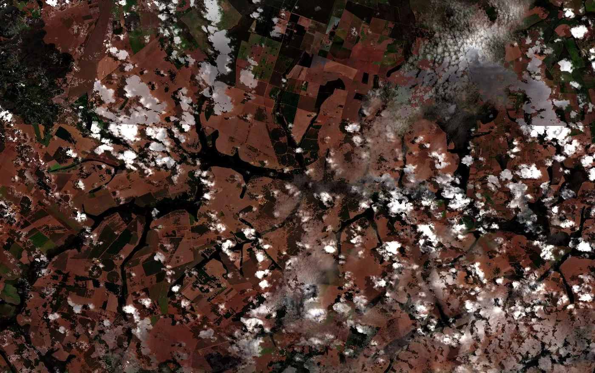
                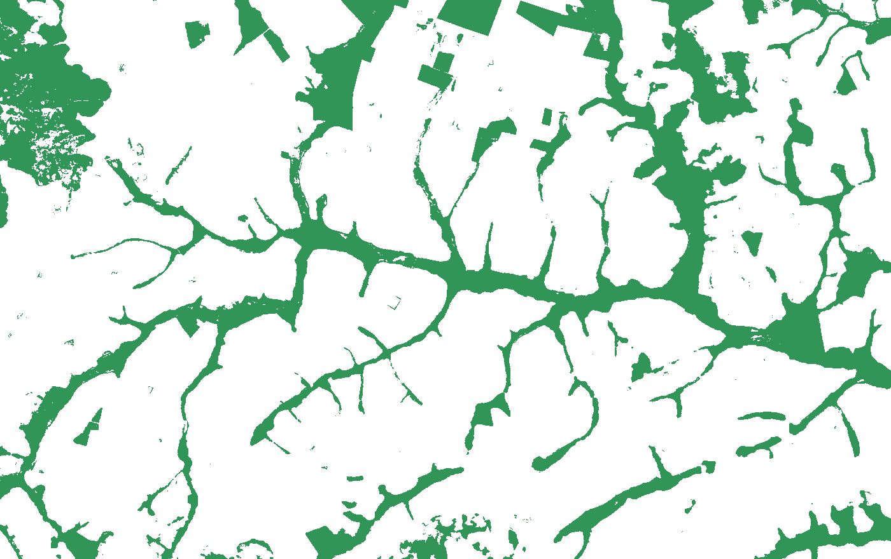
                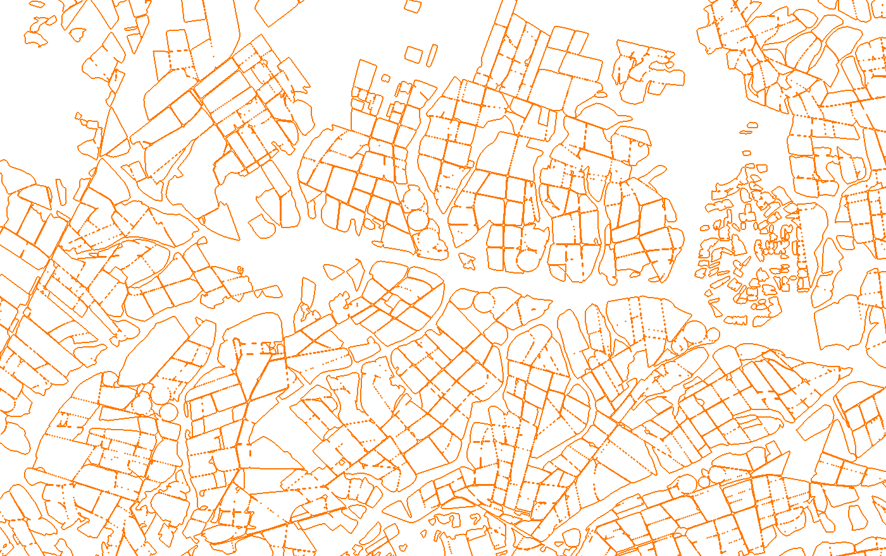
                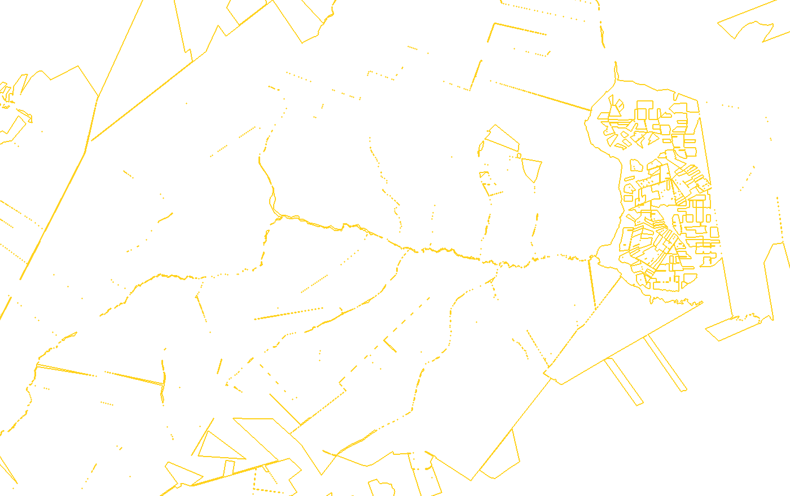
                <svg class="cv-sat-svg" viewBox="0 0 1400 880" aria-label="Polígonos interativos dos talhões agrícolas de Campo Verde">
                  <g data-cv-plots-group></g>
                </svg>
              </div>
              <div class="cv-sat-hud">
                <button type="button" class="cv-hud-btn" data-cv-zoom-out title="Reduzir zoom">−</button>
                <span data-cv-zoom-val style="min-width:2.7rem; text-align:center; font-variant-numeric:tabular-nums;">100%</span>
                <button type="button" class="cv-hud-btn" data-cv-zoom-in title="Ampliar zoom">+</button>
                <button type="button" class="cv-hud-btn" data-cv-zoom-fit title="Ajustar ao quadro">Ajustar</button>
              </div>
              <div class="cv-sat-badge" data-cv-sat-badge>Sentinel-2 RGB · 2021 Q1 (1ª safra)</div>
            </div>

            <div class="parcel-legend" style="margin-top:0.55rem;">
              <span class="parcel-legend-item"><i class="parcel-swatch" style="background:#5a9a2e"></i> Soja</span>
              <span class="parcel-legend-item"><i class="parcel-swatch" style="background:#d99b26"></i> Milho 2ª safra</span>
              <span class="parcel-legend-item"><i class="parcel-swatch" style="background:#3b82a6"></i> Algodão 2ª safra</span>
              <span class="parcel-legend-item"><i class="parcel-swatch" style="background:#1f8d49"></i> Dossel florestal (10 m)</span>
              <span class="parcel-legend-item"><i class="parcel-swatch" style="border:2px dashed #ff4d42; background:transparent"></i> Divergência na referência</span>
            </div>
          </div>

          <div>
            <div class="parcel-inspector">
              <div class="parcel-inspector-head">
                <span class="parcel-inspector-title" data-parcel-title>Talhão #3622 (401,7 ha · Campo Verde, MT)</span>
                <span class="parcel-inspector-meta" data-parcel-meta>FID 3622_5102678 · Pico NDVI 1ª safra: 0,73 | 2ª safra: 0,90</span>
              </div>
              <div class="parcel-compare-row" style="margin-bottom:0.45rem;">
                <div class="parcel-compare-cell">
                  <span>Classificação GAIA (SAR + óptico)</span>
                  <strong data-parcel-sar>Algodão 2ª safra (sucessão)</strong>
                </div>
                <div class="parcel-compare-cell">
                  <span>Referência pública (MapBiomas)</span>
                  <strong data-parcel-ref class="is-error">Soja / lavoura temporária (divergente)</strong>
                </div>
              </div>
              <div class="parcel-compare-row" style="margin-bottom:0.2rem;">
                <div class="parcel-compare-cell">
                  <span>Pico de NDVI no ano agrícola</span>
                  <strong data-parcel-ndvi>0.90</strong>
                </div>
                <div class="parcel-compare-cell">
                  <span>Filtro de nuvem na série temporal</span>
                  <strong data-parcel-drops>5 passagens filtradas</strong>
                </div>
              </div>
              <button type="button" class="cv-jump-link" data-cv-jump-iv>Inspecionar curva espectral deste talhão na Etapa 2 ↓</button>
            </div>

            <div class="acc-bench">
              <div style="font-size: 0.78rem; font-weight: 700; text-transform: uppercase; letter-spacing: 0.06em; color: var(--gaia-muted);">Acurácia validada contra dados de campo do INPE (Campo Verde, MT)</div>
              <div class="acc-crop-group">
                <div class="acc-crop-head"><span>Algodão</span><span>+25,6 p.p. sobre a referência</span></div>
                <div class="acc-dual-bars">
                  <div class="acc-bar-row"><span>GAIA Lab</span><div class="acc-bar-track"><div class="acc-bar-fill gaia" style="width:90%"></div></div><span class="acc-bar-pct">90,0%</span></div>
                  <div class="acc-bar-row"><span>Ref. pública</span><div class="acc-bar-track"><div class="acc-bar-fill ref" style="width:64.4%"></div></div><span class="acc-bar-pct">64,4%</span></div>
                </div>
              </div>
              <div class="acc-crop-group">
                <div class="acc-crop-head"><span>Milho</span><span>+9,1 p.p. sobre a referência</span></div>
                <div class="acc-dual-bars">
                  <div class="acc-bar-row"><span>GAIA Lab</span><div class="acc-bar-track"><div class="acc-bar-fill gaia" style="width:91.5%"></div></div><span class="acc-bar-pct">91,5%</span></div>
                  <div class="acc-bar-row"><span>Ref. pública</span><div class="acc-bar-track"><div class="acc-bar-fill ref" style="width:82.4%"></div></div><span class="acc-bar-pct">82,4%</span></div>
                </div>
              </div>
              <div class="acc-crop-group">
                <div class="acc-crop-head"><span>Soja</span><span>98,7% vs. 99,3%</span></div>
                <div class="acc-dual-bars">
                  <div class="acc-bar-row"><span>GAIA Lab</span><div class="acc-bar-track"><div class="acc-bar-fill gaia" style="width:98.7%"></div></div><span class="acc-bar-pct">98,7%</span></div>
                  <div class="acc-bar-row"><span>Ref. pública</span><div class="acc-bar-track"><div class="acc-bar-fill ref" style="width:99.3%"></div></div><span class="acc-bar-pct">99,3%</span></div>
                </div>
              </div>
            </div>
          </div>
        </div>
      </div>
    </div>
  </div>

  <div class="proj-block reveal">
    <div class="proj-header">
      <h3>Etapa 2 · Séries temporais de índices de vegetação e filtragem de nebulosidade</h3>
    </div>
    <div class="proj-prose">
      <p>Com os polígonos dos talhões delimitados, a segunda etapa reconstrói a evolução espectral de cada área ao longo das safras. O pipeline extrai as refletâncias do satélite <strong>Sentinel-2</strong> sobre cada polígono a partir dos cubos de dados do <strong>Brazil Data Cube (BDC)</strong> e calcula <strong>17 índices de vegetação complementares</strong> (incluindo NDVI, EVI, EVI2, NDWI, NDRE, SAVI, MSAVI e GNDVI), cobrindo vigor fotossintético, conteúdo de água no dossel e borda vermelha. A base consolidada soma <strong>499,7 mil séries por talhão</strong> e <strong>11,5 milhões de registros</strong>.</p>
      <p>Mesmo em composições temporais regulares, períodos de nebulosidade persistente no verão produzem observações contaminadas por nuvens residuais que derrubam artificialmente os índices. Para evitar que ruídos atmosféricos sejam lidos como perda de lavoura, o sistema filtra automaticamente as passagens com cobertura limpa insuficiente (descartando <strong>5,55%</strong> das observações comprometidas) e aplica suavização temporal penalizada para reconstruir a curva contínua de vigor e suas agregações mensais.</p>
    </div>

    <div class="iviz-card reveal" data-cv-iv-explorer data-lang="pt">
      <div class="iviz-top">
        <div>
          <span class="iviz-kicker">Figura interativa 2 · Série espectral real do talhão selecionado (Sentinel-2 / BDC)</span>
          <h4 class="iviz-title">Sazonalidade, remoção de nuvem residual e reconstrução da curva de vigor</h4>
          <p class="iviz-sub">A curva abaixo exibe os dados reais do talhão clicado no mapa de Campo Verde acima. Alterne entre os índices espectrais ou passe o cursor sobre cada passagem de satélite.</p>
        </div>
        <div class="iviz-controls">
          <button type="button" class="iviz-btn is-active" data-iv-index="NDVI" aria-pressed="true">NDVI (Vigor)</button>
          <button type="button" class="iviz-btn" data-iv-index="EVI" aria-pressed="false">EVI (Biomassa)</button>
          <button type="button" class="iviz-btn" data-iv-index="NDWI" aria-pressed="false">NDWI (Água no dossel)</button>
          <button type="button" class="iviz-btn" data-iv-index="NDRE" aria-pressed="false">NDRE (Borda vermelha)</button>
        </div>
      </div>

      <div class="iviz-body">
        <div class="cv-sat-toolbar">
          <div class="cv-sat-group">
            <span class="cv-sat-label">Talhão ativo:</span>
            <strong data-iv-active-plot style="font-size:0.82rem; color:var(--gaia-accent); margin-right:0.35rem;">Talhão #3622 (401,7 ha · Algodão 2ª safra)</strong>
            <button type="button" class="iviz-btn is-active" data-iv-preset="3622_5102678" aria-pressed="true">#3622 (Algodão 2ª safra)</button>
            <button type="button" class="iviz-btn" data-iv-preset="3424_5102678" aria-pressed="false">#3424 (Milho 2ª safra)</button>
            <button type="button" class="iviz-btn" data-iv-preset="3671_5102678" aria-pressed="false">#3671 (Soja 1ª safra)</button>
            <button type="button" class="iviz-btn" data-iv-center-map>Localizar no mapa ↑</button>
          </div>
          <div class="cv-sat-group">
            <span class="cv-sat-label">Camadas da série:</span>
            <button type="button" class="iviz-btn is-active" data-iv-toggle="smooth" aria-pressed="true">Curva reconstruída</button>
            <button type="button" class="iviz-btn is-active" data-iv-toggle="raw" aria-pressed="true">Observação bruta</button>
            <button type="button" class="iviz-btn is-active" data-iv-toggle="drops" aria-pressed="true">Quedas por nuvem residual</button>
            <button type="button" class="iviz-btn is-active" data-iv-toggle="band" aria-pressed="true">Faixa regional P25 a P75 (2.266 talhões)</button>
          </div>
        </div>

        <div class="iviz-grid-2">
          <div>
            <div class="cv-iv-svg-wrap">
              <svg viewBox="0 0 680 225" style="width:100%; height:auto; display:block;" role="img" aria-label="Série temporal interativa de índices de vegetação do talhão selecionado em Campo Verde">
                <line x1="42" y1="18" x2="656" y2="18" stroke="currentColor" stroke-opacity="0.1" stroke-dasharray="3 3" />
                <line x1="42" y1="108" x2="656" y2="108" stroke="currentColor" stroke-opacity="0.12" stroke-dasharray="3 3" />
                <line x1="42" y1="198" x2="656" y2="198" stroke="currentColor" stroke-opacity="0.24" />
                <text x="8" y="22" font-size="10" fill="currentColor" opacity="0.65" data-iv-ylabel>1.0</text>
                <text x="8" y="112" font-size="10" fill="currentColor" opacity="0.65" data-iv-ylabel>0.5</text>
                <text x="8" y="202" font-size="10" fill="currentColor" opacity="0.65" data-iv-ylabel>0.0</text>

                <path data-iv-svg-band d="" fill="rgba(79, 138, 34, 0.16)" />
                <path data-iv-svg-median d="" fill="none" stroke="#689f38" stroke-width="1.5" stroke-dasharray="4 3" opacity="0.75" />
                <path data-iv-svg-raw d="" fill="none" stroke="#8b9488" stroke-width="1.6" stroke-dasharray="3 3" />
                <path data-iv-svg-smooth d="" fill="none" stroke="var(--gaia-accent)" stroke-width="3.2" />
                <g data-iv-svg-drops></g>
                <g data-iv-svg-points></g>

                <text x="48" y="216" font-size="10" fill="currentColor" opacity="0.7">Jan</text>
                <text x="155" y="216" font-size="10" fill="currentColor" opacity="0.7">Mar</text>
                <text x="265" y="216" font-size="10" fill="currentColor" opacity="0.7">Mai</text>
                <text x="375" y="216" font-size="10" fill="currentColor" opacity="0.7">Jul (Seca)</text>
                <text x="495" y="216" font-size="10" fill="currentColor" opacity="0.7">Set</text>
                <text x="605" y="216" font-size="10" fill="currentColor" opacity="0.7">Nov/Dez</text>
              </svg>
            </div>
            <div class="parcel-legend" style="margin-top:0.5rem;">
              <span class="parcel-legend-item"><i class="parcel-swatch" style="background:var(--gaia-accent)"></i> Curva suavizada (reconstruída)</span>
              <span class="parcel-legend-item"><i class="parcel-swatch" style="background:#8b9488"></i> Observação bruta (16 dias)</span>
              <span class="parcel-legend-item"><i class="parcel-swatch" style="background:#d9483b"></i> Queda por nuvem descartada</span>
              <span class="parcel-legend-item"><i class="parcel-swatch" style="background:rgba(79, 138, 34, 0.35)"></i> Mediana e banda interquartil de Campo Verde</span>
            </div>
          </div>

          <div>
            <div class="parcel-inspector" style="margin-bottom:0.75rem;">
              <div class="parcel-inspector-head">
                <span class="parcel-inspector-title">Inspeção da passagem de satélite</span>
                <span class="parcel-inspector-meta" data-iv-insp-date>2021-03-06</span>
              </div>
              <div class="parcel-compare-row" style="grid-template-columns: 1fr 1fr 1fr; margin-bottom:0.5rem;">
                <div class="parcel-compare-cell">
                  <span>Valor bruto (BDC)</span>
                  <strong data-iv-insp-raw>0.074</strong>
                </div>
                <div class="parcel-compare-cell">
                  <span>Curva reconstruída</span>
                  <strong data-iv-insp-smooth>0.467</strong>
                </div>
                <div class="parcel-compare-cell">
                  <span>Cobertura limpa</span>
                  <strong data-iv-insp-clear>0%</strong>
                </div>
              </div>
              <div class="nota" style="margin-top:0;" data-iv-insp-status>
                Nuvem residual detectada (baixa cobertura limpa): queda espúria descartada pelo filtro antes da reconstrução da curva.
              </div>
            </div>
            <div class="nota" style="margin-top:0;">
              <strong>Por que vincular o mapa ao gráfico espectral:</strong> ao clicar em qualquer talhão real no visualizador da Etapa 1, você observa diretamente como o filtro de cobertura limpa remove os ruídos atmosféricos de verão e recupera os dois ciclos produtivos (1ª e 2ª safra) sobre a base de Campo Verde.
            </div>
          </div>
        </div>
      </div>
    </div>
  </div>

  <div class="proj-block reveal">
    <div class="proj-header">
      <h3>Etapa 3 · Detecção de início e fim de safra (SOS e EOS), janela do ZARC e risco na vizinhança</h3>
    </div>
    <div class="proj-prose">
      <p>Sobre a curva contínua de vigor de cada talhão, a terceira etapa identifica automaticamente os marcos fenológicos de cada ciclo produtivo: o <strong>início da safra (SOS)</strong> na inflexão de emergência pós-plantio, o <strong>pico vegetativo (POS)</strong> no fechamento máximo do dossel e o <strong>fim da safra (EOS)</strong> na senescência e colheita, separando o primeiro e o segundo cultivo do ano agrícola. O cruzamento das datas de início de safra detectadas por satélite com a janela oficial de plantio do <strong>ZARC (Zoneamento Agrícola de Risco Climático)</strong> permite auditar a aderência ao calendário agrícola em escala municipal: em Campo Verde (MT), <strong>65,5% dos talhões de soja</strong> iniciam a safra dentro da janela oficial do ZARC (variando entre <strong>72,7% e 84,5%</strong> em outros municípios avaliados), enquanto as culturas de segunda safra (algodão com 7,6% e milho safrinha com 3,3%) refletem a dependência direta do momento de colheita da primeira safra.</p>
      <p>Para transformar o acompanhamento fenológico em diagnóstico de risco de carteira, o produto combina os indicadores espectrais e climáticos de cada talhão-safra para agrupar talhões em <strong>perfis de comportamento</strong> por similaridade espectral e climática. A leitura é feita sempre <strong>em relação à vizinhança</strong>, o que separa dois fenômenos que costumam ser confundidos:</p>
      <ul>
        <li><strong>Risco operacional:</strong> manejo, praga ou condição específica do produtor. Um talhão vai mal enquanto os talhões vizinhos vão bem.</li>
        <li><strong>Risco sistêmico:</strong> seca, geada ou veranico regional. A vizinhança inteira perde vigor ao mesmo tempo. É a comparação com o entorno que diz de quem é o problema, sem exigir vistoria presencial em cada área.</li>
      </ul>
    </div>

    <div class="iviz-card reveal" data-pheno-explorer>
      <div class="iviz-top">
        <div>
          <span class="iviz-kicker">Figura interativa 3 · Fenologia (SOS / POS / EOS), ZARC e risco na vizinhança</span>
          <h4 class="iviz-title">Detecção do calendário de safra e separação entre risco operacional e risco sistêmico</h4>
          <p class="iviz-sub">Alterne entre os três modos abaixo para inspecionar os marcos de início (SOS), pico (POS) e fim de safra (EOS) e comparar o comportamento do talhão com a sua vizinhança.</p>
        </div>
        <div class="iviz-controls">
          <button type="button" class="iviz-btn is-active" data-pheno-mode="safra" aria-pressed="true"
            data-sos-label="SOS detectado: 18 out (1ª safra) · 22 fev (2ª safra)"
            data-pos-label="POS detectado: 14 dez (soja) · 28 abr (milho 2ª safra)"
            data-eos-label="EOS detectado: 08 fev (colheita 1ª safra) · 19 jun (colheita 2ª safra)"
            data-badge-text="Modo 1: Detecção de início e fim de safra (ciclo normal)"
            data-diag-text="A curva reconstruída isola os dois ciclos sucessivos no mesmo ano agrícola (soja na 1ª safra e milho na 2ª safra), demarcando automaticamente o início do ciclo (SOS), o pico vegetativo (POS) e a colheita (EOS). O plantio da 1ª safra ocorre dentro da janela oficial do ZARC.">
            1. Início e fim de safra (SOS / EOS)
          </button>
          <button type="button" class="iviz-btn" data-pheno-mode="operacional" aria-pressed="false"
            data-sos-label="SOS detectado: 18 out (1ª safra normal) · 24 fev (2ª safra)"
            data-pos-label="POS atingido na 1ª safra; perda precoce de vigor na 2ª safra"
            data-eos-label="Queda acentuada (-34%) na 2ª safra fora do padrão dos vizinhos"
            data-badge-text="Modo 2: Diagnóstico de risco operacional localizado"
            data-diag-text="Após o início da 2ª safra, a curva do talhão-alvo descola da faixa P10 a P90 da vizinhança, enquanto os 8 talhões vizinhos no mesmo perfil espectral e climático seguem saudáveis. A anomalia aponta problema localizado de manejo ou fitossanidade.">
            2. Risco operacional (local)
          </button>
          <button type="button" class="iviz-btn" data-pheno-mode="sistemico" aria-pressed="false"
            data-sos-label="SOS detectado: 18 out (1ª safra) · 25 fev (2ª safra)"
            data-pos-label="Perda conjunta de vigor antes do pico potencial da 2ª safra"
            data-eos-label="Senescência antecipada em toda a vizinhança por déficit hídrico"
            data-badge-text="Modo 3: Diagnóstico de risco climático sistêmico"
            data-diag-text="Tanto o talhão-alvo quanto toda a faixa da vizinhança sofrem queda simultânea de vigor durante o veranico. Como o entorno inteiro responde na mesma direção, o sistema classifica o evento como choque climático regional.">
            3. Risco sistêmico (regional)
          </button>
        </div>
      </div>

      <div class="iviz-body">
        <div class="iviz-grid-2">
          <div>
            <div style="font-size: 0.78rem; font-weight: 700; text-transform: uppercase; letter-spacing: 0.06em; color: var(--gaia-muted); margin-bottom: 0.4rem;">Curva fenológica (1ª e 2ª safra), marcos SOS/POS/EOS e faixa P10 a P90 da vizinhança</div>
            <svg viewBox="0 0 380 160" style="width:100%; height:auto; display:block;" role="img" aria-label="Curva fenológica com detecção de início de safra SOS, pico POS, fim de safra EOS e comparação com vizinhança">
              <rect x="48" y="14" width="38" height="114" fill="rgba(54, 89, 2, 0.08)" stroke="rgba(54, 89, 2, 0.28)" stroke-dasharray="3 2" />
              <text x="67" y="25" text-anchor="middle" font-size="8" font-weight="700" fill="var(--gaia-accent)">Janela ZARC</text>
              <line x1="30" y1="128" x2="362" y2="128" stroke="currentColor" stroke-opacity="0.22" />
              <line x1="30" y1="22" x2="362" y2="22" stroke="currentColor" stroke-opacity="0.1" stroke-dasharray="3 3" />

              <path class="pheno-env-area" d="M 30,114 C 52,112 68,96 82,70 C 98,34 118,18 140,16 C 162,18 180,60 196,96 C 206,104 216,100 228,80 C 246,44 268,24 290,22 C 312,24 330,68 346,100 L 358,110 L 358,122 L 346,116 C 330,86 312,42 290,40 C 268,42 246,62 228,96 C 216,114 206,118 196,112 C 180,76 162,34 140,32 C 118,34 98,52 82,86 C 68,108 52,120 30,122 Z" fill="rgba(79, 138, 34, 0.20)" />
              <path class="pheno-env-mean" d="M 30,118 C 52,116 68,102 82,78 C 98,42 118,24 140,22 C 162,24 180,68 196,104 C 206,112 216,108 228,88 C 246,52 268,32 290,30 C 312,32 330,76 346,108 L 358,116" fill="none" stroke="#4f8a22" stroke-width="1.8" stroke-dasharray="4 3" />
              <path class="pheno-target-line" d="M 30,118 C 52,116 68,102 82,78 C 98,42 118,24 140,22 C 162,24 180,68 196,104 C 206,112 216,108 228,88 C 246,52 268,32 290,30 C 312,32 330,76 346,108 L 358,116" fill="none" stroke="#365902" stroke-width="3" />

              <g class="pheno-markers-group">
                <circle cx="64" cy="105" r="4.2" fill="#2b6cb0" stroke="#fff" stroke-width="1.4" />
                <text x="64" y="96" text-anchor="middle" font-size="8.5" font-weight="700" fill="#2b6cb0">SOS 1</text>
                <circle cx="140" cy="22" r="4.2" fill="#365902" stroke="#fff" stroke-width="1.4" />
                <text x="140" y="14" text-anchor="middle" font-size="8.5" font-weight="700" fill="var(--gaia-accent)">POS 1</text>
                <circle cx="196" cy="104" r="4.2" fill="#d99b26" stroke="#fff" stroke-width="1.4" />
                <text x="196" y="121" text-anchor="middle" font-size="8.5" font-weight="700" fill="#b7791f">EOS 1</text>

                <circle cx="222" cy="96" r="4.2" fill="#2b6cb0" stroke="#fff" stroke-width="1.4" />
                <text x="222" y="85" text-anchor="middle" font-size="8.5" font-weight="700" fill="#2b6cb0">SOS 2</text>
                <circle cx="290" cy="30" r="4.2" fill="#365902" stroke="#fff" stroke-width="1.4" />
                <text x="290" y="21" text-anchor="middle" font-size="8.5" font-weight="700" fill="var(--gaia-accent)">POS 2</text>
                <circle cx="346" cy="108" r="4.2" fill="#d99b26" stroke="#fff" stroke-width="1.4" />
                <text x="346" y="123" text-anchor="middle" font-size="8.5" font-weight="700" fill="#b7791f">EOS 2</text>
              </g>

              <text x="64" y="144" text-anchor="middle" font-size="9" fill="currentColor" opacity="0.7">Out (Plantio)</text>
              <text x="140" y="144" text-anchor="middle" font-size="9" fill="currentColor" opacity="0.7">Dez (1ª safra)</text>
              <text x="208" y="144" text-anchor="middle" font-size="9" fill="currentColor" opacity="0.7">Fev (Colheita/2ª)</text>
              <text x="290" y="144" text-anchor="middle" font-size="9" fill="currentColor" opacity="0.7">Abr (2ª safra)</text>
              <text x="348" y="144" text-anchor="middle" font-size="9" fill="currentColor" opacity="0.7">Jun</text>
            </svg>

            <div class="parcel-compare-row" style="grid-template-columns: 1fr; gap: 0.35rem; margin-top: 0.6rem;">
              <div class="parcel-compare-cell" style="display:flex; justify-content:space-between; align-items:center;">
                <span>Início da safra (emergência pós-plantio)</span>
                <strong data-pheno-sos style="font-size:0.8rem;">SOS detectado: 18 out (1ª safra) · 22 fev (2ª safra)</strong>
              </div>
              <div class="parcel-compare-cell" style="display:flex; justify-content:space-between; align-items:center;">
                <span>Pico vegetativo (máximo vigor do dossel)</span>
                <strong data-pheno-pos style="font-size:0.8rem;">POS detectado: 14 dez (soja) · 28 abr (milho 2ª safra)</strong>
              </div>
              <div class="parcel-compare-cell" style="display:flex; justify-content:space-between; align-items:center;">
                <span>Fim da safra (senescência e colheita)</span>
                <strong data-pheno-eos style="font-size:0.8rem;">EOS detectado: 08 fev (colheita 1ª safra) · 19 jun (colheita 2ª safra)</strong>
              </div>
            </div>
          </div>

          <div>
            <div style="display:grid; grid-template-columns: 0.95fr 1.05fr; gap: 0.85rem; align-items: center; margin-bottom: 0.85rem;">
              <div class="neighbor-stage" style="padding: 0.75rem;">
                <div style="font-size: 0.72rem; font-weight: 700; text-transform: uppercase; letter-spacing: 0.05em; color: var(--gaia-muted); margin-bottom: 0.45rem; text-align:center;">Vizinhança espectral</div>
                <svg class="neighbor-grid-svg" viewBox="0 0 180 180" style="max-width: 135px;" role="img" aria-label="Grade espacial comparando o talhão-alvo central com oito talhões vizinhos">
                  <rect class="neighbor-cell" data-health="healthy" x="12" y="12" width="48" height="48" rx="6" />
                  <rect class="neighbor-cell" data-health="healthy" x="66" y="12" width="48" height="48" rx="6" />
                  <rect class="neighbor-cell" data-health="healthy" x="120" y="12" width="48" height="48" rx="6" />
                  <rect class="neighbor-cell" data-health="healthy" x="12" y="66" width="48" height="48" rx="6" />
                  <rect class="neighbor-target-cell" data-health="healthy" x="66" y="66" width="48" height="48" rx="6" />
                  <text x="90" y="94" text-anchor="middle" fill="#fff" font-size="10" font-weight="700">ALVO</text>
                  <rect class="neighbor-cell" data-health="healthy" x="120" y="66" width="48" height="48" rx="6" />
                  <rect class="neighbor-cell" data-health="healthy" x="12" y="120" width="48" height="48" rx="6" />
                  <rect class="neighbor-cell" data-health="healthy" x="66" y="120" width="48" height="48" rx="6" />
                  <rect class="neighbor-cell" data-health="healthy" x="120" y="120" width="48" height="48" rx="6" />
                </svg>
              </div>

              <div class="acc-bench" style="gap: 0.55rem;">
                <div style="font-size: 0.73rem; font-weight: 700; text-transform: uppercase; letter-spacing: 0.05em; color: var(--gaia-muted);">Plantio (SOS) dentro da janela oficial do ZARC</div>
                <div class="acc-crop-group">
                  <div class="acc-crop-head" style="font-size:0.78rem;"><span>Soja (Campo Verde, MT)</span><span>65,5% (até 84,5% em outros mun.)</span></div>
                  <div class="acc-bar-track"><div class="acc-bar-fill gaia" style="width:65.5%"></div></div>
                </div>
                <div class="acc-crop-group">
                  <div class="acc-crop-head" style="font-size:0.78rem;"><span>Algodão</span><span>7,6%</span></div>
                  <div class="acc-bar-track"><div class="acc-bar-fill ref" style="width:7.6%"></div></div>
                </div>
                <div class="acc-crop-group">
                  <div class="acc-crop-head" style="font-size:0.78rem;"><span>Milho 2ª safra (safrinha)</span><span>3,3%</span></div>
                  <div class="acc-bar-track"><div class="acc-bar-fill ref" style="width:3.3%"></div></div>
                </div>
              </div>
            </div>

            <div class="nota" style="margin-top:0;">
              <strong data-pheno-badge>Modo 1: Detecção de início e fim de safra (ciclo normal)</strong>
              <div data-pheno-diagnosis style="margin-top:0.25rem;">A curva reconstruída isola os dois ciclos sucessivos no mesmo ano agrícola (soja na 1ª safra e milho na 2ª safra), demarcando automaticamente o início do ciclo (SOS), o pico vegetativo (POS) e a colheita (EOS). O plantio da 1ª safra ocorre dentro da janela oficial do ZARC.</div>
            </div>
          </div>
        </div>
      </div>
    </div>
  </div>

  <div class="proj-block reveal">
    <div class="proj-header">
      <h3>Etapa 4 · Dinâmica de estoque de macronutrientes no solo e resposta produtiva</h3>
    </div>
    <div class="proj-prose">
      <p>A área de agricultura também é explorada no projeto <strong>Macronutrientes</strong> em parceria com o <strong>FGV Agro</strong>, que responde de quanto cai a produção agrícola brasileira se a adubação de nitrogênio (N), fósforo (P) e potássio (K) for reduzida, e quanto essa redução custa ao longo dos anos. O objeto central do modelo é o <strong>estoque de nutriente no solo</strong>, e não apenas a aplicação do ano: um solo com estoque alto absorve anos de corte antes de a produção cair, enquanto um solo pobre sente o corte já na primeira safra. A entrega cobre <strong>cinco culturas</strong> (soja, milho, arroz, cana e algodão) sobre uma linha de base de estatística oficial.</p>
      <p>Dois cuidados metodológicos estruturam a ferramenta. Primeiro, <strong>a biologia da cultura está dentro do modelo</strong>: cortar nitrogênio quase não derruba a soja brasileira, porque a planta fixa nitrogênio do ar; um modelo que tratasse N, P e K como três insumos simétricos erraria aqui. Segundo, <strong>cada número carrega de onde veio</strong>: o painel etiqueta o que é estatística oficial, o que é parâmetro de literatura e o que é estimativa do projeto, e onde a agronomia não tem consenso sobre como combinar três limitações simultâneas numa perda única, as duas regras possíveis ficam abertas à escolha do usuário, dizendo qual é a mais defensável e qual é o limite pessimista.</p>
    </div>

    <div class="iviz-card reveal" data-npk-sim data-lang="pt">
      <div class="iviz-top">
        <div>
          <span class="iviz-kicker">Figura interativa 4 · Estoque de nutrientes no solo (N, P e K)</span>
          <h4 class="iviz-title">Trajetória de produtividade e depleção de estoque em 5 safras</h4>
          <p class="iviz-sub">Combine cultura, nutriente cortado, condição inicial do solo e regra de combinação para testar a sensibilidade da produção.</p>
        </div>
      </div>

      <div class="iviz-body">
        <div class="npk-controls-grid">
          <div class="npk-ctrl-group">
            <label>1. Cultura agrícola</label>
            <div class="iviz-controls">
              <button type="button" class="iviz-btn is-active" data-npk-crop="soja" aria-pressed="true">Soja</button>
              <button type="button" class="iviz-btn" data-npk-crop="milho" aria-pressed="false">Milho</button>
              <button type="button" class="iviz-btn" data-npk-crop="algodao" aria-pressed="false">Algodão</button>
            </div>
          </div>
          <div class="npk-ctrl-group">
            <label>2. Corte de adubação</label>
            <div class="iviz-controls">
              <button type="button" class="iviz-btn is-active" data-npk-cut="N" aria-pressed="true">Corte de N</button>
              <button type="button" class="iviz-btn" data-npk-cut="P" aria-pressed="false">Corte de P</button>
              <button type="button" class="iviz-btn" data-npk-cut="NPK" aria-pressed="false">Corte de N, P e K</button>
            </div>
          </div>
          <div class="npk-ctrl-group">
            <label>3. Estoque inicial no solo</label>
            <div class="iviz-controls">
              <button type="button" class="iviz-btn is-active" data-npk-soil="alto" aria-pressed="true">Estoque alto</button>
              <button type="button" class="iviz-btn" data-npk-soil="baixo" aria-pressed="false">Solo pobre</button>
            </div>
          </div>
          <div class="npk-ctrl-group">
            <label>4. Regra sob múltipla limitação</label>
            <div class="iviz-controls">
              <button type="button" class="iviz-btn is-active" data-npk-rule="defensavel" aria-pressed="true">Mais defensável</button>
              <button type="button" class="iviz-btn" data-npk-rule="pessimista" aria-pressed="false">Pessimista</button>
            </div>
          </div>
        </div>

        <div class="iviz-grid-2">
          <div>
            <svg viewBox="0 0 370 155" style="width:100%; height:auto; display:block;" role="img" aria-label="Gráfico de trajetória de 5 anos para produtividade relativa e estoque no solo">
              <line x1="35" y1="22" x2="340" y2="22" stroke="currentColor" stroke-opacity="0.12" stroke-dasharray="3 3" />
              <line x1="35" y1="77" x2="340" y2="77" stroke="currentColor" stroke-opacity="0.12" stroke-dasharray="3 3" />
              <line x1="35" y1="132" x2="340" y2="132" stroke="currentColor" stroke-opacity="0.25" />
              <text x="6" y="26" font-size="9.5" fill="currentColor" opacity="0.65">100%</text>
              <text x="12" y="80" font-size="9.5" fill="currentColor" opacity="0.65">50%</text>
              <text x="16" y="135" font-size="9.5" fill="currentColor" opacity="0.65">0%</text>

              <polyline class="npk-stock-line" fill="none" stroke="#d99b26" stroke-width="2.5" stroke-dasharray="5 3" points="45,22 115,26 185,30 255,33 325,35" />
              <polyline class="npk-yield-line" fill="none" stroke="var(--gaia-accent)" stroke-width="3.2" points="45,22 115,23 185,23 255,24 325,24" />

              <circle class="npk-stock-dot" cx="45" cy="22" r="3.5" fill="#d99b26" />
              <circle class="npk-stock-dot" cx="115" cy="26" r="3.5" fill="#d99b26" />
              <circle class="npk-stock-dot" cx="185" cy="30" r="3.5" fill="#d99b26" />
              <circle class="npk-stock-dot" cx="255" cy="33" r="3.5" fill="#d99b26" />
              <circle class="npk-stock-dot" cx="325" cy="35" r="3.5" fill="#d99b26" />

              <circle class="npk-yield-dot" cx="45" cy="22" r="4" fill="var(--gaia-accent)" />
              <circle class="npk-yield-dot" cx="115" cy="23" r="4" fill="var(--gaia-accent)" />
              <circle class="npk-yield-dot" cx="185" cy="23" r="4" fill="var(--gaia-accent)" />
              <circle class="npk-yield-dot" cx="255" cy="24" r="4" fill="var(--gaia-accent)" />
              <circle class="npk-yield-dot" cx="325" cy="24" r="4" fill="var(--gaia-accent)" />

              <text x="45" y="148" text-anchor="middle" font-size="9.5" fill="currentColor" opacity="0.7">Safra 1</text>
              <text x="115" y="148" text-anchor="middle" font-size="9.5" fill="currentColor" opacity="0.7">Safra 2</text>
              <text x="185" y="148" text-anchor="middle" font-size="9.5" fill="currentColor" opacity="0.7">Safra 3</text>
              <text x="255" y="148" text-anchor="middle" font-size="9.5" fill="currentColor" opacity="0.7">Safra 4</text>
              <text x="325" y="148" text-anchor="middle" font-size="9.5" fill="currentColor" opacity="0.7">Safra 5</text>
            </svg>
          </div>

          <div>
            <div style="display:grid; grid-template-columns:1fr 1fr; gap:0.75rem; margin-bottom:0.85rem;">
              <div class="parcel-compare-cell">
                <span>Produtividade na 5ª safra (linha contínua)</span>
                <strong data-npk-end-yield style="font-size:1.35rem;">98%</strong>
              </div>
              <div class="parcel-compare-cell">
                <span>Estoque remanescente (linha tracejada)</span>
                <strong data-npk-end-stock style="font-size:1.35rem; color:#d99b26;">88%</strong>
              </div>
            </div>
            <div class="nota" style="margin-top:0;">
              <strong>Leitura agronômica do cenário</strong>
              <div data-npk-callout style="margin-top:0.25rem;">Biologia da cultura no modelo: cortar nitrogênio mineral quase não derruba a produtividade da soja brasileira, pois a fixação biológica supre a maior parte da demanda da planta. Um modelo que tratasse N, P e K como insumos simétricos erraria essa resposta.</div>
            </div>
            <div class="npk-provenance-row">
              <span class="prov-tag"><i class="prov-dot" style="background:#365902"></i> Linha de base: Estatística oficial</span>
              <span class="prov-tag"><i class="prov-dot" style="background:#d99b26"></i> Parâmetros de resposta: Literatura</span>
              <span class="prov-tag"><i class="prov-dot" style="background:#3b82a6"></i> Estoque residual: Estimativa do projeto</span>
            </div>
          </div>
        </div>
      </div>
    </div>
  </div>

  <div class="area-meta-box reveal">
    <div>
      <div class="meta-col-label">Parceiro institucional</div>
      <div class="meta-col-val"><strong>FGV Agro</strong> (Centro de Estudos do Agronegócio da FGV)</div>
    </div>
    <div>
      <div class="meta-col-label">Linhas metodológicas conectadas</div>
      <div class="meta-pills">
        <a class="meta-pill" href="#linhas">Aprendizado com baixa rotulagem</a>
        <a class="meta-pill" href="#linhas">Adaptação de domínio</a>
        <a class="meta-pill" href="#linhas">Modelagem de incerteza</a>
        <a class="meta-pill" href="#linhas">Interação de sistemas geoespaciais</a>
      </div>
    </div>
  </div>
</section>

<section id="floresta" class="rsec">
  <span id="forests"></span>
  <div class="rsec-head reveal">
    <div class="rsec-num">02</div>
    <div>
      <span class="rsec-kicker">Área de aplicação</span>
      <h2>Floresta</h2>
    </div>
  </div>

  <p class="rsec-lead reveal">Monitoramento trimestral de dossel florestal com contexto espaço-temporal, quantificação de passivo ambiental por imóvel rural no CAR, camada semântica de incerteza e geração automática de relatórios territoriais.</p>

  <div class="proj-block reveal">
    <div class="proj-header">
      <h3>Etapa 1 · Monitoramento trimestral de dossel florestal e supressão intra-anual</h3>
    </div>
    <div class="proj-prose">
      <p>A área de floresta é explorada no projeto <strong>AgroInteligência Territorial</strong> em parceria com o <strong>FGV Agro</strong>, voltado a identificar onde há passivo ambiental sobre grandes carteiras rurais por meio do monitoramento intra-anual de cobertura florestal e de áreas protegidas por lei. Em vez de depender apenas de mapas anuais ou de imagens isoladas sujeitas a variações sazonais, o produto opera trimestre a trimestre combinando observações ópticas consecutivas do satélite <strong>Sentinel-2</strong> (10 metros de resolução) a representações anuais multissensor que integram radar, relevo e clima.</p>
      <p>Avaliado ao longo de 20 trimestres de teste em região espacial independente em Campo Verde (MT), o modelo atinge <strong>0,850 de IoU médio</strong> (precisão de 88,0% e <strong>revocação de 96,3%</strong> no mapeamento do dossel florestal), reduzindo os falsos positivos em áreas de pastagem em <strong>31,6%</strong> e em áreas de lavoura em <strong>20,9%</strong>. A série operacional produzida pelo laboratório abrange <strong>26 mapas trimestrais contínuos (2020 Q1 a 2026 Q2)</strong>.</p>
    </div>

    <div class="metrics reveal">
      <div>
        <div class="m-val" data-count="0.850" data-decimals="3">0,850</div>
        <div class="m-lab">IoU médio em 20 trimestres de teste</div>
      </div>
      <div>
        <div class="m-val" data-count="96.3" data-decimals="1" data-suffix="%">96,3%</div>
        <div class="m-lab">revocação em dossel florestal</div>
      </div>
      <div>
        <div class="m-val" data-count="31.6" data-decimals="1" data-prefix="-" data-suffix="%">-31,6%</div>
        <div class="m-lab">falsos positivos em pastagem</div>
      </div>
      <div>
        <div class="m-val" data-count="26">26</div>
        <div class="m-lab">trimestres mapeados (2020 Q1 a 2026 Q2)</div>
      </div>
    </div>

    <div class="iviz-card reveal" data-tab-group>
      <div class="iviz-top">
        <div>
          <span class="iviz-kicker">Figura interativa 1 · Evolução trimestral do dossel florestal</span>
          <h4 class="iviz-title">Comparação direta (2020 Q1 vs. 2026 Q2) e série contínua de 26 trimestres</h4>
          <p class="iviz-sub">Arraste o divisor para comparar os extremos da série ou percorra os 26 mapas trimestrais gerados pelo modelo em Campo Verde (MT).</p>
        </div>
        <div class="iviz-controls" role="tablist">
          <button type="button" class="iviz-btn is-active" data-tab-target="floresta-compare" role="tab" aria-selected="true">Comparador 2020 Q1 vs. 2026 Q2</button>
          <button type="button" class="iviz-btn" data-tab-target="floresta-scrub" role="tab" aria-selected="false">Série contínua de 26 trimestres</button>
        </div>
      </div>

      <div class="iviz-body">
        <div data-tab-pane="floresta-compare" class="is-active">
          <div class="compare" style="margin-top:0;">
            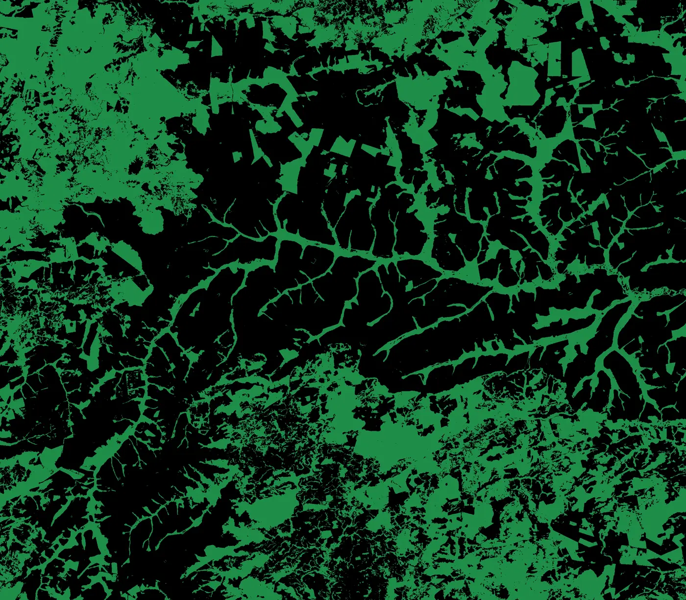
            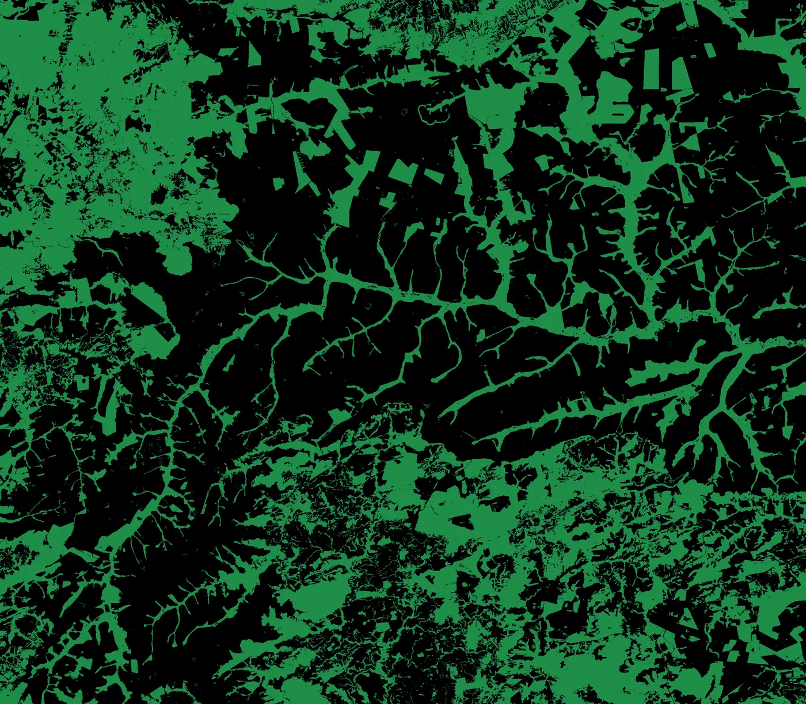
            <div class="compare-handle"></div>
            <span class="compare-label left">2020 Q1</span>
            <span class="compare-label right">2026 Q2</span>
            <input class="compare-range" type="range" min="0" max="100" value="50" aria-label="Comparar cobertura florestal entre 2020 Q1 e 2026 Q2">
          </div>
          <p class="compare-caption" style="margin-bottom:0;">Arraste o divisor central: em verde, a cobertura florestal nativa estimada pelo modelo sobre mosaico Sentinel-2; as áreas escuras que avançam entre 2020 Q1 e 2026 Q2 indicam supressão de vegetação.</p>
        </div>
        <div data-tab-pane="floresta-scrub" hidden>
          <div class="scrub" style="margin-top:0;" data-scrub
               data-base="images/floresta/trim-"
               data-ext=".webp"
               data-play-label="Reproduzir série"
               data-pause-label="Pausar série"
               data-quarters="2020q1,2020q2,2020q3,2020q4,2021q1,2021q2,2021q3,2021q4,2022q1,2022q2,2022q3,2022q4,2023q1,2023q2,2023q3,2023q4,2024q1,2024q2,2024q3,2024q4,2025q1,2025q2,2025q3,2025q4,2026q1,2026q2">
            <div class="scrub-stage">
              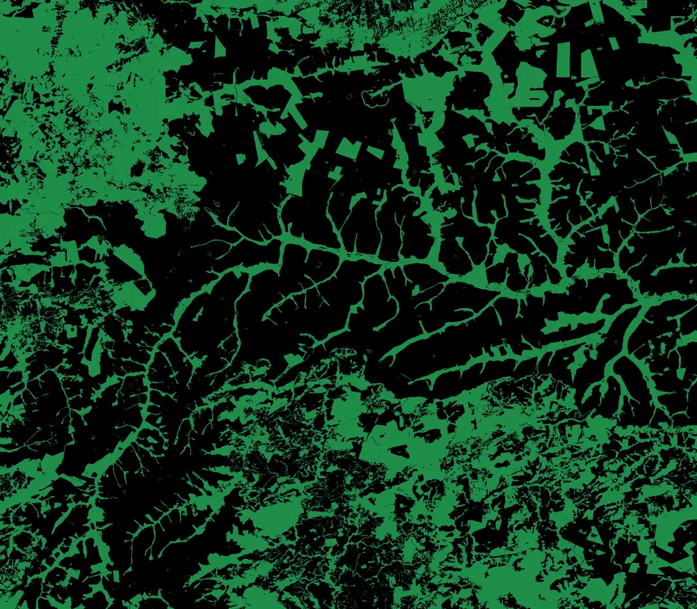
              <span class="scrub-badge">2026 Q2</span>
            </div>
            <div class="scrub-controls">
              <button class="scrub-play" type="button" aria-label="Reproduzir série">▶</button>
              <input class="scrub-range" type="range" min="0" max="25" value="25" aria-label="Escolher trimestre entre 2020 Q1 e 2026 Q2">
              <span class="scrub-label">2026 Q2</span>
            </div>
          </div>
        </div>
      </div>
    </div>
  </div>

  <div class="proj-block reveal">
    <div class="proj-header">
      <h3>Etapa 2 · Passivo ambiental por imóvel rural (CAR) e camada semântica de incerteza</h3>
    </div>
    <div class="proj-prose">
      <p>Na segunda etapa, os mapas trimestrais de cobertura florestal são cruzados com os perímetros declarados no <strong>Cadastro Ambiental Rural (CAR)</strong> para analisar o passivo ambiental (supressão recente e áreas protegidas por lei sem cobertura nativa) tendo o <strong>imóvel rural como unidade de análise</strong>. Avaliado sobre <strong>1.432 imóveis rurais</strong> em Campo Verde, o produto alcança <strong>0,797 de IoU</strong> dentro dos limites das propriedades cadastradas.</p>
      <p>Para apoiar a auditoria de carteira sem gerar falsos alertas de desmatamento durante a estação seca do Cerrado, o sistema quantifica a incerteza preditiva pixel a pixel e organiza o território em seis classes operacionais: diferencia <em>floresta consolidada</em>, <em>zonas de transição e borda</em>, <em>alerta de supressão</em>, <em>estresse hídrico sazonal</em> (quando a mata decídua perde folhagem na seca sem ter sofrido corte), <em>não-floresta estável</em> e <em>não-floresta provável</em>, permitindo priorizar a verificação e cruzar os alertas com bases oficiais como DETER e PRODES.</p>
    </div>

    <div class="iviz-card reveal" data-cv-forest-viewer>
      <div class="iviz-top">
        <div>
          <span class="iviz-kicker">Figura interativa 2 · Visualizador de satélite para auditoria por imóvel (CAR) e incerteza</span>
          <h4 class="iviz-title">Inspeção interativa com zoom e arrasto: dossel florestal, perímetros do CAR, incerteza semântica e talhões</h4>
          <p class="iviz-sub">Arraste a imagem de satélite de Campo Verde (MT), dê zoom até a escala de 10 metros e combine livremente as camadas de predição, recorte por imóvel, incerteza e lavouras vizinhas.</p>
        </div>
        <div class="iviz-controls">
          <button type="button" class="iviz-btn is-active" data-cv-f-clip="completo" aria-pressed="true">Predição em toda a cena</button>
          <button type="button" class="iviz-btn" data-cv-f-clip="car" aria-pressed="false">Recorte apenas nos imóveis do CAR (1.432 imóveis)</button>
        </div>
      </div>
      <div class="iviz-body">
        <div class="cv-sat-toolbar">
          <div class="cv-sat-group">
            <span class="cv-sat-label">Trimestre:</span>
            <button type="button" class="iviz-btn is-active" data-cv-f-quarter="2023q3" data-badge="Sentinel-2 RGB · 2023 Q3 (Estação seca)" aria-pressed="true">2023 Q3 (Seca)</button>
            <button type="button" class="iviz-btn" data-cv-f-quarter="2020q1" data-badge="Sentinel-2 RGB · 2020 Q1 (Início da série)" aria-pressed="false">2020 Q1</button>
            <button type="button" class="iviz-btn" data-cv-f-quarter="2026q2" data-badge="Sentinel-2 RGB · 2026 Q2 (Fim da série)" aria-pressed="false">2026 Q2</button>
          </div>
          <div class="cv-sat-group">
            <span class="cv-sat-label">Camadas sobrepostas:</span>
            <button type="button" class="iviz-btn is-active" data-cv-f-toggle="pred" aria-pressed="true">Dossel florestal (10 m)</button>
            <button type="button" class="iviz-btn" data-cv-f-toggle="incerteza" aria-pressed="false">Classes de incerteza e alerta</button>
            <button type="button" class="iviz-btn is-active" data-cv-f-toggle="car" aria-pressed="true">Perímetros do CAR</button>
            <button type="button" class="iviz-btn" data-cv-f-toggle="talhoes" aria-pressed="false">Talhões agrícolas</button>
            <button type="button" class="iviz-btn" data-cv-f-toggle="rotulo" aria-pressed="false">Referência MapBiomas</button>
          </div>
          <div class="cv-sat-group">
            <span class="cv-sat-label">Opacidade:</span>
            <input type="range" class="cv-opacity-slider" data-cv-f-opacity min="10" max="100" value="78" aria-label="Opacidade das camadas florestais">
            <span data-cv-f-opacity-val style="font-variant-numeric: tabular-nums; font-weight:700;">78%</span>
          </div>
        </div>

        <div class="cv-sat-viewport" style="height:430px;" role="region" aria-label="Visualizador interativo de satélite para dossel florestal, CAR e incerteza em Campo Verde">
          <div class="cv-sat-stage">
            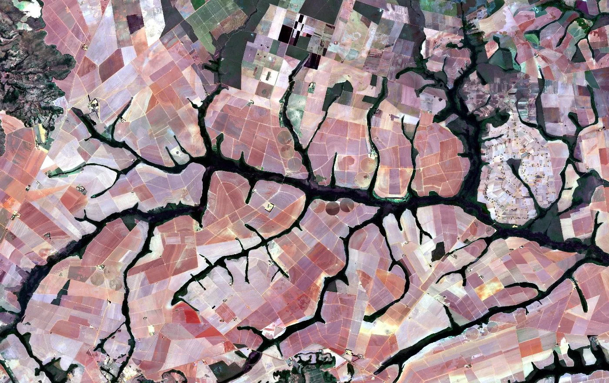
            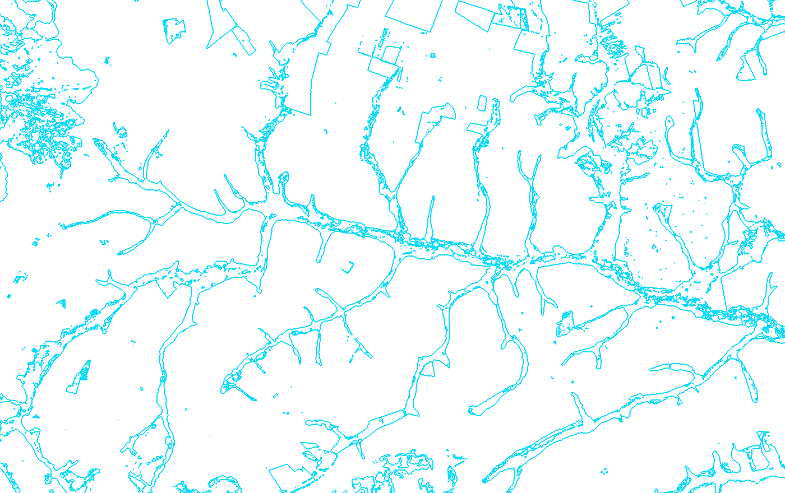
            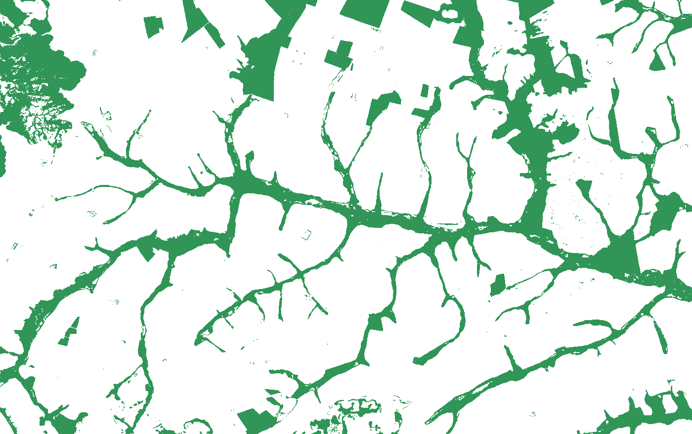
            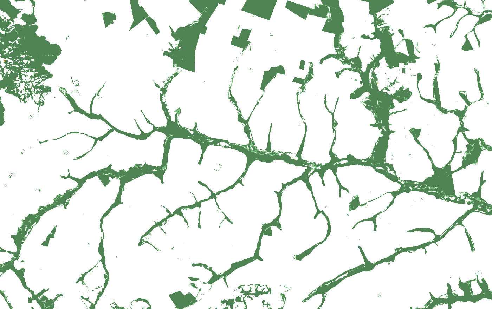
            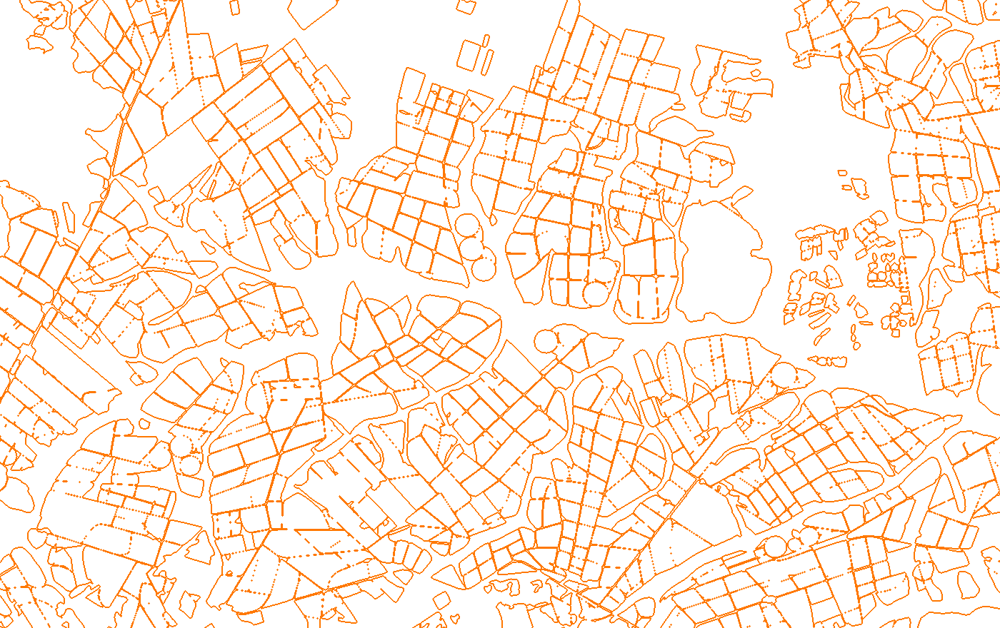
            
          </div>
          <div class="cv-sat-hud">
            <button type="button" class="cv-hud-btn" data-cv-zoom-out title="Reduzir zoom">−</button>
            <span data-cv-zoom-val style="min-width:2.7rem; text-align:center; font-variant-numeric:tabular-nums;">100%</span>
            <button type="button" class="cv-hud-btn" data-cv-zoom-in title="Ampliar zoom">+</button>
            <button type="button" class="cv-hud-btn" data-cv-zoom-fit title="Ajustar ao quadro">Ajustar</button>
          </div>
          <div class="cv-sat-badge" data-cv-sat-badge>Sentinel-2 RGB · 2023 Q3 (Estação seca)</div>
        </div>

        <div class="parcel-legend" style="margin-top:0.6rem;">
          <span class="parcel-legend-item"><i class="parcel-swatch" style="background:#1b5e20"></i> Floresta consolidada / dossel predito</span>
          <span class="parcel-legend-item"><i class="parcel-swatch" style="background:#66bb6a"></i> Zona de borda e transição</span>
          <span class="parcel-legend-item"><i class="parcel-swatch" style="background:#fdd835"></i> Estresse hídrico sazonal na seca</span>
          <span class="parcel-legend-item"><i class="parcel-swatch" style="background:#e53935"></i> Alerta de supressão</span>
          <span class="parcel-legend-item"><i class="parcel-swatch" style="border:2px solid #f59e0b; background:transparent"></i> Limites de imóveis do CAR</span>
        </div>
      </div>
    </div>
  </div>

  <div class="proj-block reveal">
    <div class="proj-header">
      <h3>Etapa 3 · Geração automática de relatórios territoriais e autonomia narrativa</h3>
    </div>
    <div class="proj-prose">
      <p>A área de floresta também é explorada no projeto desenvolvido em parceria com o <strong>FGVces</strong> (Centro de Estudos em Sustentabilidade da FGV) e a <strong>Coiab</strong> (Coordenação das Organizações Indígenas da Amazônia Brasileira), no qual construímos uma <strong>ferramenta de geração automática e edição de relatórios territoriais</strong> a partir de dois insumos: dados públicos oficiais e estruturas explícitas de narrativa. O sistema acompanha status e riscos de desmatamento, fogo, mineração e mudança climática nas escalas do Brasil, dos estados e das terras indígenas, gerando saídas em PDF, clipping ou página de observatório. É o único projeto do laboratório com contraparte técnica do parceiro trabalhando diretamente ao lado dos pesquisadores na integração com a plataforma geoespacial.</p>
      <p><strong>A narrativa depende da audiência:</strong> os mesmos dados públicos, o mesmo território e os mesmos fatos exigem estruturas de história distintas conforme o leitor. Um documento para a imprensa precisa ser direto e sintético; um relatório técnico precisa expor metodologia e margens de incerteza; uma representação para o Ministério Público precisa sustentar cada parágrafo com evidência rastreável até a fonte primária.</p>
      <p><strong>O ponto que dá sentido ao produto é o controle de quem escreve a história:</strong> relatórios sobre territórios indígenas historicamente são escritos por terceiros. Uma ferramenta que organiza dados públicos em uma estrutura narrativa explícita e editável <strong>transfere a autoria</strong>: a Coiab opera a ferramenta de edição, decide a história e assina o documento sobre o próprio território, apoiada pelo treinamento e pela transferência tecnológica realizados pelo projeto.</p>
    </div>

    <div class="iviz-card reveal" data-tab-group>
      <div class="iviz-top">
        <div>
          <span class="iviz-kicker">Figura interativa 3 · Estrutura narrativa por audiência (FGVces e Coiab)</span>
          <h4 class="iviz-title">Os mesmos dados públicos organizados para três perfis de leitor</h4>
          <p class="iviz-sub">Selecione o destinatário abaixo para observar como os mesmos indicadores territoriais de desmatamento, fogo, mineração e clima reorganizam a estrutura do relatório.</p>
        </div>
        <div class="iviz-controls" role="tablist">
          <button type="button" class="iviz-btn is-active" data-tab-target="aud-midia" role="tab" aria-selected="true">Para imprensa e clipping</button>
          <button type="button" class="iviz-btn" data-tab-target="aud-tecnico" role="tab" aria-selected="false">Para equipe técnica</button>
          <button type="button" class="iviz-btn" data-tab-target="aud-mp" role="tab" aria-selected="false">Para Ministério Público</button>
        </div>
      </div>

      <div class="iviz-body">
        <div class="iviz-grid-2">
          <div>
            <div style="font-size: 0.76rem; font-weight: 700; text-transform: uppercase; letter-spacing: 0.06em; color: var(--gaia-muted); margin-bottom: 0.55rem;">Eixos monitorados a partir de bases públicas oficiais</div>
            <div class="trend-grid" style="margin-top:0; grid-template-columns: 1fr 1fr;">
              <div class="trend-card">
                <div class="trend-name">Desmatamento</div>
                <div class="trend-value" style="font-size:1.25rem;">DETER / PRODES</div>
                <div class="trend-note">recorte por terra indígena, estado e Amazônia Legal</div>
              </div>
              <div class="trend-card">
                <div class="trend-name">Fogo</div>
                <div class="trend-value" style="font-size:1.25rem;">Focos e cicatrizes</div>
                <div class="trend-note">acompanhamento de queimadas e pressão no entorno</div>
              </div>
              <div class="trend-card">
                <div class="trend-name">Mineração</div>
                <div class="trend-value" style="font-size:1.25rem;">Garimpo e processos</div>
                <div class="trend-note">cruzamento de alertas e bases públicas oficiais</div>
              </div>
              <div class="trend-card">
                <div class="trend-name">Mudança climática</div>
                <div class="trend-value" style="font-size:1.25rem;">Seca e temperatura</div>
                <div class="trend-note">anomalias climáticas sobre o território</div>
              </div>
            </div>
          </div>
          <div>
            <div data-tab-pane="aud-midia" class="coiab-report-pane is-active">
              <div class="coiab-doc-kicker">Estrutura 1 · Imprensa e comunicação pública</div>
              <h5 class="coiab-doc-title">Síntese executiva com mensagens-chave e recorte territorial imediato</h5>
              <p class="coiab-doc-body">Prioriza leitura rápida dos fatos do período: destaca a variação recente de desmatamento e fogo na terra indígena ou estado selecionado, contextualiza a pressão em linguagem acessível e prepara recortes visuais prontos para boletins de imprensa e páginas de observatório.</p>
              <div class="coiab-doc-meta">
                <span>Saída: Clipping e boletim de divulgação</span>
                <span>Autoria e edição final: Coiab</span>
              </div>
            </div>

            <div data-tab-pane="aud-tecnico" class="coiab-report-pane" hidden>
              <div class="coiab-doc-kicker">Estrutura 2 · Corpo técnico e gestão territorial</div>
              <h5 class="coiab-doc-title">Detalhamento de séries históricas, metodologia e cruzamento entre ameaças</h5>
              <p class="coiab-doc-body">Apresenta a evolução completa das séries temporais de desmatamento, fogo, mineração e clima, explicitando as bases públicas consultadas, os critérios de agregação espacial (Brasil, estado ou terra indígena) e as notas metodológicas necessárias para acompanhamento pelas equipes técnicas.</p>
              <div class="coiab-doc-meta">
                <span>Saída: Relatório analítico em PDF e observatório</span>
                <span>Autoria e edição final: Coiab</span>
              </div>
            </div>

            <div data-tab-pane="aud-mp" class="coiab-report-pane" hidden>
              <div class="coiab-doc-kicker">Estrutura 3 · Órgãos de controle e Ministério Público</div>
              <h5 class="coiab-doc-title">Exposição formal com vínculo rastreável até cada registro público oficial</h5>
              <p class="coiab-doc-body">Organiza os fatos constatados no território com referência direta e verificável à fonte pública oficial de cada dado (alertas de desmatamento, registros de fogo e indícios de mineração), garantindo que cada afirmação do documento seja auditável na origem.</p>
              <div class="coiab-doc-meta">
                <span>Saída: Relatório instruído com fontes primárias citadas</span>
                <span>Autoria e edição final: Coiab</span>
              </div>
            </div>
          </div>
        </div>
      </div>
    </div>
  </div>

  <div class="area-meta-box reveal">
    <div>
      <div class="meta-col-label">Parceiros institucionais</div>
      <div class="meta-col-val"><strong>FGVces</strong>, <strong>Coiab</strong> (Coordenação das Organizações Indígenas da Amazônia Brasileira) e <strong>FGV Agro</strong></div>
    </div>
    <div>
      <div class="meta-col-label">Linhas metodológicas conectadas</div>
      <div class="meta-pills">
        <a class="meta-pill" href="#linhas">Aprendizado com baixa rotulagem</a>
        <a class="meta-pill" href="#linhas">Modelagem de dados textuais</a>
        <a class="meta-pill" href="#linhas">Open-set e OOD</a>
        <a class="meta-pill" href="#linhas">Adaptação de domínio</a>
      </div>
    </div>
  </div>
</section>

<section id="clima" class="rsec">
  <span id="climate"></span>
  <div class="rsec-head reveal">
    <div class="rsec-num">03</div>
    <div>
      <span class="rsec-kicker">Área de aplicação</span>
      <h2>Clima</h2>
    </div>
  </div>

  <p class="rsec-lead reveal">Eventos extremos, regimes e risco climático, do dado de reanálise e das projeções de modelos globais ao indicador aplicado sobre infraestrutura e agricultura.</p>

  <div class="proj-block reveal">
    <div class="proj-header">
      <h3>Exposição de infraestrutura de energia elétrica a ameaças climáticas extremas</h3>
    </div>
    <div class="proj-prose">
      <p>A área de clima é explorada no projeto desenvolvido em parceria com o <strong>FGV CERI</strong> (Centro de Estudos em Regulação e Infraestrutura da FGV), voltado à modelagem da exposição de infraestrutura de energia elétrica a <strong>ameaças climáticas extremas</strong>.</p>
      <p>O projeto completo cobre <strong>sete ameaças</strong>, cada uma com metodologia própria: tempestades e descargas atmosféricas, incêndios florestais, inundações fluviais, deslizamentos, temperaturas máximas, ventos extremos e elevação do nível do mar. As projeções combinam um conjunto de <strong>seis modelos climáticos globais</strong> em <strong>três cenários de emissão</strong> com bases observacionais nacionais e internacionais.</p>
      <p><strong>A contribuição do laboratório está na modelagem de cinco dessas ameaças</strong> (ventos extremos, tempestades, chuva intensa, incêndios florestais e temperaturas máximas) e na construção do <strong>painel interativo de mapas e indicadores</strong>.</p>
    </div>

    <div class="iviz-card reveal" data-ceri-explorer>
      <div class="iviz-top">
        <div>
          <span class="iviz-kicker">Figura interativa 1 · Escopo modelado pelo laboratório junto ao FGV CERI</span>
          <h4 class="iviz-title">Cinco ameaças climáticas em três cenários de emissão sobre o conjunto de 6 modelos globais</h4>
          <p class="iviz-sub">Selecione uma das cinco ameaças modeladas pelo laboratório e alterne entre o histórico observacional e os cenários de emissão para visualizar a estrutura do painel de exposição por trecho.</p>
        </div>
        <div class="iviz-controls">
          <button type="button" class="iviz-btn" data-ceri-scen="hist" aria-pressed="false">Base observacional</button>
          <button type="button" class="iviz-btn is-active" data-ceri-scen="ssp245" aria-pressed="true">Cenário intermediário</button>
          <button type="button" class="iviz-btn" data-ceri-scen="ssp585" aria-pressed="false">Cenário de alta emissão</button>
        </div>
      </div>

      <div class="iviz-body">
        <div class="iviz-controls" style="margin-bottom: 1.1rem;">
          <button type="button" class="iviz-btn is-active" data-ceri-threat="ventos" aria-pressed="true"
            data-title="1. Ventos extremos"
            data-indicator="Frente modelada pelo Green AI Lab · Conjunto de 6 modelos globais em 3 cenários"
            data-method="Modelagem da exposição de ativos de energia elétrica a eventos de ventos extremos, combinando projeções de seis modelos climáticos globais em três cenários de emissão com bases observacionais nacionais e internacionais no painel interativo.">
            1. Ventos extremos
          </button>
          <button type="button" class="iviz-btn" data-ceri-threat="tempestades" aria-pressed="false"
            data-title="2. Tempestades e descargas atmosféricas"
            data-indicator="Frente modelada pelo Green AI Lab · Conjunto de 6 modelos globais em 3 cenários"
            data-method="Modelagem da exposição a tempestades e descargas atmosféricas sobre a rede elétrica, integrando bases observacionais nacionais e internacionais às projeções dos seis modelos climáticos globais.">
            2. Tempestades
          </button>
          <button type="button" class="iviz-btn" data-ceri-threat="chuva" aria-pressed="false"
            data-title="3. Chuva intensa"
            data-indicator="Frente modelada pelo Green AI Lab · Conjunto de 6 modelos globais em 3 cenários"
            data-method="Modelagem de eventos de chuva intensa para avaliação de exposição física da infraestrutura elétrica sob três cenários de emissão e seis modelos climáticos globais.">
            3. Chuva intensa
          </button>
          <button type="button" class="iviz-btn" data-ceri-threat="incendios" aria-pressed="false"
            data-title="4. Incêndios florestais"
            data-indicator="Frente modelada pelo Green AI Lab · Conjunto de 6 modelos globais em 3 cenários"
            data-method="Modelagem do risco de incêndios florestais no entorno de infraestruturas de energia elétrica, disponibilizada em mapas e indicadores no painel interativo do projeto.">
            4. Incêndios florestais
          </button>
          <button type="button" class="iviz-btn" data-ceri-threat="temperatura" aria-pressed="false"
            data-title="5. Temperaturas máximas"
            data-indicator="Frente modelada pelo Green AI Lab · Conjunto de 6 modelos globais em 3 cenários"
            data-method="Modelagem de extremos de temperatura máxima a partir de bases observacionais e do conjunto de seis modelos climáticos globais em três cenários de emissão.">
            5. Temperaturas máximas
          </button>
        </div>

        <div class="iviz-grid-2">
          <div>
            <div style="font-size: 0.76rem; font-weight: 700; text-transform: uppercase; letter-spacing: 0.06em; color: var(--gaia-muted); margin-bottom: 0.5rem;">Representação esquemática de indicador relativo por trecho no painel (0 a 100)</div>
            <div class="ceri-bars-stage">
              <div class="grid-seg-col"><span class="grid-seg-val">39/100</span><div class="grid-seg-track"><div class="grid-seg-bar" data-level="low" style="height:39%"></div></div><span class="grid-seg-label">Trecho 1</span></div>
              <div class="grid-seg-col"><span class="grid-seg-val">58/100</span><div class="grid-seg-track"><div class="grid-seg-bar" data-level="med" style="height:58%"></div></div><span class="grid-seg-label">Trecho 2</span></div>
              <div class="grid-seg-col"><span class="grid-seg-val">48/100</span><div class="grid-seg-track"><div class="grid-seg-bar" data-level="low" style="height:48%"></div></div><span class="grid-seg-label">Trecho 3</span></div>
              <div class="grid-seg-col"><span class="grid-seg-val">76/100</span><div class="grid-seg-track"><div class="grid-seg-bar" data-level="high" style="height:76%"></div></div><span class="grid-seg-label">Trecho 4</span></div>
              <div class="grid-seg-col"><span class="grid-seg-val">67/100</span><div class="grid-seg-track"><div class="grid-seg-bar" data-level="med" style="height:67%"></div></div><span class="grid-seg-label">Trecho 5</span></div>
              <div class="grid-seg-col"><span class="grid-seg-val">44/100</span><div class="grid-seg-track"><div class="grid-seg-bar" data-level="low" style="height:44%"></div></div><span class="grid-seg-label">Trecho 6</span></div>
            </div>
          </div>

          <div>
            <div class="parcel-inspector" style="margin-bottom:0;">
              <div class="parcel-inspector-title" data-ceri-title style="margin-bottom:0.35rem;">1. Ventos extremos</div>
              <div style="font-size:0.82rem; font-weight:600; color:var(--gaia-accent); margin-bottom:0.55rem;" data-ceri-indicator>Frente modelada pelo Green AI Lab · Conjunto de 6 modelos globais em 3 cenários</div>
              <p style="font-size:0.88rem; line-height:1.58; margin:0 0 0.7rem;" data-ceri-method>Modelagem da exposição de ativos de energia elétrica a eventos de ventos extremos, combinando projeções de seis modelos climáticos globais em três cenários de emissão com bases observacionais nacionais e internacionais no painel interativo.</p>
              <div style="font-size:0.78rem; color:var(--gaia-muted); border-top:1px solid var(--gaia-border); padding-top:0.55rem;">
                Divisão no projeto completo (7 ameaças): o laboratório modela estas 5 ameaças e o painel interativo; inundações fluviais, deslizamentos e elevação do nível do mar compõem as demais frentes do projeto.
              </div>
            </div>
          </div>
        </div>
      </div>
    </div>
  </div>

  <div class="proj-block reveal">
    <div class="proj-header">
      <h3>Tendências climáticas municipais e acoplamento com o calendário agrícola (2011 a 2025)</h3>
    </div>
    <div class="proj-prose">
      <p>Na interface entre clima e agricultura dentro da parceria com o <strong>FGV Agro</strong>, o laboratório analisa séries históricas de indicadores climáticos por município para quantificar o aquecimento e o aumento de dias secos durante a janela agrícola. Os indicadores abaixo sintetizam a variação observada ao longo de <strong>15 anos (2011 a 2025)</strong> em Nova Mutum (MT).</p>
    </div>

    <div class="trend-grid reveal">
      <div class="trend-card">
        <div class="trend-name">Temperatura máxima</div>
        <div class="trend-value" data-count="1.1" data-decimals="1" data-prefix="+" data-suffix=" °C">+1,1 °C</div>
        <div class="trend-note">+0,76 °C por década na série de 2011 a 2025</div>
      </div>
      <div class="trend-card">
        <div class="trend-name">Noites quentes (&gt; 22 °C)</div>
        <div class="trend-value" data-count="108" data-prefix="+">+108</div>
        <div class="trend-note">noites por ano acima de 22 °C ao fim de 15 anos</div>
      </div>
      <div class="trend-card">
        <div class="trend-name">Precipitação anual</div>
        <div class="trend-value" data-count="7.7" data-decimals="1" data-prefix="-" data-suffix="%">-7,7%</div>
        <div class="trend-note">cerca de 151 mm a menos por ano no período</div>
      </div>
      <div class="trend-card">
        <div class="trend-name">Dias secos na estação chuvosa</div>
        <div class="trend-value" data-count="5.3" data-decimals="1" data-prefix="+" data-suffix=" dias">+5,3 dias</div>
        <div class="trend-note">de estiagem dentro da estação chuvosa</div>
      </div>
    </div>
  </div>

  <div class="area-meta-box reveal">
    <div>
      <div class="meta-col-label">Parceiros institucionais</div>
      <div class="meta-col-val"><strong>FGV CERI</strong> (Centro de Estudos em Regulação e Infraestrutura) e <strong>FGV Agro</strong></div>
    </div>
    <div>
      <div class="meta-col-label">Linhas metodológicas conectadas</div>
      <div class="meta-pills">
        <a class="meta-pill" href="#linhas">Modelagem climática</a>
        <a class="meta-pill" href="#linhas">Interação de sistemas geoespaciais</a>
        <a class="meta-pill" href="#linhas">Redes de modelos especialistas geolocalizados</a>
      </div>
    </div>
  </div>
</section>

<section id="cidades" class="rsec">
  <span id="cities"></span>
  <div class="rsec-head reveal">
    <div class="rsec-num">04</div>
    <div>
      <span class="rsec-kicker">Área de aplicação</span>
      <h2>Cidades</h2>
    </div>
  </div>

  <p class="rsec-lead reveal">Caracterização de assentamentos urbanos e leitura socioeconômica por imagem de satélite.</p>

  <div class="proj-block reveal">
    <div class="proj-header">
      <h3>Caracterização urbana e super-resolução no espaço de representações</h3>
    </div>
    <div class="proj-prose">
      <p>Na área de cidades, o laboratório investiga a caracterização de assentamentos urbanos e a leitura socioeconômica por imagem orbital, desenvolvendo métodos de <strong>super-resolução diretamente no espaço de embedding</strong> combinados a técnicas de <strong>adaptação de domínio</strong> para transferir representações aprendidas entre contextos urbanos distintos.</p>
    </div>

    <div class="area-meta-box reveal">
      <div>
        <div class="meta-col-label">Frente de pesquisa</div>
        <div class="meta-col-val"><strong>Super-resolução no espaço de embedding</strong> e leitura socioeconômica por imagem</div>
      </div>
      <div>
        <div class="meta-col-label">Linhas metodológicas conectadas</div>
        <div class="meta-pills">
          <a class="meta-pill" href="#linhas">Adaptação de domínio</a>
          <a class="meta-pill" href="#linhas">Aprendizado com baixa rotulagem</a>
        </div>
      </div>
    </div>
  </div>
</section>

<section id="documentos" class="rsec">
  <span id="documents"></span>
  <div class="rsec-head reveal">
    <div class="rsec-num">05</div>
    <div>
      <span class="rsec-kicker">Modelagem de dados textuais</span>
      <h2>Documentos técnicos e institucionais</h2>
    </div>
  </div>

  <p class="rsec-lead reveal">Modelos de linguagem operando sobre documento técnico com evidência rastreável e sob restrição de confidencialidade: toda afirmação aponta para o trecho que a sustenta, e o acervo nunca sai do ambiente.</p>

  <div class="proj-block reveal">
    <div class="proj-header">
      <h3>Análise automatizada de propostas e contratos com evidência citada</h3>
    </div>
    <div class="proj-prose">
      <p>Em parceria com o <strong>FGV PMO</strong>, desenvolvemos um sistema para análise automatizada de propostas e contratos que cobre a cadeia inteira: extração de texto com OCR preservando estrutura de tabelas, <strong>anonimização em duas camadas</strong> (regras determinísticas para padrões fixos como CNPJ, CPF e valores; modelo de linguagem para nomes, empresas e endereços), classificação na taxonomia de segmentos e tipos de serviço, e <strong>identificação de riscos contratuais com evidência documental citada</strong> via RAG.</p>
      <p>O que diferencia o trabalho é a <strong>rastreabilidade</strong>: nenhuma sinalização de risco sai sem apontar a causa, o efeito potencial e o trecho exato do documento que a sustenta.</p>
    </div>
  </div>

  <div class="proj-block reveal">
    <div class="proj-header">
      <h3>Bancos de questões de certificação e simulação de alunos virtuais</h3>
    </div>
    <div class="proj-prose">
      <p>Em parceria com a <strong>FGV Projetos</strong> (projeto concluído), aplicamos processamento de linguagem natural sobre bancos de questões de exames de certificação, para geração, revisão e calibragem de itens de múltipla escolha.</p>
      <p>Dois aspectos definem o projeto. O primeiro é que <strong>todo o pipeline roda em ambiente 100% fechado</strong>, com modelos de pesos abertos em servidores próprios, sem que nenhum documento saia da instituição. O segundo é o método de <strong>simulação de turma de alunos virtuais</strong>: agentes com acesso parcial e controlado ao material de referência respondem às questões geradas, e o padrão de respostas estima a dificuldade de cada questão antes de ela ser aplicada a candidatos reais.</p>
    </div>
  </div>

  <div class="area-meta-box reveal">
    <div>
      <div class="meta-col-label">Parceiros institucionais</div>
      <div class="meta-col-val"><strong>FGV PMO</strong> (em andamento) e <strong>FGV Projetos</strong> (concluído)</div>
    </div>
    <div>
      <div class="meta-col-label">Linha metodológica central</div>
      <div class="meta-pills">
        <a class="meta-pill" href="#linhas">Modelagem de dados textuais</a>
      </div>
    </div>
  </div>
</section>

<section id="linhas" class="rsec">
  <span id="lines"></span>
  <div class="rsec-head reveal">
    <div class="rsec-num">06</div>
    <div>
      <span class="rsec-kicker">Espinha dorsal da pesquisa</span>
      <h2>Linhas metodológicas em quatro camadas</h2>
    </div>
  </div>

  <p class="rsec-lead reveal">Pesquisa metodológica se descreve pela linha, não pela área: incerteza, adaptação de domínio e arquitetura de modelos são método, e método atravessa domínios em vez de pertencer a um único setor. As linhas formam camadas que se alimentam.</p>

  <div class="layers-stack reveal">
    <div class="layer-card">
      <div class="layer-card-head">
        <h3 class="layer-card-title">Camada 1 · Componentes metodológicos</h3>
        <span class="layer-card-sub">Cada linha desenvolve um método com profundidade própria</span>
      </div>
      <div class="lines-grid">
        <div class="line-item">
          <h4>Aprendizado com baixa rotulagem</h4>
          <p>Dado ambiental quase nunca vem rotulado, e quando vem, vem só no agregado, enviesado ou para poucas amostras. A linha troca anotação por estrutura: proporção conhecida de uma região, similaridade entre amostras e forma da curva de vigor vegetativo.</p>
        </div>
        <div class="line-item">
          <h4>Adaptação de domínio</h4>
          <p>Fazer um modelo treinado em um contexto funcionar em outro: outra região, outro sensor ou outro ano.</p>
        </div>
        <div class="line-item">
          <h4>Open-set e OOD</h4>
          <p>Reconhecer o que o modelo nunca viu, em vez de forçá-lo a classificar tudo entre as opções conhecidas.</p>
        </div>
        <div class="line-item">
          <h4>Modelagem de incerteza</h4>
          <p>Quantificar e calibrar o quanto o modelo não sabe, em classificação, segmentação e regressão.</p>
        </div>
        <div class="line-item">
          <h4>Modelagem de dados textuais</h4>
          <p>Fazer um modelo de linguagem operar sobre documento técnico com evidência rastreável e sob restrição de confidencialidade: toda afirmação aponta para o trecho que a sustenta, e o corpus nunca sai do ambiente.</p>
        </div>
      </div>
    </div>
    <div class="layer-card">
      <div class="layer-card-head">
        <h3 class="layer-card-title">Camada 2 · Substrato</h3>
        <span class="layer-card-sub">Combina os componentes num aparato operável</span>
      </div>
      <div class="lines-grid">
        <div class="line-item">
          <h4>Redes de modelos especialistas geolocalizados</h4>
          <p>Uma rede de modelos especializados por contexto que roteia, pondera e gera especialistas sob demanda, usando modelos de fundação como espaço de referência compartilhado.</p>
        </div>
      </div>
    </div>
    <div class="layer-card">
      <div class="layer-card-head">
        <h3 class="layer-card-title">Camada 3 · Ciência de sistemas acoplados</h3>
        <span class="layer-card-sub">A vocação fundadora, que o substrato viabiliza</span>
      </div>
      <div class="lines-grid">
        <div class="line-item">
          <h4>Interação de sistemas geoespaciais</h4>
          <p>Medir como clima, floresta e agricultura se influenciam em cadeia, e como a força de cada elo varia por bioma.</p>
        </div>
        <div class="line-item">
          <h4>Modelagem climática (atravessa as camadas 1 e 3)</h4>
          <p>Eventos extremos, teleconexões e regimes climáticos como objetos de modelagem próprios.</p>
        </div>
      </div>
    </div>
  </div>
</section>

</div>

<aside class="side-toc" data-spy aria-label="Sumário">
<div class="side-toc-body">
  <div class="side-toc-title">Sumário</div>
  <ul>
    <li><a class="side-toc-link active" href="#agricultura">Agricultura</a></li>
    <li><a class="side-toc-link" href="#floresta">Floresta</a></li>
    <li><a class="side-toc-link" href="#clima">Clima</a></li>
    <li><a class="side-toc-link" href="#cidades">Cidades</a></li>
    <li><a class="side-toc-link" href="#documentos">Documentos</a></li>
    <li><a class="side-toc-link" href="#linhas">Linhas de pesquisa</a></li>
  </ul>
</div>
</aside>

</div>
```
